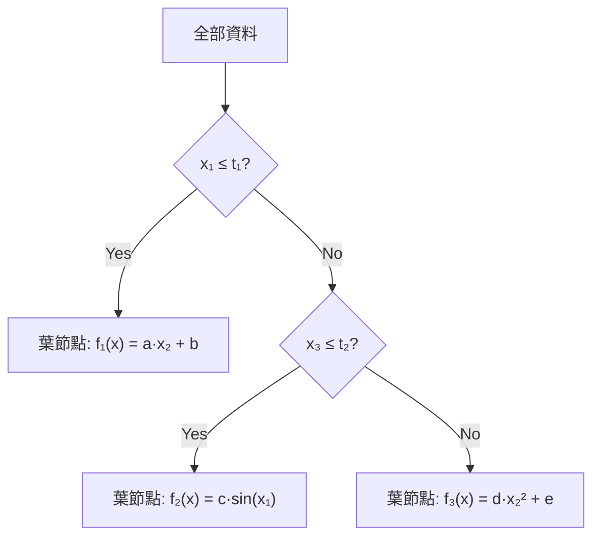

# 從單一公式到分段公式：Piecewise Symbolic Regression 與 PS-Tree

## 學習目標

讀完這篇筆記，你應該能回答：

1. 為什麼一個全域 symbolic formula 可能無法描述整個資料集？
2. Piecewise symbolic regression 的核心想法是什麼？
3. PS-Tree 如何用樹狀結構自動發現分段？這和 Model-Based Recursive Partitioning / subgroup analysis 有什麼關聯？

---

## 為什麼單一公式不夠

Symbolic Regression 的目標是從資料中找出一個可解釋的數學公式 $f(x)$ 來逼近目標 $y$。常見的方法（如遺傳程式設計 Genetic Programming）搜尋的是==一條==封閉公式，例如：

$$
y = a \cdot x_1^2 + b \cdot \sin(x_2) + c
$$

這在資料來自單一機制時很合理。但現實資料常常不是這樣：

> [!example] 異質資料情境
> 想像一個醫療資料集：年輕病患對某藥物的劑量—反應關係是線性的，老年病患卻是指數衰減。如果我們硬用一條公式去擬合全部資料，結果會是兩個群體的「妥協」——既不準確也不可解釋。

更具體地說，單一公式的失敗模式包括：

- **殘差結構化**：擬合殘差不是隨機散布，而是呈現系統性模式（表示公式漏掉了結構）
- **過度複雜化**：為了同時捕捉多個 regime，GP 會傾向生成極長、極深的 expression tree，失去可解釋性
- **無法反映因果異質性**：不同 subgroup 的生成機制可能本質不同，強行合併等於假設了不存在的同質性

這不只是擬合好壞的問題，更是==可解釋性==與==因果推論==的問題。

---

## Piecewise Symbolic Regression 的核心想法

核心想法很直覺：**先分再擬合（divide-and-conquer）**。

$$
f(x) = \begin{cases} f_1(x) & \text{if } x \in R_1 \\ f_2(x) & \text{if } x \in R_2 \\ \vdots & \vdots \\ f_K(x) & \text{if } x \in R_K \end{cases}
$$

其中：

- $R_1, R_2, \ldots, R_K$ 是輸入空間的互不重疊分區（partition）
- 每個 $f_k$ 是該分區內的簡單 symbolic formula

> [!tip] 為什麼這樣做更好
> - 每個 $f_k$ 只需描述一個 regime，所以可以更簡單、更準確
> - 分區本身帶有語意：它告訴我們「在什麼條件下，資料的行為不同」
> - 整體模型仍然是可解釋的：分段公式的每一段都能用人類語言描述

但關鍵問題來了：**怎麼找到好的分區？**

傳統做法有幾種：

1. **預先指定分區**：例如已知年齡閾值，手動切割。缺點是需要先驗知識。
2. **先分群再擬合**：用 clustering 分群，再在各群內做 symbolic regression。缺點是分群和擬合是獨立的，分群可能不是依據「擬合效果」來優化。
3. ** jointly 優化分區與公式**：這就是 PS-Tree 的策略。

---

## PS-Tree 的直覺與流程

### 直覺

PS-Tree（Piecewise Symbolic Tree）的核心直覺來自決策樹：**用樹的分支結構來發現分區，用葉節點來存放 local symbolic model**。

你可以把它想成：

> 決策樹的分類/回歸能力 + Symbolic Regression 的可解釋公式 = PS-Tree

### 流程

PS-Tree 的建構流程可以簡化為：

1. **根節點初始化**：在整個資料集上做一次 symbolic regression，得到初始公式 $f_0$
2. **分區搜尋**：評估每個候選切割變數與切割點（如 $x_j \leq t$），將資料分成左右兩子集
3. **分區評估**：在兩個子集上分別重新擬合 symbolic formula，計算整體擬合改善量
4. **選擇最佳切割**：選擇帶來最大改善的切割，建立分支
5. **遞迴**：對每個子節點重複步驟 2–4，直到停止條件滿足（如改善量太小、子集太小、深度限制）
6. **結果**：一棵樹，每個葉節點存放一個簡單 symbolic formula

> [!info] 與一般 Regression Tree 的差別
> 一般 regression tree（如 CART）的葉節點只存常數或簡單平均。PS-Tree 的葉節點存的是一個 symbolic expression，可以捕捉更豐富的局部結構。

用 Mermaid 圖來看整體結構：

### 為什麼 jointly 優化很重要

如果分區和擬合是分開做的（先 cluster 再 fit），分區的目標通常是資料本身的距離或密度結構，和最終擬合效果沒有直接關係。PS-Tree 的切割判準是基於==擬合改善==，所以分區本身就是為了「讓每段的公式更好」而設計的。

---

## 和 Model-Based Recursive Partitioning / Subgroup Analysis 的關係

PS-Tree 的精神和統計學中的 **Model-Based Recursive Partitioning (MOB)** 有深層對應：

### MOB 的想法

MOB（Zeileis et al., 2008）的邏輯是：

1. 在整個資料上擬合一個 parametric model（例如線性迴歸）
2. 對每個觀測計算估計得分（score function 或 M-fluctuation test）
3. 如果參數估計在不同子群間顯著不穩定，就找一個切割變數把資料分開
4. 在子群內重新擬合，遞迴直到參數穩定

這和 PS-Tree 的邏輯==幾乎同構==，差別在於：

|       | MOB               | PS-Tree                |
| ----- | ----------------- | ---------------------- |
| 葉節點模型 | 參數模型（線性、GLM 等）    | Symbolic expression    |
| 參數估計  | M-estimation / ML | Symbolic regression 搜尋 |
| 切割判準  | 參數不穩定性檢定          | 擬合改善量                  |
| 可解釋性  | 限於預設模型族           | 公式形式自由，可能更簡潔           |

### 連結到 Subgroup Analysis 與 NARM-UDRF

在臨床與政策研究裡，**subgroup analysis** 的目標是找出「治療效果因人而異」的群體——也就是效應異質性（treatment effect heterogeneity）。MOB 是一種 model-based 的 subgroup 發現方法。

PS-Tree 把同樣的精神帶入 symbolic regression 的世界：

- 如果資料的生成機制在不同 subgroup 下本質不同，PS-Tree 能同時發現 subgroup 邊界和各 subgroup 的機制公式
- 這為後續的 **NARM-UDRF**（Numerical Association Rule Mining – Unsupervised Deep Rule Forest）研究鋪路：NARM-UDRF 關心的是如何在樹狀結構中做無偏的效應估計，而 PS-Tree 提供了「每個葉節點有自己的模型」這個起點

> [!important] 核心洞見
> Piecewise symbolic regression = 用樹做 subgroup 發現 + 用 symbolic expression 做 local modeling。這是連接統計學的 recursive partitioning 傳統和 symbolic regression 的可解釋性傳統的橋梁。

---

## Demo 導讀

這次 R demo 建立一個刻意設計的 synthetic dataset：同樣有 predictor $x$，但資料其實來自兩個 hidden regimes：

- **Regime A**：$z < 0$ 時，真實關係偏向線性加上 sine 波動。
- **Regime B**：$z \ge 0$ 時，真實關係偏向二次項加上 cosine 波動。

也就是說，若硬用一條 global formula 來 fit 全部資料，模型會被迫在兩種不同機制之間取平均；piecewise symbolic regression / PS-Tree 的目標則是先找出分區，再在每個 leaf 裡 fit 比較簡單的 local formula。

> [!note] Demo 定位
> 這份 R demo 是教學版 **PS-Tree-style approximation**，不是官方 PS-Tree 演算法完整重現。兩層都有簡化：
> - **葉節點公式**：用「候選 symbolic terms + BIC stepwise selection」近似，而不是 genetic programming 搜尋
> - **切分搜尋**：用 CART-style 窮舉切點 + BIC 改善量選最佳切分，而不是原版 PS-Tree 的 GP-based partition
>
> 所以 demo 展示的是 PS-Tree 的「精神」（先分區再 local fit），而非原版演算法的搜尋機制。

### Demo 評估結果

| Model | RMSE | MAE | R² |
|---|---:|---:|---:|
| Global symbolic formula | 1.9506 | 1.7080 | 0.3158 |
| Oracle piecewise symbolic formulas | 0.3439 | 0.2635 | 0.9787 |
| Learned PS-Tree-style formulas | 0.3439 | 0.2635 | 0.9787 |
| Constant-leaf regression tree | 2.0941 | 1.7692 | 0.2114 |

> [!important] 怎麼讀這張表
> - **Global symbolic formula** 明顯失敗，因為它只能用一條公式平均兩種 regime。
> - **Oracle piecewise** 使用真實分區，因此接近最佳可達表現。
> - **Learned PS-Tree-style** 沒有直接知道真實 regime，但透過 tree partition 學到接近 oracle 的效果。
> - **Constant-leaf tree** 只在 leaf 裡存平均值，沒有 local formula，所以比 global 好，但不如 PS-Tree-style。

### Figure 1：資料確實有兩個不同生成機制

![[piecewise_ps_tree_data_two_regimes.png]]

> 這張圖把兩個 hidden regimes 用不同顏色標出。重點是：兩群資料在同一個 $x$ 軸上有不同形狀的關係，所以「一條公式」很難同時描述兩邊。

### Figure 2：Global formula vs. piecewise formulas

![[piecewise_ps_tree_prediction_curves.png]]

> Global formula 會在兩個 regime 之間妥協；oracle piecewise 與 learned PS-Tree-style curves 則能貼近各 regime 的 local pattern。這就是 piecewise symbolic regression 的核心價值。

### Figure 3：Held-out observed vs. predicted

![[piecewise_ps_tree_observed_vs_predicted.png]]

> 點越靠近虛線代表預測越準。可以看到 global formula 分散最明顯，而 PS-Tree-style 和 oracle piecewise 明顯更靠近對角線。

### Figure 4：學到的 partition tree

![[piecewise_ps_tree_partition_tree.png|531]]

> 這棵樹就是 PS-Tree-style demo 的「先分區」部分。每個 terminal leaf 之後會各自 fit 一個 symbolic-style formula，而不是只存一個常數平均值。

---

## Research Gaps：這些方法哪裡不夠好？

帶著「找 research gap」的目標，我們必須問：這些方法目前做不好什麼？

### PS-Tree 的局限

1. **搜尋空間爆炸**：PS-Tree 原始論文用 Genetic Programming 搜尋每個 leaf 的 symbolic formula，GP 本身的搜尋空間就很大；加上 tree partition 的切割點組合，整體搜尋空間是指數級。實務上很難保證找到好的解，尤其當變數多、資料維度高時。
2. **切割與公式的耦合問題**：PS-Tree 的切割是根據「擬合改善量」來選，但擬合改善量依賴當前 leaf 裡的 symbolic formula 好壞——如果 GP 在某個 leaf 找到很差的公式，改善量的計算就不準確，導致切割判斷失誤。這是一個==雞生蛋蛋生雞==的問題。
3. **過度擬合風險**：遞迴分裂 + 每個 leaf 獨立搜尋 formula = 很大的 model capacity。如果沒有好的正則化或 pruning 策略，容易過度擬合。
4. **切割判準缺乏統計檢定基礎**：PS-Tree 用擬合改善量做切割，不像 MOB 用 parameter instability test（有明確的 $p$-value 和漸近理論）。這讓 PS-Tree 的切割缺乏統計保證——你不知道一個切割是「真的有意義」還是「剛好降低了 training error」。
5. **本 demo 的簡化**：今日 demo 不只公式搜尋用 BIC stepwise 代替 GP，**切分搜尋也用 CART-style 窮舉切點 + BIC 改善量**，而非原版 PS-Tree 的 GP-based partition。所以 demo 展示的是 PS-Tree 的「精神」（先分區再 local fit），而非原版演算法的搜尋機制。

### MOB 的局限（作為對照）

1. **葉節點模型受限**：MOB 只能放預先指定的 parametric model（如線性、GLM）。如果真實的 local 關係是非線性且形式未知，MOB 的 leaf model 就不夠靈活。
2. **切割只能用 partitioning variables**：MOB 的 splitting variable 和 model variable 可以不同，但 leaf model 的形式是固定的，不會隨 partition 而改變。

### 交叉觀察：PS-Tree 與 MOB 的互補與 Gap

| 問題 | MOB | PS-Tree | 今日 demo | Gap |
|---|---|---|---|---|
| Leaf model 靈活度 | 低（固定 parametric） | 高（symbolic，但 GP 搜尋困難） | 中（候選項 + BIC stepwise） | 需要一種既靈活又可穩定搜尋的 leaf model |
| 切分搜尋 | instability test 引導 | GP-based partition | CART 窮舉切點 + BIC 改善量 | PS-Tree 原版和 demo 都缺乏統計基礎的切割判準 |
| 切割統計保證 | 有（instability test） | 無（只有改善量） | 無（只有改善量） | 需要在 symbolic regression 情境下有統計基礎的切割判準 |
| 高維度 / 多變數 | 受限於 model complexity | 搜尋空間爆炸 | 窮舉切點更慢 | 需要可擴展的方法 |
| 過度擬合控制 | pruning + test 統計量 | 弱 | 弱 | 需要更好的正則化框架 |

> [!important] 給自己的研究備忘
> PS-Tree 和 MOB 各有強項也各有弱項。一個可能的 research direction 是：結合 MOB 的統計切割判準 + PS-Tree 的 symbolic leaf model，並加上穩健的搜尋策略和正則化。這正是 DRF / mobDRF 試圖處理的方向，但也還有尚未解決的問題——後續課程會逐步展開。
>
> 另外要注意：本 demo 的切分搜尋（CART-style 窮舉切點）也不同於原版 PS-Tree（GP-based partition），所以 demo 展示的是「先分區再 local fit」的直覺和精神，而非原版演算法的搜尋機制。讀 MOB 原文時要特別留意 MOB 的 instability test 是怎麼決定切分變數和切分位置的——那是 PS-Tree 和 demo 都缺少的。

---

## Ting 可以帶走的研究直覺

1. **異質性是常態，同質性是假設**：在做 symbolic regression 之前，先問「我的資料是否真的來自同一個機制？」如果不是，piecewise 是比硬擬一條公式更好的起點
2. **分區本身是有意義的**：PS-Tree 的切割變數和切割點揭示了「什麼條件下機制不同」，這本身就是研究發現
3. **Symbolic ≠ 僵化**：symbolic regression 的公式族可以很豐富，piecewise 只是讓它更靈活——每個區域用自己的簡單公式，勝過一個區域用一個複雜公式
4. **從 MOB 到 PS-Tree 到 NARM-UDRF 是一條研究脈絡**：這三者的共同主題是「樹狀分區 + local model」，差別在 local model 的表徵方式和估計的無偏性
5. **每種方法都帶著它的 gap**：MOB 的 leaf model 太死板、PS-Tree 的搜尋太粗暴且缺乏統計基礎——找到兩者的交叉地帶就是可能的貢獻點

---

## 下一步

- **實際跑 PS-Tree demo**：在遠端 server 上用 R 產生視覺化，感受「分段公式 vs 全域公式」的差異
- **閱讀 MOB 原文**：Zeileis et al. (2008), "Model-Based Recursive Partitioning"，理解統計檢定背後的理論
- **思考 NARM-UDRF 的定位**：PS-Tree 的 local model 是 symbolic expression；NARM-UDRF 的 local model 是 rule-based 的效應估計——兩者如何對話？
- **觀察切割變數的選擇**：在 demo 中留意哪些變數被選為切割點，它們是否對應已知的實務知識
- **帶著 gap 去讀 MOB**：PS-Tree 和本 demo 都沒有統計基礎的切割判準，MOB 有——讀 MOB 時特別留意：MOB 的 instability test 是怎麼決定切分變數和切分位置的？這個機制能否移植到 symbolic regression 或 rule-based 的情境？

---

## 參考資料

- Zeileis, Hothorn, and Hornik (2008), *Model-Based Recursive Partitioning*. MOB 的核心流程是 fit parametric model → test parameter instability → split by most unstable variable → recursively refit。
- Zhang et al. (2022), *PS-Tree: A Piecewise Symbolic Regression Tree*. 這篇提出 PS-Tree：leaf nodes 不只存常數或線性模型，而是放 symbolic regressors。
