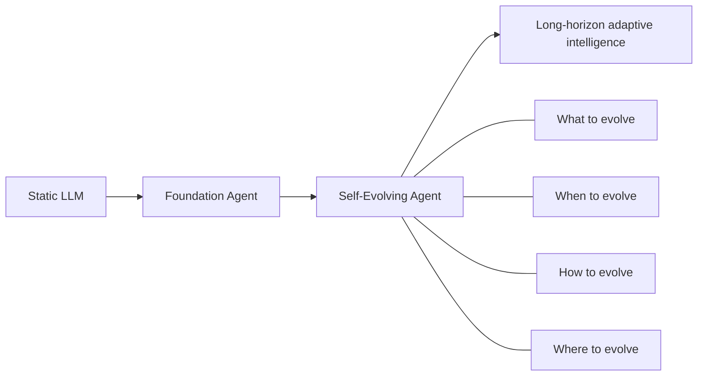
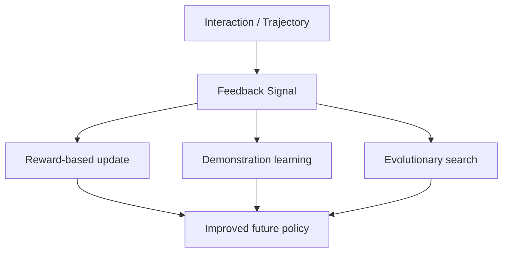

## Research Background

大型語言模型（LLM）雖然已經展現強大的推理、生成與工具使用能力，但本質上仍偏向**靜態系統**：模型訓練完成後，不會自然地從後續任務經驗中持續改進。這件事在 agent 場景尤其明顯，因為真實世界的 agent 不是只回答一次問題，而是需要在**開放環境、長時間互動、反覆試錯**中不斷調整。

這篇 survey 把研究焦點從「怎麼把模型做大」轉向「怎麼讓 agent 自己變強」：
- 不只會做 task
- 還要能從 task 中**留下經驗**
- 進一步把經驗轉成**未來行為改進**

> [!info] 這篇 paper 的核心主張
> Self-evolving agent 不是單一技術，而是一個**持續閉環學習系統**：
> interaction → feedback → update → better future behavior

從 big picture 來看，這篇 paper 想回答的是：**如果 agent 要像一個會成長的系統，它到底可以改哪裡、何時改、怎麼改、以及在哪些場景最有價值。**

## Research Problem

這篇 survey 想系統化釐清四個問題：

1. **What to evolve?**  
   Agent 的哪個部分值得被持續更新？是模型參數、memory、prompt、tool 還是整體 architecture？
2. **When to evolve?**  
   演化應該發生在單一任務執行中，還是跨任務、跨時間尺度地累積？
3. **How to evolve?**  
   是靠 reward、textual feedback、demonstration，還是 evolutionary / population-based 方法？
4. **Where to evolve?**  
   哪些場域最適合 self-evolving agents：general assistant、coding、GUI、finance、medical、education？

作者也進一步指出：現有研究雖然很多，但概念常被混在一起，例如 curriculum learning、lifelong learning、model editing、test-time adaptation、memory systems。這篇 paper 的目標是把這些分散 work 放進同一張研究地圖裡。

<strong>Self-evolving agent 跟相近概念差在哪？</strong>

- **Curriculum learning**：重點是訓練資料或任務難度安排；不一定是 agent 自主發起更新。
- **Lifelong learning**：重點是跨時間持續學習；但不一定涵蓋工具、workflow、architecture 的共同演化。
- **Model editing / unlearning**：通常針對特定知識或行為進行局部修補；不等於整個 agent 系統的自主成長。
- **Self-evolving agent**：強調的是**agent 自己根據軌跡、回饋、環境互動持續改寫未來策略**，而且改動會留下 persistent effect。

## Method
### 1. 用四個維度建立研究地圖
![[Pasted image 20260421135720.png]]
作者用 **What / When / How / Where** 來切整個領域，這個框架本身就是這篇 survey 最重要的價值。

### 2. What to Evolve（演化什麼）

| 演化對象 | 這一類在改什麼 | 代表性想法 |
|---|---|---|
| **Models** | 更新 policy / model parameters，讓 agent 從成功與失敗經驗中直接學習 | self-training, SFT, RL, self-rewarding |
| **Context** | 更新 prompt、memory、reflection、lesson 等外顯上下文 | Reflexion, TextGrad, DSPy, prompt optimization |
| **Tools** | 創造新工具、熟練工具、管理工具選擇與檢索 | Voyager, DRAFT, ToolGen |
| **Architecture** | 改寫 workflow、節點結構、multi-agent collaboration topology | AFlow, ADAS, EvoFlow |
+ Architecture:
	+ Single-agent:
		+ **LLM-invoking node optimization**：優化 workflow 裡的一個 LLM 節點。
		- **Autonomous-agent optimization**：優化單一 agent 的整體結構。
	+ Multi-agents:
		- **Agentic workflow optimization**：優化多 agent 的明確合作流程。
		- **Multi-autonomous-agent optimization**：讓多個 autonomous agents 在互動中共同學習與演化。
			- 
> [!tip] 讀這篇時最值得記住的一句話
> **Memory 只是 self-evolution 的一個 locus，不是全部。**  
> 真正的 self-evolving agent 是「模型 × 記憶 × 工具 × 架構」四層都可能被改寫的系統。

### 3. When to Evolve（何時演化）

| 時間尺度 | 定義 | 典型例子 | 研究意義 |
|---|---|---|---|
| **Intra-test-time** | 任務執行中就邊做邊調整 | reflection, retry, dynamic planning, online memory update | 提升當下任務適應性 |
| **Inter-test-time** | 任務結束後把經驗轉成持久改進 | fine-tuning, lesson distillation, skill library growth | 建立跨任務累積能力 |

這個切法很重要，因為它把「當下補救」和「長期成長」拆開了。很多看似都叫 adaptation，但其實發生在完全不同的時間尺度。

### 4. How to Evolve（如何演化）

| 方法家族                                | 核心訊號                                               | 直覺理解                      |
| ----------------------------------- | -------------------------------------------------- | ------------------------- |
| **Reward-based**                    | scalar reward / textual feedback / implicit signal | 用回饋告訴 agent 什麼做得好、什麼不好    |
| **Imitation & Demonstration**       | self-generated 或 cross-agent demonstration         | 用好例子教 agent 下次怎麼做         |
| **Population-based / Evolutionary** | mutation, selection, population search             | 不只優化單一 agent，而是讓多個候選解競爭演化 |

### 5. Where to Evolve（在哪裡演化）

作者把應用場景分成兩大類：

| 類型                               | 重點                  | 例子                                         |
| -------------------------------- | ------------------- | ------------------------------------------ |
| **General domain evolution**     | 讓 agent 在廣泛任務中越做越好  | personal assistant, web / mobile assistant |
| **Specialized domain evolution** | 讓 agent 在某個專業領域越做越深 | coding, GUI, finance, medical, education   |

其中 paper 特別強調：
- **General domain** 常靠 memory mechanism、curriculum-driven training、model-agent co-evolution
- **Specialized domain** 則更看重 domain feedback loop，例如 coding 的 unit test、GUI 的 execution trace、medical 的安全約束

### 6. Evaluation：把「會不會成長」變成可量測問題

作者認為 self-evolving agent 不能只看單次 task success，而要看整條成長軌跡。主要評估面向包括：

| 評估維度 | 問題意義 |
|---|---|
| **Adaptivity** | 能不能根據新情境快速調整 |
| **Retention** | 學到的新能力會不會很快忘掉 |
| **Generalization** | 能不能把學到的東西轉移到新任務 |
| **Efficiency** | 成長成本是否可接受（時間、token、compute） |
| **Safety** | 演化過程會不會 reward hacking、drift、失控 |

## Contribution

1. **第一篇系統化聚焦 self-evolving agents 的綜述之一**  
   它不是把 evolution 當 agent 裡的小模組，而是把它提升成一個獨立研究範式。

2. **提出清楚的研究座標系**  
   用 What / When / How / Where 讓原本分散的研究能被比較、定位與組合。

3. **把 evaluation 拉到核心位置**  
   作者強調真正難的不是讓 agent 一次表現好，而是讓它在長期互動中**越來越好且不走偏**。

4. **把應用與安全問題一起納入**  
   不只講方法，也討論 personalized agents、multi-agent ecosystems、safe and controllable evolution 等更接近 deployment 的議題。

> [!important] 對你做 research 最有用的 takeaway
> 這篇 paper 提供的不只是文獻整理，而是一個**研究設計模板**：  
> 你在設計 agent paper 時，可以直接問自己：
> - 我改的是哪個 evolution locus？
> - 更新發生在什麼時間尺度？
> - 用什麼 feedback signal？
> - 要怎麼證明它真的有長期進步？

### 代表性研究地圖（快速記）

| 問題              | 常見答案                                                 |
| --------------- | ---------------------------------------------------- |
| Agent 改哪裡？      | model / context / tool / architecture                |
| Agent 何時改？      | task 內即時調整 vs task 間長期累積                             |
| Agent 怎麼改？      | reward、reflection、demonstration、population evolution |
| Agent 在哪裡改最有價值？ | 一般助理場景 + 高 feedback 的專業場景                            |

## Conclusion

這篇 survey 的大圖像很清楚：**agent research 正從「會做事」走向「會成長」**。

幾個最重要的結論：

- **Self-evolving agent 是一個 closed-loop learning system**，而不是一次性的 prompt engineering trick。
- **記憶很重要，但不是全部**；真正的研究 frontier 在於讓 model、memory、tool、architecture 協同演化。
- **evaluation 會成為未來瓶頸**：如果沒有長期、動態、可比較的 benchmark，就很難知道 agent 是否真的在進步。
- **安全與可控性是核心，不是附錄**：越會自我更新的 agent，越需要 guardrails 來防止 behavior drift、reward hacking、forgetting、misalignment。

### 我會怎麼用這篇 paper 來定位研究

如果你之後要做 agentic / memory / continual learning 類研究，這篇很適合作為**上位框架 paper**：
- 想做 memory → 可以把自己定位在 **context evolution**
- 想做 reflective planning → 可以定位在 **intra-test-time evolution**
- 想做 synthetic self-improvement / self-play → 可以定位在 **reward-based / inter-test-time evolution**
- 想做 multi-agent collaboration → 可以定位在 **architecture evolution / co-evolution**

簡單說，這篇 paper 最大的價值不是提出新方法，而是幫你建立：**self-evolving agent 這個領域到底在研究哪幾條主線。**
