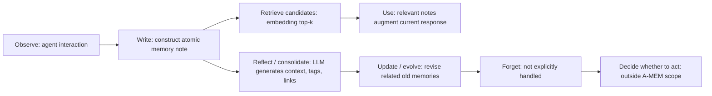

- **Authors**: Wujiang Xu, Zujie Liang, Kai Mei, Hang Gao, Juntao Tan, Yongfeng Zhang
- **Venue**: NeurIPS 2025 / arXiv 2025
- **Paper URL**: https://arxiv.org/abs/2502.12110
- **Code**: benchmark evaluation: https://github.com/WujiangXu/AgenticMemory；production-ready system: https://github.com/WujiangXu/A-mem-sys

## Direction tags

| Direction | 判斷 | 原因 |
|---|---|---|
| **Memory** | **強相關** | A-MEM 直接提出 agentic memory system，將 interaction 寫成 structured notes，並支援 retrieval、linking、memory evolution。 |
| **Self-evolve** | **強相關** | 新 memory 會觸發 link generation 與 memory evolution，讓既有 memory 的 context / keywords / tags 被更新，屬於 memory representation 的持續演化。 |
| **Proactivity** | **弱到中度相關** | 它讓 memory 主動整理自己，但沒有設計 agent 何時自主發起外部行動或主動提醒；retrieval 仍由 interaction query 觸發。 |

> [!note] 一句話摘要
> A-MEM 把 Zettelkasten 的 atomic notes、dynamic linking、continuous refinement 搬進 LLM agent memory：每段互動不只被存起來，還會被 LLM 轉成帶 tags / keywords / context description 的 note，並更新相關舊記憶。

## Research Background

LLM agents 已能使用工具、規劃任務與執行多步流程，但如果沒有長期記憶，就很難在長期互動中累積經驗。現有 memory systems 多半提供基本的 storage / retrieval，例如 conversation history、summary、vector RAG、graph database memory；但它們通常需要開發者預先定義 memory schema、寫入點、讀取時機與關係類型。

A-MEM 認為這種固定結構限制了 agent 在多樣任務中的 adaptability。真實長期 agent 不只是「查過去資料」，還需要能在新經驗進來時：

- 重新理解舊經驗的意義；
- 把分散記憶連成有用的知識網路；
- 發現 higher-order patterns；
- 讓 memory organization 隨互動逐步變好。

因此作者借用 **Zettelkasten**：把知識寫成 atomic note，再透過彈性 linking 形成 network，而不是依賴一開始固定好的分類樹或 graph schema。

## Research Problem

這篇 paper 想回答：**能不能設計一個不依賴 predetermined memory operations 的 agentic memory system，讓 LLM agent 在長期互動中自動組織、連結、演化自己的 memory？**

具體挑戰包括：

1. 如何把 raw interaction 轉成具有多重語意表示的 structured memory note？
2. 如何自動找出新舊 memories 的 meaningful links，而不只靠 embedding similarity？
3. 如何讓新 memory 觸發舊 memory 的 context / tags / keywords 更新？
4. 如何在長對話 QA 中，讓 retrieval context 更短但回答更準？

## Method / Architecture

### 1. Data structure：structured memory note

A-MEM 將每個 memory note 表示為：

$$
m_i = \{c_i, t_i, K_i, G_i, X_i, e_i, L_i\}
$$

| Field | 意義 |
|---|---|
| $c_i$ | 原始 interaction content。 |
| $t_i$ | interaction timestamp。 |
| $K_i$ | LLM-generated keywords。 |
| $G_i$ | LLM-generated tags。 |
| $X_i$ | LLM-generated contextual description，用來補充原始內容中隱含的語意。 |
| $e_i$ | note 的 dense embedding，用於 similarity matching。 |
| $L_i$ | linked memories，表示與其他 notes 的語意關係。 |

這個 note schema 是 A-MEM 最核心的設計：memory 不只是 chunk，而是一張帶多個可演化欄位的 atomic note。

### 2. Note construction

當 agent 與環境互動後，A-MEM 使用 LLM 根據 interaction content 與 timestamp 生成 keywords、tags、contextual description：

$$
K_i, G_i, X_i \leftarrow LLM(c_i \parallel t_i \parallel P_{s1})
$$

接著將 $c_i$、$K_i$、$G_i$、$X_i$ 串接後送入 text encoder，得到 embedding $e_i$。paper 實驗使用 all-MiniLM-L6-v2。

### 3. Link generation

新 note $m_n$ 加入時，系統先用 embedding cosine similarity 找 top-k related memories：

$$
s_{n,j} = \frac{e_n \cdot e_j}{\lVert e_n \rVert \lVert e_j \rVert}
$$

再把新 note 與 candidate neighbors 交給 LLM 判斷是否建立 meaningful links。這裡的重點是：embedding 只做 candidate filtering，真正的 relation reasoning 由 LLM 完成，因此可以捕捉 shared attributes、conceptual similarity、causal relation 等較細緻的連結。

### 4. Memory evolution

建立 links 後，A-MEM 會讓新 memory 反過來更新相關舊 memory。對每個 nearest neighbor memory $m_j$，LLM 判斷是否更新它的 context、keywords、tags：

$$
m_j^* \leftarrow LLM(m_n \parallel M_{near}^{n} \setminus m_j \parallel m_j \parallel P_{s3})
$$

這是 A-MEM 的 self-evolving 核心：**新經驗不只是被追加，而是會改變既有記憶的表示方式。**

### 5. Retrieval and agent loop

在每次 interaction 中，A-MEM 將 current query $q$ 編碼成 embedding，與 memory notes 做 similarity matching，取 top-k memories 作為 prompt context。paper 主要使用 $k=10$，並在 hyperparameter analysis 中測試不同 $k$。

### 6. Planner / trigger policy / reflection mechanism

- **Planner**：A-MEM 不是完整 planner；它提供 memory retrieval context 給外部 LLM agent。
- **Trigger policy**：write / retrieve / update 多半綁在每次 interaction；沒有提出「何時主動查記憶、何時主動行動」的 adaptive trigger policy。
- **Reflection / evolution**：LLM 生成 contextual description、link generation、memory evolution 都可視為 memory-level reflection。

## Lifecycle / Mechanism

A-MEM 覆蓋 observe → write → retrieve → use → reflect/consolidate → update/evolve，但沒有完整處理 forgetting，也沒有自主行動決策。

## Contribution

1. **Agentic memory architecture**：提出不依賴固定 schema 的 memory system，讓 memory 能自動產生 contextual description、tags、keywords。
2. **Zettelkasten-inspired linking**：用 atomic notes + dynamic links 組成 knowledge network。
3. **Memory evolution mechanism**：新 memory 觸發既有 memory 的表示更新，讓 memory network 隨時間 refined。
4. **跨模型 evaluation**：在 GPT、Qwen、Llama 等六個 foundation models 上測 long-term conversational QA。
5. **實作釋出**：paper 提供 benchmark evaluation 與 production-ready system 的 code links。

## Evaluation / Benchmark

### Tasks and datasets

| Dataset | 任務 | 特性 |
|---|---|---|
| **LoCoMo** | long-term conversation QA | 約 9k tokens、最多 35 sessions；包含 single-hop、multi-hop、temporal、open-domain、adversarial questions，共 7,512 QA pairs。 |
| **DialSim** | long-term multi-party dialogue QA | 來自 Friends、The Big Bang Theory、The Office 等長期劇集對話；約 1,300 sessions、350k tokens。 |

### Metrics and baselines

- **Metrics**：F1、BLEU-1；appendix 也提供 ROUGE-L、ROUGE-2、METEOR、SBERT similarity。
- **Baselines**：LoCoMo baseline、ReadAgent、MemoryBank、MemGPT。
- **Models**：GPT-4o-mini、GPT-4o、Qwen2.5 1.5B / 3B、Llama 3.2 1B / 3B，appendix 另含 DeepSeek 與 Claude variants。

### Key results

- 在 LoCoMo 上，A-MEM 在多數模型與類別達到最好的 average ranking，尤其對 **multi-hop** 與 **temporal reasoning** 改善明顯。
- 在 GPT-4o-mini 上，A-MEM 的 temporal F1 達 45.85，相比 MemGPT 25.52 與 LoCoMo 18.41 有明顯提升。
- 在 DialSim 上，A-MEM F1 為 3.45，高於 LoCoMo 2.55 與 MemGPT 1.18；不過絕對分數偏低，表示任務仍非常難。
- Token cost 約 1,200 tokens / memory operation，比 LoCoMo 與 MemGPT 約 16,900 tokens 低很多。

### Ablations and analysis

| Ablation | 結果解讀 |
|---|---|
| **w/o Link Generation & Memory Evolution** | performance 大幅下降，代表只有 plain memory note 不夠。 |
| **w/o Memory Evolution** | 比完全移除兩者好，但仍低於 full A-MEM，表示 link generation 是基礎，evolution 提供額外 refined structure。 |
| **k sensitivity** | $k$ 變大通常會提升到某個 plateau，但過大可能引入 noise。 |
| **t-SNE visualization** | A-MEM memory embeddings 比 base memory 更有 cluster structure；但這是輔助證據，不等於直接證明 causal mechanism。 |

### 是否證明 long-term improvement / autonomous initiative？

- **Long-term improvement**：有證據顯示 memory representation evolution 能提升長對話 QA，尤其 multi-hop / temporal 問題。
- **Self-evolution**：主要發生在 memory notes 的 representation 與 links，不是 agent policy、tool skill 或 planner 的跨任務改寫。
- **Autonomous initiative**：沒有充分證明；系統並未學會何時主動開啟任務或提醒使用者。
- **固定 scheduling 問題**：write / retrieve / evolution 的觸發看起來仍綁定每次 interaction，不是學出來的 adaptive trigger。

## Conclusion

A-MEM 的結論是：agent memory 不應只是被動 storage / retrieval，而可以變成會自我整理的知識網路。透過 structured note construction、dynamic linking、memory evolution，agent 能在長期對話中以更少 retrieval context 支援更好的 multi-hop 與 temporal QA。

這篇 paper 對 Ting 的方向特別有價值，因為它把 self-evolution 限定在 memory representation 層，模組清楚、可復現、可做 ablation；但它也留下明確缺口：memory evolution 的 correctness、forgetting、trigger policy、以及是否能轉化成真正的 action-level improvement。

## Reproducibility

- **Repo availability**：paper 明確列出 benchmark evaluation 與 production-ready A-MEM system 的 GitHub links。
- **Toy reproduction requirements**：
  - 任一 LLM API 或 local LLM，用於 note construction / link generation / evolution。
  - text encoder，例如 all-MiniLM-L6-v2。
  - vector store 或簡單 NumPy cosine search。
  - 一組 multi-session dialogues 與 QA pairs。
- **Minimal demo idea**：
  1. 收集 50-100 則跨 session 對話，每則寫成 A-MEM note。
  2. 實作三個版本：plain vector memory、+ link generation、+ memory evolution。
  3. 設計 multi-hop / temporal / preference-change QA。
  4. 比較 F1、retrieved token length、update latency、link quality。

## Borrowable ideas for Ting's AAAI direction

- **Memory note as research object**：把 memory unit 設計成含 raw content、timestamp、tags、context description、embedding、links 的可演化資料結構。
- **New memory triggers old memory update**：這是很適合 AAAI agentic memory 題目的 mechanism，可延伸成「何時更新、更新什麼、如何避免錯誤更新」。
- **Zettelkasten framing**：跟 Ting 的 Obsidian / knowledge management 很契合，也容易解釋為 human-inspired memory organization。
- **Ablation-friendly modules**：note construction、link generation、memory evolution、retrieval 可以清楚拆 ablation。
- **Memory evolution vs policy evolution**：可以把 A-MEM 當 memory-level self-evolve baseline，再提出更進一步的 decision-level / proactivity-level evolution。

## Attackable Gaps / Follow-up Ideas

1. **Memory evolution 缺少 correctness guard**：LLM 更新舊 memory 可能引入錯誤、overgeneralization 或 hallucinated tags。
2. **缺少 explicit forgetting / conflict resolution**：當新舊 memory 矛盾時，paper 主要更新 representation，未清楚處理 invalidation、deletion、privacy-aware forgetting。
3. **trigger policy 固定**：每次 interaction 都寫入與更新，成本與必要性未被 adaptive policy 控制。
4. **link semantics 不夠 formal**：links 是 meaningful connections，但沒有固定 relation type 或可驗證的 graph semantics。
5. **evaluation 仍偏 QA**：沒有測 memory evolution 是否真的改善 long-horizon planning、tool use、autonomous initiative。
6. **DialSim 絕對分數低**：雖然相對提升明顯，但絕對 F1 很低，表示方法在 complex multi-party memory 上仍有很大空間。
7. **LLM-dependent behavior**：不同 LLM 生成的 contextual description / tags / links 可能差異很大，缺少 robustness analysis。
