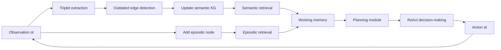

# AriGraph: Learning Knowledge Graph World Models with Episodic Memory for LLM Agents

- **Authors**: Petr Anokhin, Nikita Semenov, Artyom Sorokin, Dmitry Evseev, Andrey Kravchenko, Mikhail Burtsev, Evgeny Burnaev
- **Venue**: IJCAI 2025 — Proceedings of the Thirty-Fourth International Joint Conference on Artificial Intelligence
- **Paper URL**: https://arxiv.org/abs/2407.04363
- **IJCAI page**: https://www.ijcai.org/proceedings/2025/2
- **Code**: https://github.com/AIRI-Institute/AriGraph

## Direction tags

| Direction | 判斷 | 原因 |
|---|---|---|
| **Memory** | **強相關** | AriGraph 的核心就是把 agent 經驗寫入 semantic KG + episodic memory，並在決策前做 semantic / episodic retrieval。 |
| **Self-evolve** | **中度相關** | agent 會在互動過程中從 observation 抽取 triplets、更新 KG、移除 outdated edges；這是「world model / memory 自我更新」，但還不是完整的 policy self-improvement 或跨任務能力演化。 |
| **Proactivity** | **弱到中度相關** | Ariadne 有 exploration mode、unexplored exits detection，會主動探索環境以完成目標；但不是無外部目標的 autonomous initiative，也不是 calendar-like 主動提醒。 |

> [!note] 一句話摘要
> AriGraph 把 LLM agent 的長期記憶做成「semantic knowledge graph + episodic observation nodes」的動態 world model，讓 agent 在 TextWorld / NetHack 這類 partial observable environment 中能邊探索邊學習、邊更新、邊用記憶規劃行動。

## Research Background

LLM agent 要在長時間互動環境中完成任務，必須累積並使用過去經驗。單純把完整 history 塞進 context window 雖然直接，但成本高、長期不可擴展，而且 LLM 很難在大量雜訊中做複雜邏輯推理。

常見替代做法是 RAG、summarization、或 memory stream：

- **Full history**：保留全部 observation / action，但 token 成本隨時間線性成長。
- **Summarization**：壓縮歷史，但容易丟失細節，尤其是 recipe、key-location 這類一次看過但後面才需要用的資訊。
- **Vector RAG**：用 embedding 找相似記憶，但記憶是 unstructured chunks；如果相關事實分散在多個時間點，retrieval 很容易漏掉關係。
- **Reflection / Simulacra style memory**：可以有 importance、recency、reflection，但仍缺少明確的 structured world model。

這篇 paper 的出發點是：人類記憶不是只有 episodic trace，也有逐漸整理出的 semantic knowledge。對 agent 來說，若能把「我在某步看到的完整觀察」與「從觀察抽出的世界事實」連起來，就可以同時保留細節與可推理結構。

## Research Problem

這篇 paper 主要回答兩個研究問題：

1. **LLM-based agent 能不能從零開始，透過與環境互動學到有用的 structured world model？**
2. **structured knowledge representation 是否能改善 memory retrieval，進而支援有效 exploration 與 complex decision-making？**

更具體地說，它想解決：

- 如何在 partial observable environment 中記住「地圖、物件位置、物件狀態、任務線索」。
- 如何在世界狀態改變時更新記憶，而不是一直保留過期資訊。
- 如何把 semantic fact retrieval 與 episodic detail retrieval 結合起來。
- 如何讓 LLM agent 不只是回想相似文字，而是能利用 graph structure 做 navigation / planning。

## Method

### 1. AriGraph world model：semantic memory + episodic memory

AriGraph 定義為一個動態記憶圖：

```text
G = (Vs, Es, Ve, Ee)
```

其中：

- **Semantic vertices `Vs`**：從 observation 中抽出的 entities / objects，例如 room、locker、key、recipe、ingredient。
- **Semantic edges `Es`**：triplets `(object1, relation, object2)`，例如：
  - `kitchen, contains, apple`
  - `room x, has exit, east`
  - `recipe, requires, green pepper`
  - `stove, used for, frying`
- **Episodic vertices `Ve`**：每一步完整 textual observation；也就是 agent 的 raw experience trace。
- **Episodic edges `Ee`**：把某一次 observation 抽出的所有 semantic triplets 連到該 episodic node，代表「這些事實是在同一個時間 / 場景一起被觀察到」。

這個設計很重要：semantic graph 支援結構化推理與 navigation；episodic nodes 保留原始觀察細節，避免 triplet extraction 把資訊壓扁後丟失 context。

### 2. Agent loop：observe → update graph → retrieve → plan → act

Ariadne 是用來測試 AriGraph 的 cognitive architecture。每一步大致如下：



每一步 observation 都會觸發 learning / update，因此 AriGraph 不是靜態 KB，而是互動過程中持續長大的 world model。

### 3. Graph construction / update mechanism

給定新的 observation `ot`：

1. LLM 從 observation 中抽取新的 semantic triplets `Est`。
2. 找出與新 triplets 中 entities 相關的既有 semantic edges。
3. 用 LLM 比較新舊 triplets，偵測 redundant / conflicting / outdated facts。
4. 移除 outdated semantic edges。
5. 把新的 vertices / edges 加進 semantic graph。
6. 新增一個 episodic vertex，存放完整 observation。
7. 新增 episodic edge，把這次 observation 的 triplets 和 episodic vertex 連起來。

> [!important] 這裡的 Self-evolve 意義
> AriGraph 的「演化」主要是 **memory/world-model evolution**：agent 會根據新經驗更新自己的世界模型，包括新增知識與刪除過時知識。它不是讓 LLM 權重更新，也不是讓 agent 自動學出新 policy。

### 4. Retrieval：semantic search + episodic search

AriGraph retrieval 分兩階段。

#### Semantic search

- 輸入 query（通常來自 current observation / plan）。
- 用 Contriever embedding 在 semantic edges 中找 top-w relevant triplets。
- 再沿著 graph structure 做類 BFS 擴展；可用 depth `d` 與 width `w` 控制搜尋範圍。
- 這讓 retrieval 不只依賴文字相似度，也能透過 graph neighborhood 找到相關 facts。

#### Episodic search

semantic search 找到一批相關 triplets 後，再透過 episodic edges 回到相關 observations。paper 用一個 relevance score 衡量某 episodic memory 和 query triplets 的重疊程度：

```text
rel(ve_i) = (n_i / max(N_i, 1)) * log(max(N_i, 1))
```

- `n_i`：該 episodic memory 中有多少 semantic triplets 命中目前 query 結果。
- `N_i`：該 episodic memory 總共連了多少 triplets。
- log term 避免只含一個 trivial triplet 的 observation 得到過高分數，同時讓資訊量較高的 observation 有較大權重。

最後返回 top-k episodic observations，讓 agent 可以看到原始上下文。

### 5. Working memory / planner / decision-making

Ariadne 的 working memory 會包含：

- final goal description
- current observation
- recent observation-action history
- retrieved semantic memories
- retrieved episodic memories
- previous / updated plan
- unexplored exits（如果 exploration mode 啟用）

接著分成兩個 LLM module：

1. **Planning module**
   - 根據 working memory 產生或更新 hierarchical plan。
   - plan 是一組 sub-goals，每個 sub-goal 有 reason。
   - 會根據上一個 action 的 environment feedback 調整計畫。

2. **ReAct decision-making module**
   - 讀取 working memory 與 current plan。
   - 先產生 action rationale，再從 valid actions 中選一個 action。
   - 在 text game 中，action 必須來自 valid actions list。

### 6. Exploration / trigger policy

paper 有一個額外的 exploration mechanism：

- 在 planning / decision 前，auxiliary agent 根據目前 plan 判斷是否需要 exploration mode。
- AriGraph 會抽取「exit / spatial relation」相關 triplets，例如：
  - `kitchen, has unexplored exit, south`
  - `hall, east of, kitchen`
- graph-based method 會找出目前 location 附近「已偵測但尚未探索」的 exits，並加入 working memory。
- decision module 會優先考慮探索未拜訪區域。

這是 AriGraph 與 Proactivity 最接近的部分：agent 不只是被動回答，而是在 goal-directed setting 中主動探索未知環境。不過它仍是由任務目標驅動，並沒有自發創造新長期目標。

### 7. Reflection / consolidation / forgetting

這篇 paper 沒有像 Generative Agents 那樣設計 explicit reflection module，也沒有定期把 episodic memories consolidate 成 higher-level insights。

它有的「演化 / 整理」機制是：

- **consolidation-like**：每次 observation 被抽成 semantic triplets，相當於從 episodic trace 中抽取 semantic knowledge。
- **update / forgetting-like**：當新 triplets 與舊 triplets 衝突或重複時，LLM 會選出 outdated triplets 並移除。
- **no decay / no long-term forgetting policy**：沒有根據時間、重要性、使用頻率做 memory pruning。
- **no reflection-on-reflection**：沒有把過往 episodes 反思成抽象策略或 lesson。

## Lifecycle / mechanism

可以把 Ariadne + AriGraph 的生命週期整理成：

1. **Observe**：agent 從 environment 收到 textual observation。
2. **Write**：完整 observation 寫入 episodic vertex；LLM 抽取 triplets 寫入 semantic KG。
3. **Update / forget**：比較新舊 triplets，刪除 outdated semantic edges。
4. **Retrieve**：用 semantic search 找 relevant triplets，再透過 episodic search 找相關 raw observations。
5. **Use**：把 retrieved memory 放入 working memory，planner 更新 sub-goals。
6. **Decide whether to act / explore**：auxiliary exploration check 決定是否加入 unexplored exits；ReAct module 選擇 action。
7. **Act**：執行 valid action，進入下一個 observation。
8. **Evolve**：world model 隨互動逐步擴張；graph growth 在熟悉環境後趨緩。

## Evaluation / Benchmark

### 1. TextWorld interactive environments

任務都是 POMDP 類型，需要長期記憶、空間導航、物件追蹤與工具使用。

| Task | 核心能力 |
|---|---|
| **Treasure Hunt** | 找 key / clue chain、記住 room / locker / key 關係、導航到目標。 |
| **Cleaning** | 找 misplaced items，推理物件應該放在哪，追蹤物件位置是否改變。 |
| **Cooking** | 找 recipe、記住 ingredients 與 preparation method，正確使用 tools；中間做錯一步就會 fail。 |

Baselines：

- Full history
- Iterative summarization
- Vector RAG
- RAG + Reflexion
- Simulacra memory
- RL baselines：GATA, LTL-GATA, EXPLORER（Cooking benchmark）
- Human players（basic tasks）

Metrics：normalized score；每個 LLM agent 5 次嘗試，報告 top-3 average。

主要結果：

- Ariadne + AriGraph 在 Treasure Hunt / Cooking 上達到 1.0 normalized score，Cleaning 約 0.79。
- 在 hard variants 上仍能維持高分：Treasure Hunt Hard 1.0、Cooking Hard 1.0；hardest Cooking 約 0.65。
- Full history、summary、RAG 在較難任務上明顯失效。
- AriGraph 在 Cooking benchmark 四個 difficulty levels 上優於 RL baselines，尤其在較難 levels。
- 和人類比較：Treasure Hunt / Cooking 接近 top human players；Cleaning 低於 top human，但高於 average human。

### 2. Ablations / mechanism evidence

附錄結果包含：

- **AriGraph w/o exploration**：Treasure Hunt、Cooking 分數下降，表示 exploration module 對目標導向探索有幫助。
- **AriGraph w/o episodic**：Cooking 明顯下降（例如 Cooking 約 0.64），表示 raw episodic observations 對 recipe / detailed instructions 很重要。
- **Graph statistics**：graph 在探索早期快速成長，熟悉環境後 growth rate 趨緩；作者把這解讀為 world model 逐漸 saturate。

這些 ablations 支援「不是單純多塞 context」，而是 graph structure + episodic linkage + exploration 都各自有貢獻。

### 3. NetHack

Setup：基於 NetPlay agent，但限制 observation 只包含 current room / corridor（Room obs），測試 AriGraph 是否能補上 long-term spatial memory。

| Method | Score | Levels |
|---|---:|---:|
| Ariadne (Room obs) | 593.00 ± 202.62 | 6.33 ± 2.31 |
| NetPlay (Room obs) | 341.67 ± 109.14 | 3.67 ± 1.15 |
| NetPlay (Level obs oracle) | 675.33 ± 130.27 | 7.33 ± 1.15 |

Ariadne 在只有局部 observation 的情況下接近 Level obs oracle，說明 AriGraph 能把過去看到的 dungeon information 存起來並用於後續探索。

### 4. Multi-hop Q&A

雖然 AriGraph 是為 interactive agent 設計，作者也把它改用於 MuSiQue / HotpotQA。

Metrics：Exact Match (EM)、F1。

Baselines：BM25、Ada-002 retrieval、GPT-4 full context、ReadAgent、GraphReader、HOLMES、GraphRAG。

主要結果：

- AriGraph (GPT-4) 在 MuSiQue：EM 45.0、F1 57.0，接近 HOLMES。
- AriGraph (GPT-4) 在 HotpotQA：EM 68.0、F1 74.7，EM 高於 HOLMES、F1 略低於 HOLMES。
- AriGraph (GPT-4o-mini) 在 HotpotQA F1 優於 GraphRAG，但 MuSiQue 較弱。
- token usage：QA task 中 AriGraph 約 11k prompt tokens / 2.5k completion tokens；GraphRAG 約 115k / 20k，AriGraph 成本低很多。

### 是否證明 long-term improvement / autonomous initiative？

- **Long-term memory improvement：有一定證據。** TextWorld hard variants、Cooking recipe recall、NetHack partial observation 都顯示 AriGraph 能利用長期互動經驗改善表現。
- **不是只靠更多 context：有 ablation 支援。** w/o episodic、w/o exploration、Full history baseline 的比較說明 graph + episodic retrieval 有額外效果。
- **Autonomous initiative：證據有限。** 它有 goal-directed exploration，但沒有證明 agent 會自發設定新目標、主動提醒人類、或在無任務時發起行動。
- **Self-evolution：偏 memory/world-model 層級。** 沒有跨 episode 累積策略、沒有 skill library、沒有 policy update，也沒有 learned trigger policy。

## Contribution

1. **提出 AriGraph：一種結合 semantic KG 與 episodic memory 的 LLM agent world model。**
   - semantic graph 支援 structured reasoning / navigation。
   - episodic nodes 保留完整 observation，補足 triplets 遺失的細節。

2. **設計 Ariadne cognitive architecture。**
   - 把 AriGraph retrieval、planning、ReAct decision-making、exploration mode 串成完整 agent loop。

3. **證明 structured memory 對 interactive environments 有明顯優勢。**
   - 在 TextWorld 任務中顯著優於 full history、summary、RAG、Simulacra、Reflexion。
   - 在 NetHack partial observation setting 中接近 memory oracle。

4. **展示 AriGraph 可遷移到非互動式 multi-hop QA。**
   - 即使不是專門為 QA 設計，也能和 GraphReader / HOLMES / GraphRAG 等 KG retrieval 方法競爭。

5. **提供可用 repo 與 logs。**
   - GitHub repo 包含 agents、envs、graphs、prompts、logs、qa_data 等，對 toy reproduction 有幫助。

## Conclusion

AriGraph 的核心價值是：把 agent 的長期經驗從「一串文字」轉成「可更新、可搜尋、可導航的世界模型」。它同時保留 semantic structure 和 episodic detail，因此比 full history / summary / vector RAG 更適合處理需要長期記憶與空間推理的互動任務。

這篇 paper 對長期 agent 很有參考價值，尤其是 Ting 關心的 KGE / long-running agents：如果 agent 要持續生活在某個 workspace、chat、research project、或個人助理環境中，它需要的不是更長 context，而是能從經驗中形成、修正、檢索 world model 的機制。

不過它仍有明顯限制：reflection / abstraction 不夠強，forgetting policy 偏簡單，evaluation 主要是 game environment，proactivity 也只到 goal-directed exploration。這些反而正好提供後續研究切入點。

## Reproducibility

### Repo availability

- arXiv 頁面明確提供 code link。
- GitHub repo：AIRI-Institute/AriGraph。
- README 說明 AriGraph 是 Ariadne agent 的 memory architecture，支援 TextWorld games 與 QA experiments。
- repo 結構包含：
  - `agents`：GPTagent
  - `envs`：TextWorld environments
  - `graphs`：TripletGraph and derived graph classes
  - `prompts`：pipeline prompts
  - `logs`：reported runs logs
  - `qa_data`：QA datasets

### Environment requirements

README 提到：

- Python 3.11+
- `pip install -r requirements.txt`
- TextWorld dependencies；Linux 比較穩，Debian/Ubuntu 需安裝 `build-essential libffi-dev python3-dev curl git`
- macOS 也列出 `brew install libffi curl git`，但 TextWorld dependency 可能仍比較麻煩

### Minimal demo idea

可以做一個比原 paper 小很多的 toy reproduction：

1. 建立 6-room text maze，每個 room 有物件、exit、hidden note。
2. 任務：根據 clue chain 找到 final key / recipe ingredient。
3. 實作三種 memory：
   - Full history
   - Vector RAG over observations
   - Mini AriGraph：triplet extraction + NetworkX graph + episodic node linkage
4. 每步流程：observation → extract triplets → update graph → retrieve relevant triplets / observations → LLM choose action。
5. 指標：success rate、steps to completion、token usage、wrong action count、retrieval recall（是否拿到 needed clue）。

這個 demo 很適合 Ting 的 AAAI direction，因為它能展示「structured evolving memory」比「long context / RAG」更能支援長程任務。

## Borrowable ideas for Ting's AAAI direction

1. **把 agent memory 拆成 semantic layer + episodic layer。**
   - semantic layer 用 KG / KGE 表示穩定世界知識。
   - episodic layer 保留原始事件、對話、observation。
   - 兩者用 provenance edge 連起來，讓每個 fact 都能回溯來源。

2. **把 update / contradiction handling 做成核心研究點。**
   - AriGraph 只用 LLM prompt 判斷 outdated triplets。
   - Ting 可以研究更 formal 的 belief revision / temporal KG update / confidence scoring。

3. **KGE for retrieval and planning。**
   - AriGraph 用 Contriever + graph BFS。
   - 可以改成 dynamic KGE：根據 graph embedding 找 multi-hop relevant facts，或預測未知 relation / next useful node。

4. **World model saturation as learning signal。**
   - paper 用 graph growth rate / update rate 觀察 agent 是否熟悉環境。
   - 可以延伸成「何時需要探索、何時該 consolidation、何時該 ask human」的 trigger。

5. **Episodic-to-semantic consolidation。**
   - AriGraph 每步抽 triplets，但沒有週期性 abstraction。
   - Ting 可以設計 reflection / consolidation module，把多個 episodes 壓成 reusable rules、preferences、procedures。

6. **Proactivity 的自然切入點：unexplored / uncertain graph regions。**
   - 如果 memory graph 有缺口、低 confidence、或 contradictory facts，agent 可以主動探索、提問、或安排檢查。
   - 這比固定 schedule 更像真正的 proactive agent。

7. **Evaluation 可以從 games 轉成 personal assistant / research assistant。**
   - 例如：長期追 paper、維護 project state、記住 user preference、跨週更新 research tracker。
   - Metrics 可設計為：memory correctness、outdated info rate、decision usefulness、human interruption precision。

## Attackable gaps / Follow-up Ideas

### 1. Outdated triplet detection 過度依賴 LLM prompt

目前更新舊知識的方法是讓 LLM 比較新舊 triplets。這可能有幾個問題：

- LLM 可能誤刪 complementary facts。
- relation schema 不穩定，synonym / paraphrase 會造成 duplicate nodes。
- 缺少 confidence / uncertainty tracking。
- 缺少 temporal validity，例如「apple was on table at t1」不一定要刪掉，只是現在狀態改變。

**Follow-up**：用 temporal KG + belief revision 做更穩定的 update mechanism。

### 2. Semantic graph quality 沒有直接評估

作者承認因為 synonyms / equivalent restructuring，很難直接測 graph 是否符合 true graph，所以只測 growth rate / update rate。這不足以證明 KG 本身是正確的。

**Follow-up**：設計 graph alignment metrics、fact-level precision/recall、temporal consistency score，或用 environment oracle 產生 ground-truth KG。

### 3. 沒有真正的 reflection / abstraction

AriGraph 從 observation 抽 triplets，但沒有把多個 experiences 反思成：

- reusable strategy
- causal rule
- user preference
- procedural memory
- high-level belief

**Follow-up**：加入 episodic-to-semantic consolidation：週期性從 episode clusters 中抽 rules / preferences / failure lessons，並保留 provenance。

### 4. Forgetting / compression policy 不完整

AriGraph 會移除 outdated semantic edges，但 episodic memory 看起來持續累積，沒有重要性、recency、使用頻率、或 privacy-based pruning。

**Follow-up**：研究 memory lifecycle：retain / summarize / archive / delete / ask-human-confirmation。

### 5. Proactivity 證據偏弱

exploration mode 仍是任務目標驅動。它沒有展示 agent 在沒有明確任務時，基於 memory gaps 或 user goals 主動提出行動。

**Follow-up**：把 graph uncertainty / missing edge / contradiction 轉成 proactive triggers，例如：

- 「這個 project 的 deadline 沒有記錄，要不要確認？」
- 「兩份筆記對同一概念有衝突，要不要我整理？」
- 「這篇 paper 的 code repo 更新了，是否要跑 reproduction？」

### 6. Benchmark 和真實長期 agent 還有距離

TextWorld / NetHack 很適合測 navigation 和 object memory，但真實 personal / research agent 的 memory 包含：user preference、multi-project state、social boundaries、calendar / email context、long-term goals。

**Follow-up**：建立 research assistant benchmark，測 agent 是否能跨天維護 project KG、更新 outdated state、在正確時機主動提醒或詢問。

### 7. KGE 沒有真正被用到

雖然 paper 是 KG world model，但 retrieval 主要是 embedding retriever + graph traversal，不是 KGE training / link prediction。

**Follow-up**：把 AriGraph 改成 dynamic KGE memory：

- 用 KGE 預測 hidden relation / likely next location。
- 用 embedding drift 偵測 world model change。
- 用 relation confidence 決定 exploration priority。
- 用 graph contrastive learning 讓 episodic trace 和 semantic facts 對齊。

## Personal takeaways

這篇對 Ting 的方向很值得收，因為它把「長期 agent memory」做成具體 architecture，而不是抽象地說 agent 需要 memory。最可借用的是三件事：

1. **semantic + episodic 雙層記憶**：同時保留結構與原始經驗。
2. **每次 observation 都觸發 world-model update**：agent 不是查資料庫，而是在生活中學習資料庫。
3. **用 graph gaps / unexplored exits 支援 goal-directed proactivity**：這可以延伸到研究助理或個人助理場景。

如果要攻它，最強的缺口會是：AriGraph 的 graph update 太 prompt-based、沒有 temporal / confidence model，也沒有真正的 reflection / consolidation。這剛好可以接到「KGE for long-running self-evolving agents」的 AAAI 題目。

## Sources checked

- arXiv abstract and submission metadata: https://arxiv.org/abs/2407.04363
- IJCAI proceedings page: https://www.ijcai.org/proceedings/2025/2
- IJCAI proceedings PDF: https://www.ijcai.org/proceedings/2025/0002.pdf
- arXiv extended PDF: https://arxiv.org/pdf/2407.04363
- GitHub repo README: https://github.com/AIRI-Institute/AriGraph
- IJCAI 2025 dates cross-check: https://2025.ijcai.org/ and DBLP / ACM snippets
