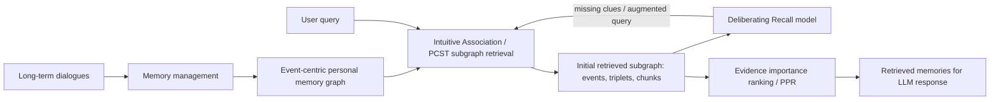

# Bridging Intuitive Associations and Deliberate Recall: Empowering LLM Personal Assistant with Graph-Structured Long-term Memory

- **Authors**: Yujie Zhang, Weikang Yuan, Zhuoren Jiang
- **Venue / year**: Findings of ACL 2025
- **DOI**: 10.18653/v1/2025.findings-acl.901
- **Core idea**: 提出 **Associa**：用 event-centric memory graph 管理個人助理的長期對話記憶，再用 **Intuitive Association**（PCST subgraph retrieval）與 **Deliberating Recall**（缺漏線索偵測 + query refinement）做更接近人類「聯想 + 刻意回想」的 evidence gathering。
- **Why it matters for Ting**: 這篇很適合作為 structured agent memory / graph retrieval / long-term assistant evaluation 的設計參考，尤其是「multi-intent query 不應只靠 dense similarity」這個問題切入點。

## Direction tags

| Tag | 判斷 | 理由 |
|---|---|---|
| **Memory** | 強相關 | 核心就是個人助理 long-term conversational memory 的寫入、結構化、檢索與下游 QA。 |
| **Graph Retrieval** | 強相關 | memory store 是 event-centric graph；retrieval 用 PCST 找 evidence-rich connected subgraph，再用 PPR 做 evidence ranking。 |
| **Agentic / Self-evolve** | 中等相關 | 有 query-time deliberation，但沒有完整 agent loop、長期 policy learning 或 durable self-improvement。 |
| **Proactivity** | 弱相關 | 系統仍是 query-triggered，不會自主判斷是否要主動行動。 |

## Research Background

LLM personal assistant 如果真的要「長期陪伴」使用者，就不能只靠當下 context window。使用者的偏好、事件、目標、過去對話會跨越多個 session 分散出現；當使用者問問題時，assistant 需要從長期記憶中找出真正能回答問題的 evidence。

現有 long-term memory 系統常用 dense retriever：把歷史對話、summary、fact 或 observation encode 成向量，query 時取 top-k。這很直覺，但 paper 指出它和個人記憶 retrieval 的目標有落差：dense retriever 擅長找語意相近文本，卻不一定擅長「蒐集回答問題所需的證據」。

Figure 1 的例子很清楚：使用者問 Facebook ad campaign + Instagram influencer collaboration 的總觸及人數。dense retriever 可能抓到與 social media / influencer marketing 語意相似的對話，但真正關鍵是：

- Facebook ad campaign 這個 event 的 reach；
- Instagram influencer collaboration 這個 event 的 followers / reach；
- 兩個 intent 都要被完整找回並加總。

這就是 paper 要解決的核心：personal memory retrieval 不只是 semantic matching，而是 **entity relationship + multi-intent evidence gathering**。

## Research Problem

這篇 paper 聚焦兩個 retrieval gap：

1. **忽略 entity / event association**
   Dense retrieval 容易把單一 utterance 視為 isolated chunk，但個人記憶中的資訊往往透過 event、entity、time、speaker、raw utterance 彼此連接。若 query 涉及「Facebook + ad campaign」這類綁定關係，單純相似度不足以表示 evidence quality。

2. **混淆或遺漏多個 evidence-gathering intents**
   一個 query 可能同時包含多個 retrieval intent，例如「Facebook ad reach」與「Instagram influencer reach」。top-k dense retrieval 可能偏向其中一個 intent，或抓到相關但不能回答問題的 general discussion。

作者的問題定義是：給定長期對話歷史 $L$、當前 query $q_t$ 與當前 session context $S_t$，assistant 需要先建立外部 memory database $M$，再 retrieve relevant memories $m_{q_t}$，最後讓 LLM 生成 response $r_t$。Associa 的創新點主要落在 **memory management** 與 **memory retrieval**。

## Method

### 1. Overall architecture

Associa 可以分成兩個大層：



作者刻意把人類記憶的兩種機制拆成兩個 module：

- **Intuitive Association**：先憑 query cue 在 graph memory 中做關聯式搜尋，抓出 evidence-rich subgraph。
- **Deliberating Recall**：檢查目前 evidence 是否漏掉 query 的重要 clues；若漏掉，就把 query 改寫 / 補強，再進行下一輪 retrieval。

### 2. Memory store: event-centric personal memory graph

Figure 2 展示 Associa 的 memory graph。這不是純 vector store，而是 **hybrid utterance-graph storage**：一方面保留 raw utterance，避免結構化過程遺失細節；另一方面把事件、實體、時間、使用者資訊轉成 graph nodes / edges，支援 relational retrieval。

#### Node types

Associa 定義四種核心 node：

| Node type | 作用 |
|---|---|
| **utterance** | 原始對話片段，作為可回溯 evidence。 |
| **user-related event** | 記憶的中心 anchor；包含 temporal、participant、contextual information。 |
| **entity** | event 中的 referential objects，包含 Object, Person/User/Organization, Resource, Place, Event, Goal/Intention, Time, Interest/Skill, Sentiment 等。 |
| **event time** | event 發生時間，由 utterance timestamp / context 推斷。 |

這裡最值得借的是：entity 不只抽「人事物」，也抽 **Goal/Intention**、**Interest/Skill**、**Sentiment**。對 personal assistant 來說，這讓 memory graph 可以保存使用者需求、情緒與偏好，而不是只存 facts。

#### Edge schema

Associa 設計六種 edge：

| Edge | 意義 |
|---|---|
| `(event, <\|event occur at\|>, event time)` | event 發生時間。 |
| `(event, <\|event fact\|>, utterance)` | event 與提供事實的原始 utterance 連接。 |
| `(event, <\|event include\|>, entity)` | event 包含哪些 entity。 |
| `(utterance, <\|include\|>, entity)` | utterance 直接提到哪些 entity。 |
| `(user/speaker, <\|ask\|>, utterance)` | user / speaker 與 utterance 的關係。 |
| `(entity, <\|relation\|>, entity)` | entity 之間的任意語意關係，例如 action、state、feel、occur at。 |

#### Graph deduplication

為了讓 graph 可擴展，作者用兩種 deduplication：

1. **Incremental deduplication**：基於 FAISS，新增 memory 時若 similarity 超過 threshold，就動態合併重複 nodes / edges。
2. **Clustering deduplication**：先建立 similarity matrix，再用 Agglomerative Clustering 批次合併大規模重複 entities / events / relations。

這等於把 `observe -> write` 之後的 consolidation 部分落在 dedup / merge 上，而不是 reflection summary。

### 3. Intuitive Association: PCST-based subgraph retrieval

Intuitive Association 的目標是從 memory graph 中找出一個 connected subgraph，使它同時：

- 包含與 query 高相關的 nodes / edges；
- 避免拿太多低價值或成本太高的連接；
- 能透過 graph connectivity 捕捉 entity / event association。

流程如下：

1. **Contextual prize initialization**
   對 query embedding、node feature、edge feature 做 cosine similarity，得到 node prize 與 edge prize。這代表每個 node / edge 對 query 的初始相關性。

2. **Top-k selection with decaying weights**
   只保留 top-k 高相關 nodes / edges，並用 rank-based decay 重新分配 prize。這讓 retrieval 更聚焦。

3. **Virtual node injection**
   PCST 容易偏向選 node 而忽略高價值 edge。作者對高 prize edge 插入 virtual node，把 edge 的重要性轉成 node prize，減少 edge selection bias。

4. **Prize-Collecting Steiner Tree optimization**
   在 graph 中找 connected subgraph，最大化 selected node / edge prize，最小化 edge construction cost。直覺上就是找一團「高 evidence value 且互相連得起來」的 memory。

這個設計比 top-k chunks 更適合 personal memory，因為 answer evidence 常常不是單一句話，而是 event、entity、time、raw utterance 之間的關係。

### 4. Deliberating Recall: missing clue detection + recursive retrieval

作者認為第一次 intuitive retrieval 可能仍會漏掉重要 clues，尤其是 query 有多個 intents 時。因此加入 Deliberating Recall。

#### Deliberating model

作者 fine-tune 一個 specialized deliberating model，base 是 **Qwen-2.5-3B-instruct**。訓練資料來自 CoQA，但只用於訓練 deliberation capability，不用於最終 benchmark evaluation。

訓練資料製作流程：

1. 對 CoQA reading materials 建 graph，包含 chunks、events、entity nodes。
2. 用 qwen-plus 將含 pronoun 的問題還原成完整問題。
3. 根據 CoQA cues，在 graph 中定位與正確 clue 最相似的 2-3 個 nodes。
4. 建 positive / negative samples：positive 包含 correct cue；negative 移除 correct cue。
5. positive output 是 `{}`；negative output 要模型輸出 missing entities 與 unrelated content。

Appendix E 的 inference prompt 會給模型：retrieved events、triplets、chunks、query，要求輸出：

```json
{
  "add_entity": ["missing entity 1", "missing entity 2"],
  "unrelated_content": ["irrelevant content 1"]
}
```

#### Recursive evidence retrieval

query-time 的 loop 是：

1. 用 raw query 做 Intuitive Association，取回 subgraph。
2. Deliberating model 檢查 retrieved results 是否漏掉 query 的重要 entity / clue。
3. 若有 missing clues，就把它們加入 augmented query，再跑下一輪 subgraph retrieval。
4. 重複直到沒有 missing clue 或達到 `max_iter`。實驗中 `max_iter = 2`。
5. 合併完整 subgraph 後，進入 evidence importance ranking。

Figure 3 展示的例子是：第一輪 query 可能沒完整找回 Facebook ad campaign / Instagram influencer collaboration；deliberating model 會指出 missing clues，下一輪 retrieval 才補齊。

### 5. Evidence importance ranking

取得 subgraph 後，Associa 用 **Personalized PageRank (PPR)** 評估 subgraph 中 nodes 的重要性：

- personalized preference `p_i` 來自 node prize；
- edge weight `w(i,j)` 由 edge construction cost 轉換而來；
- 最後依 PPR score 排序 utterances / events / entities，挑出最重要 evidence。

Table 3 的 ablation 顯示移除 Evidence Importance Ranking 後，Recall@10 不一定變差，但 Recall@5、NDCG@5、NDCG@10 明顯下降，表示 ranking 對 top evidence quality 很重要。

### 6. Lifecycle / mechanism 對照

| Lifecycle stage | Associa 有沒有？ | 實作方式 |
|---|---:|---|
| **observe** | 有 | 接收 long-term user-assistant dialogues / utterances 與 timestamp。 |
| **write** | 有 | LLM 依 prompt 抽 user events、event time、description、triplets，寫入 event-centric graph。 |
| **retrieve** | 有 | query-triggered PCST subgraph retrieval + recursive deliberating recall。 |
| **use** | 有 | 將 retrieved memories / evidence 提供給 LLM 生成回答；實驗中 QA 使用 GPT-4o。 |
| **reflect / consolidate** | 部分 | Deliberating Recall 是 query-time reflection；graph dedup 是 memory consolidation。沒有 durable reflection note / lesson。 |
| **update / forget / evolve** | 部分 / 缺 | 可新增 memory 並 deduplicate；沒有明確 conflict update、forgetting policy、memory decay 或 outcome-based evolution。 |
| **decide whether to act** | 無 | 系統仍被動回應 query；沒有 proactive trigger 或 action policy。 |

## Contribution

1. **提出 event-centric graph memory schema**
   Associa 把長期對話記憶整理成 utterance、event、entity、event time 的 hybrid graph，特別適合個人助理場景中「事件 + 目標 + 情緒 + 偏好」的保存。

2. **把 memory retrieval 從 dense similarity 改成 evidence gathering**
   作者明確指出 personal memory 的目標不是找語意最像的 chunk，而是找回答問題所需的 evidence。這個 framing 對 Ting 做 agent memory 很有用。

3. **PCST subgraph retrieval 用於 associative memory**
   Intuitive Association 透過 prize / cost 找 connected subgraph，能捕捉 entity relationship 與 fragmented evidence。

4. **Deliberating Recall 補足 multi-intent query 的缺漏**
   用 fine-tuned small LLM 檢查 retrieved result 是否漏掉 clues，再改寫 query 做 recursive retrieval。這比單輪 retriever 更像人類刻意回想。

5. **在 retrieval 與 QA benchmark 都有實證提升**
   Longmemeval-s、Longmemeval-m、LoCoMo 上，Associa 在 retrieval metrics 與 QA accuracy 多數優於 baselines。

## Conclusion

Associa 的結論是：LLM personal assistant 的 long-term memory 不應該只是 vector DB + top-k retrieval。若要處理長期、多 session、multi-intent、relational 的使用者記憶，memory system 需要：

- 用 graph 保存 event / entity / utterance / time 的 association；
- 用 subgraph retrieval 找 evidence，而不是只找相似文本；
- 用 deliberation 檢查是否漏掉重要 clues；
- 用 ranking 機制把最關鍵 evidence 排到前面。

這篇的實驗支持 graph-structured memory + human-like retrieval mechanism 是一個有潛力的方向。不過它仍主要是 retrieval framework，尚未處理 proactive assistant、long-term self-improvement、temporal conflict update、privacy-aware memory management 等更完整 agent 問題。

## Reproducibility

### Source access

- ACL Anthology page 可讀 abstract 與 metadata。
- PDF 可完整取得，包含 main method、tables、appendices、prompt templates。
- BibTeX 提供 venue、month、DOI、pages。

### Code / implementation availability

- 我在 ACL page、PDF 文字與快速 web search 中沒有看到官方 code repository。這點是主要 reproducibility gap。
- Paper 提供不少 implementation details，但若要完全復現，仍需要自行實作 graph construction、PCST retrieval、deliberating model training、evaluation pipeline。

### Useful implementation details from paper

| Component | Detail |
|---|---|
| Graph construction model | 使用 Qwen-Turbo API 做 memory graph construction。 |
| Deliberating model | Qwen-2.5-3B-instruct fine-tuned on CoQA-derived graph samples。 |
| Retriever inside Associa | 實驗中用 Contriever，但作者說可替換。 |
| Generation model for QA | GPT-4o (`gpt-4o-2024-11-20`)。 |
| QA evaluator | GPT-4o-mini 判斷 correctness。 |
| Hyperparameters | `max_iter=2`; PCST edge cost `cost_e=0.5`; node `topk=15`; edge `tope=15`。 |
| Hardware | 單張 Nvidia A800 80GB GPU。 |
| Prompts | Appendix E 提供 deliberating model prompt 與 memory graph construction prompt。 |

### Practical reproduction risk

1. **Graph extraction quality strongly affects result**：Qwen-Turbo / Qwen variants 都可用，但 graph schema extraction 一旦不穩，後續 retrieval 會受影響。
2. **PCST implementation details not fully expanded in main text**：需要確認 virtual node injection、prize normalization、cost setting 的細節。
3. **LLM-as-judge QA evaluation**：使用 GPT-4o-mini 判斷 correctness，可能引入 evaluator bias。
4. **No official code found**：要重現可能需要工程量，尤其是 long-term dialogue graph construction 和 recursive retrieval pipeline。

## Evaluation / Benchmark

### Research questions

作者設計三個 RQ：

- **RQ1**: Associa 在 long-term dialogue memory retrieval 表現如何？
- **RQ2**: Associa 在 long-term dialogue QA 表現如何？
- **RQ3**: 各 module 對 Associa performance 的貢獻是什麼？

### Datasets

| Dataset | 用途 / 特性 |
|---|---|
| **Longmemeval-s** | 每題約 115k tokens，約 200 dialogue turns；測 information extraction、multi-session reasoning、temporal reasoning、knowledge updating、abstention。 |
| **Longmemeval-m** | 每題約 1.5M tokens，約 2000 turns / 500 sessions；更接近 needle-in-a-haystack 的長期記憶 retrieval。 |
| **LoCoMo** | persona + temporal event graph 生成的 very long-term dialogues；平均 300 turns / 9K tokens，最多 35 sessions。 |

### Metrics

- Retrieval：Recall@5、Recall@10、NDCG@5、NDCG@10。
- QA：用 GPT-4o-mini 根據 task category、question、gold answer、model response 判斷 correct / incorrect，計算 accuracy。

### Retrieval baselines

BM25、Contriever、Stella、BGE-M3、Longmemeval retrieval variants（user facts / time filtering）。

### QA baselines

MemoRAG、Longmemeval、MemoryBank、LightRAG。

### Key results

#### Retrieval results（Table 1）

Associa `max_iter=2` 在三個 dataset 上多數 metrics 最好：

| Dataset | Associa max_iter=2 highlights |
|---|---|
| Longmemeval-s | Recall@5 = 0.87，Recall@10 = 0.93，NDCG@10 = 0.88。 |
| Longmemeval-m | Recall@5 = 0.66，Recall@10 = 0.77，NDCG@10 = 0.73；長文本難度最高，但提升也明顯。 |
| LoCoMo | Recall@5 = 0.74，Recall@10 = 0.80，NDCG@10 = 0.74。 |

重點不是只有分數高，而是：`max_iter=2` 通常優於 `max_iter=1`，支持 Deliberating Recall 的 recursive retrieval 確實能補回 missing clues。

#### QA results（Table 2）

Associa 在 QA accuracy 上也最好或接近最好：

- Longmemeval-s：Associa 0.81，略高於 Longmemeval 0.80。
- Longmemeval-m：Associa 0.66，高於 Longmemeval 0.64。
- LoCoMo：Associa 0.69，高於 LightRAG / Longmemeval 的 0.64 / 0.62。

MemoRAG 與 MemoryBank 在長文本下表現差，作者推測是過長 context 會降低 LLM comprehension。

#### Ablation（Table 3）

在 Longmemeval-s 上：

| Variant | Recall@5 | NDCG@5 | Recall@10 | NDCG@10 | 解讀 |
|---|---:|---:|---:|---:|---|
| w/o AM | 0.67 | 0.69 | 0.85 | 0.74 | 移除 association mechanism 下降最大，代表 graph association 是核心。 |
| w/o DM | 0.84 | 0.85 | 0.90 | 0.87 | 移除 deliberating module 仍可用，但少了第二輪補線索。 |
| w/o SFT | 0.84 | 0.86 | 0.91 | 0.87 | fine-tuning deliberating model 有小幅幫助。 |
| w/o EIR | 0.52 | 0.51 | 0.85 | 0.60 | ranking 對 top-k evidence quality 很重要。 |
| Associa | 0.87 | 0.87 | 0.93 | 0.88 | 完整模型最佳。 |

#### Cost / efficiency（Appendix C）

- Graph construction token usage（Table 4）：Associa 比 LightRAG / Longmemeval variants 使用更少 tokens。例如 LoCoMo 每 session 約 4181 tokens；LightRAG 約 7085；Longmemeval 約 8766。
- Retrieval latency（Table 5）：Associa iter=1 在 LoCoMo 約 0.71s/query、Longmemeval-s 約 0.87s/query；iter=2 約 2.34s / 1.92s，仍比 MemoRAG 快很多。

#### Robustness（Appendix D, Table 6）

作者用 Qwen-2.5-Instruct 7B / 32B / 72B 與 Qwen-Turbo 做 graph generation robustness test。結果顯示：

- 不同 LLM 產生 memory graph 時，Associa 都能超過 baselines。
- 更大的 LLM 通常更好，符合 scaling law。
- 多輪 iteration 可以補償部分模型大小差距，例如較小模型 + iter=2 有時接近或超越較大模型 + iter=1。

## Borrowable Ideas for Ting's AAAI Direction

1. **把 memory retrieval framing 改成 evidence gathering**
   若 Ting 要做 agent memory，建議不要只說「提升 retrieval accuracy」，而是明確定義 assistant 需要從長期記憶中 gather evidence 來支援 decision / answer / proactive action。

2. **Event-centric schema 可以當 personal assistant memory backbone**
   `event -> utterance -> entity -> time -> goal/intention/sentiment` 這種 schema 很適合 Ting 後續做 structured memory demo。尤其 Goal/Intention/Sentiment nodes 能連到 user modeling。

3. **Hybrid raw + structured storage 是務實設計**
   不要只存 graph，也不要只存 raw chunks。Graph 用於 association；raw utterance 用於 factual grounding 與回答可追溯性。

4. **Deliberating Recall 可改造成 agent 的 self-questioning retrieval loop**
   這篇只用 missing entity 補 query。Ting 可以延伸成：agent 在回答 / 行動前自問「我缺哪些 evidence？目前 evidence 是否支持 action？」這會更接近 robust agent decision-making。

5. **用 multi-intent query 當 benchmark slice**
   很多 memory system 看平均 retrieval，但 Ting 可以專門設計 multi-intent、multi-session、relation binding、temporal update、abstention 的測試切片，凸顯 structured memory 的必要性。

6. **Graph retrieval + proactivity 可以形成新 gap**
   Associa 是 query-triggered。若 Ting 的 AAAI direction 想做 proactive agent，可以把 event graph 變成 trigger substrate：當新事件寫入後，系統判斷是否與 pending goals / constraints / risks 形成 actionable condition。

7. **Evidence importance ranking 可用於 explainability**
   PPR / PCST 的 node / edge scores 可以轉成「為什麼 assistant 想起這些記憶」的 explanation。這對個人助理的 trust / auditability 很有價值。

## Attackable Gaps / Follow-up Ideas

1. **Temporal modeling 不足**
   作者自己在 Limitations 承認沒有 specifically model temporal information。Long-term assistant 很常需要處理 preference update、事件先後、舊資訊失效。可以加入 temporal edges、valid time interval、recency decay、conflict resolution。

2. **沒有真正的 memory update / forgetting policy**
   Associa 有 dedup，但沒有回答：什麼記憶該更新？何時忘記？新舊矛盾怎麼處理？這是 personal assistant memory 很好攻的 gap。

3. **Deliberation 只發生在 query-time，不會形成 durable improvement**
   Deliberating Recall 找到 missing clues 後，只幫本次 retrieval。它沒有把「這次為何漏掉」寫回 memory policy 或 index。可延伸成 retrieval failure reflection / memory schema evolution。

4. **仍然是被動 QA / retrieval framework**
   沒有 decide whether to act、proactive trigger、task planning、action execution。若研究目標是 agentic personal assistant，Associa 可以當 memory substrate，但不是完整 agent。

5. **Graph construction 依賴 LLM extraction quality**
   如果 event / entity / relation 抽錯，PCST 再漂亮也會 retrieve 錯。後續可以研究 uncertainty-aware graph extraction、schema validation、human-in-the-loop correction。

6. **PCST connected subgraph 對多 intent 是否 always 合適？**
   多 intent evidence 有時可能分散在 graph 中不相連或弱連接。強迫 connected subgraph 可能引入 irrelevant bridge nodes。可以比較 multi-subgraph retrieval、intent decomposition + independent subgraph retrieval。

7. **Privacy / security 未處理**
   個人助理 memory graph 會存 goals、sentiment、personal facts。Paper 沒處理 access control、sensitive memory filtering、data minimization、right-to-forget。

8. **Evaluation 語言與情境有限**
   作者承認只測 English datasets。若 Ting 面向 zh-TW / bilingual assistant，值得測 code-switching、中文對話、台灣情境的 memory graph robustness。

9. **No official code found**
   對學術可重現性是弱點。若 Ting 做後續工作，可以提供簡化版 open-source implementation 或 reproducible benchmark pipeline，這會是 practical contribution。

10. **LLM-as-judge QA accuracy 需要更嚴格驗證**
    GPT-4o-mini correctness judge 方便，但可能偏誤。可以加入 exact evidence matching、human evaluation、calibration analysis。
