- **Authors**: Guibin Zhang, Muxin Fu, Guancheng Wan, Miao Yu, Kun Wang, Shuicheng Yan
- **Venue**: arXiv / OpenReview 2025
- **Paper URL**: https://arxiv.org/abs/2506.07398
- **Code**: https://github.com/bingreeky/GMemory

## Direction tags

| Direction | 判斷 | 原因 |
|---|---|---|
| **Memory** | **強相關** | G-Memory 專門為 multi-agent systems 設計 shared / collective memory，將 MAS collaboration traces 組織成三層 graph。 |
| **Self-evolve** | **強相關** | 每次任務完成後，interaction graph、query graph、insight graph 都會根據 feedback 更新，讓 agent team 跨 trial 累積經驗。 |
| **Proactivity** | **弱到中度相關** | 它會在新 query 到來時自動 retrieve / update memory，但仍是 query-triggered；沒有處理無外部 query 時是否主動行動。 |

> [!note] 一句話摘要
> G-Memory 把 multi-agent collaboration 的長軌跡壓成 **interaction graph → query graph → insight graph** 三層 organizational memory，讓每個 agent 在下一次任務前收到 role-specific 的過去經驗與高層 insight。

## Research Background

LLM-based multi-agent systems（MAS）已能透過角色分工、辯論、協作與投票超越單一 agent，但多數 MAS 仍缺少真正的 cross-trial memory。現有 MAS 常見兩種情況：

- 只有 **inside-trial memory**：同一個任務內保留對話 context，但任務結束後不累積可重用經驗。
- 只有粗略 cross-trial artifact：例如保存 final solution 或 execution result，卻忽略多個 agents 之間實際如何協作、哪一步造成成功或失敗。

這對 self-evolving MAS 是瓶頸。因為 MAS 的價值不只在單一 agent 的知識，而在於**團隊協作模式**：誰該先做什麼、誰該驗證什麼、什麼溝通策略有效、哪些失敗模式要避免。

G-Memory 借用 organizational memory theory，把 MAS 的跨任務經驗視為一種組織知識，並用 hierarchical graph 保存與檢索。

## Research Problem

這篇 paper 想解決：**如何為 multi-agent systems 建立一個能捕捉長協作軌跡、支援跨 trial reuse、並對不同 agent role 提供客製化 memory 的架構？**

具體問題包括：

1. MAS interaction trajectory 很長，直接塞進 prompt token cost 太高，也會干擾 reasoning。
2. 單一 agent memory 方法通常只做 similarity retrieval，不懂 agent role 與 inter-agent dependency。
3. 過去經驗需要同時保留 abstract lesson 與 concrete failure / success trajectory。
4. memory update 需要根據 task feedback 把新協作經驗吸收進團隊知識庫。

## Method / Architecture

### 1. MAS formalization

G-Memory 把 multi-agent framework 表示為 directed graph $G = (V, E)$，其中每個 agent node $C_i$ 包含：

$$
C_i = (Base_i, Role_i, Mem_i, Plugin_i)
$$

- $Base_i$：底層 LLM。
- $Role_i$：agent role / persona。
- $Mem_i$：該 agent 的 memory state。
- $Plugin_i$：可用工具，例如 web search。

任務執行時，agents 依 communication graph 的 topological order 多輪產生 response，最後由 aggregation operator 形成答案。

### 2. Three-tier hierarchical memory

| Graph layer | Node / edge | 保存什麼 | 作用 |
|---|---|---|---|
| **Interaction graph** | utterance nodes；temporal / inspiration edges | 單一 query 內每個 agent 的 utterance 與互相影響關係 | 保留細粒度協作軌跡，可抽出 core path / failure lesson。 |
| **Query graph** | query nodes；semantic relation edges | 過去 query、status、對應 interaction graph | 做 coarse retrieval 與 hop expansion，找相似任務與鄰近任務。 |
| **Insight graph** | insight nodes；supporting queries / hyper-connections | 從多個 query 中蒸餾出的可泛化 insight | 提供高層 guidance，例如分工、檢查策略、常見錯誤。 |

這三層分別對應：**具體對話 → 任務案例 → 可泛化組織知識**。

### 3. Coarse-grained memory retrieval

當新 query $Q$ 到來時，G-Memory 先在 query graph 上做 embedding similarity retrieval，取 top-k historical queries：

$$
Q_S = \operatorname{arg\ top\text{-}k}_{q_i \in Q}\left(\frac{v(Q) \cdot v(q_i)}{\lVert v(Q) \rVert \lVert v(q_i) \rVert}\right)
$$

接著在 query graph 做 1-hop expansion，把語意相關但不一定 embedding 最相似的鄰近 query 納入候選。

### 4. Bi-directional memory traversal

G-Memory 接著做上下兩個方向的 traversal：

#### Upward traversal：query graph → insight graph

從相關 query 找出其支持的 insight nodes，取回 high-level guidance。這些 insights 可以像團隊 SOP 一樣提醒 agent：

- 先驗證 entity 是否同名不同人；
- 在 embodied task 中先確認物品狀態；
- block stacking 前先檢查 clear condition。

#### Downward traversal：query graph → interaction graph

從相關 query 的完整 interaction graph 中，用 LLM graph sparsifier 抽出 core collaboration subgraph，保留成功 / 失敗關鍵步驟，而不是整段對話全塞進 prompt。

### 5. Role-specific memory augmentation

G-Memory 不把同一份 memory 給所有 agents，而是根據每個 agent 的 $Role_i$ 與當前 query $Q$，過濾 insight 與 trajectory snippets，初始化該 agent 的 $Mem_i$。

這點是 MAS memory 的核心差異：planner agent、executor agent、verifier agent 需要的過去經驗不同。

### 6. Hierarchical memory update

任務完成後，系統取得 final solution 與 environmental feedback，例如 success / fail、token usage、tool calls，然後更新三層 graph：

1. **Interaction graph update**：把本次 agents utterances 追蹤成新 interaction graph。
2. **Query graph update**：新增 query node，包含 original query、status、interaction graph；並連到相關 historical queries。
3. **Insight graph update**：從本次協作軌跡與結果蒸餾新 insight，並把用過的 insights 的 supporting query sets 更新。

### 7. Planner / trigger policy / reflection mechanism

- **Planner**：G-Memory 不直接取代 MAS planner，而是 plug-in memory module；它改變每個 agent 的 memory context。
- **Trigger policy**：主要在新 query 開始時觸發 retrieval，任務結束時觸發 update；沒有討論任務中細粒度或無 query 時的 autonomous trigger。
- **Reflection / evolution**：LLM sparsifier、trajectory condensation、insight generation、supporting query update 都是 reflection / consolidation mechanism。

## Lifecycle / Mechanism

```mermaid
flowchart LR
    A[Observe: new user query + MAS execution] --> B[Retrieve: query graph similarity + hop expansion]
    B --> C[Use: role-specific insights and trajectories augment agents]
    C --> D[Act: MAS solves task]
    D --> E[Reflect: condense trajectory and generate insights]
    E --> F[Write: store interaction graph and query node]
    F --> G[Update / evolve: update insight graph and supporting queries]
    G --> H[Forget: not explicitly modeled]
    H --> I[Decide whether to act proactively: outside scope]
```

G-Memory 是三篇中最接近「collective self-evolution」的，因為它把 feedback 後的協作經驗寫回 shared memory；但主動性仍是 query-triggered。

## Contribution

1. **Bottleneck identification**：指出 MAS self-evolution 缺口主要來自 memory architecture 過度簡化。
2. **Hierarchical collective memory**：提出 insight / query / interaction 三層 graph，專門保存 MAS collaboration experience。
3. **Bi-directional traversal**：同時取回高層 insight 與細粒度 collaboration trajectory。
4. **Role-specific memory cues**：根據 agent role 分配不同 memory，不是一份 context 全員共用。
5. **Plug-and-play evaluation**：可嵌入 AutoGen、DyLAN、MacNet 等既有 MAS framework，不改原架構也能提升表現。

## Evaluation / Benchmark

### Tasks and datasets

| Domain | Benchmarks | Metrics |
|---|---|---|
| **Knowledge reasoning** | HotpotQA、FEVER | exact match / accuracy。 |
| **Embodied action** | ALFWorld、SciWorld | success rate。 |
| **Game / planning** | PDDL | task success / accuracy。 |

### Baselines

- **No-memory**
- **Single-agent memory baselines**：Voyager、MemoryBank、Generative Agents。
- **MAS memory baselines**：MetaGPT-M、ChatDev-M、MacNet-M。
- **MAS frameworks**：AutoGen、DyLAN、MacNet。
- **LLM backbones**：GPT-4o-mini、Qwen-2.5-7B、Qwen-2.5-14B。

### Key results

- 在 GPT-4o-mini 上，G-Memory 對 AutoGen 的平均分數從 no-memory 48.27 提升到 57.18；對 DyLAN 從 43.12 提升到 50.88；對 MacNet 從 42.01 提升到 51.95。
- paper 摘要報告：在 embodied action 任務成功率最高提升 **20.89%**，在 knowledge QA accuracy 最高提升 **10.12%**。
- G-Memory 在多個 setting 下同時提升 performance，且 token cost 增加比某些 MAS memory baselines 更低。

### Ablations and sensitivity

| Analysis | 發現 |
|---|---|
| **Hop expansion** | 1-hop 通常最好；2-hop / 3-hop 容易引入 irrelevant insights。 |
| **Parameter k** | $k \in \{1, 2\}$ 較穩定；取太多 query 可能引入 task-irrelevant noise。 |
| **Only insights vs only interactions** | 移除任一層都會降分；fine-grained interactions 對某些任務略更關鍵，但 full model 最好。 |
| **Cost analysis** | 相比某些 baseline，G-Memory 在較低 token overhead 下獲得更高 performance gain。 |

### 是否證明 long-term improvement / autonomous initiative？

- **Long-term / cross-trial improvement**：有較強證據，因為 memory 會跨任務保存 query、trajectory、insight，並提升後續任務成功率。
- **Self-evolution**：證明在 MAS shared memory 層面有效，但不是改寫 agent architecture 或 LLM parameters。
- **Autonomous initiative**：沒有證明；G-Memory 仍在新 query 到來時啟動，不是自己決定何時發起新任務。
- **Fixed scheduling**：retrieval-on-query-start 與 update-on-query-end 是固定流程，還沒有 adaptive trigger policy。

## Conclusion

G-Memory 的結論是：MAS 的 self-evolution 需要專門設計的 collective memory，而不是直接套用單一 agent 的 vector memory。透過 insight / query / interaction 三層 graph，系統能同時保存高層 lessons 與細粒度協作軌跡，並在新任務開始時提供 role-specific memory cues。

它是三篇中最接近 Ting 可能關心的「跨任務團隊經驗累積」的一篇；但它仍是 query-triggered memory augmentation，尚未處理 adaptive trigger、主動行動、privacy-aware forgetting，以及 insight correctness validation。

## Reproducibility

- **Repo availability**：官方 repo 已提供：https://github.com/bingreeky/GMemory
- **Toy reproduction requirements**：
  - 一個簡化 MAS framework（例如 3 agents：planner / executor / verifier）。
  - query graph 與 insight graph 可先用 NetworkX 實作。
  - embedding model：ALL-MINILM-L6-v2 或任一 sentence transformer。
  - LLM API for trajectory sparsification / insight generation。
  - 小型 benchmark：例如 ALFWorld subset、HotpotQA subset，或自製 multi-agent puzzle tasks。
- **Minimal demo idea**：
  1. 建立 30 個 block-world 或 web QA tasks，每題由 3-agent MAS 解。
  2. 保存每次對話成 interaction graph。
  3. 從成功 / 失敗案例蒸餾 insights，例如「先確認 search result 指的是同一 entity」。
  4. 比較 no-memory、raw trajectory retrieval、G-Memory 三種設定的 success rate / token cost。

## Borrowable ideas for Ting's AAAI direction

- **Memory hierarchy for agent teams**：如果 Ting 想做 agentic research，G-Memory 的三層架構很適合作為 MAS memory baseline。
- **Role-specific retrieval**：同一段 history 不應直接丟給所有 agents；可以研究根據 role / capability / current subtask 分配 memory。
- **Trajectory condensation**：把長對話壓成 core collaboration path，比 summary 更能保留「誰影響誰」與 failure point。
- **Insight graph as evolving SOP**：insight graph 可被視為 agent team 自動形成的 SOP / lessons learned，這很適合連到 self-evolving agents。
- **AAAI angle**：可以攻「adaptive trigger + memory hierarchy」，讓系統不只 query-start retrieve，而是學會何時需要回憶、何時需要更新、何時需要主動提醒其他 agents。

## Attackable Gaps / Follow-up Ideas

1. **LLM sparsifier 可解釋性不足**：core interaction graph 由 LLM 抽取，可能漏掉真正造成成功 / 失敗的 utterance。
2. **insight 品質缺少驗證**：insights 是否正確、是否過度泛化、是否互相矛盾，paper 未深入處理。
3. **trigger policy 固定**：只在 query start / end 觸發 retrieval / update，沒有學習何時 retrieve 或何時 consolidate。
4. **缺少 forgetting / privacy**：跨 trial 保存 MAS trajectories 可能有安全與隱私問題，paper 沒有處理 deletion、retention、access control。
5. **benchmark 多為 task success**：雖然比 QA 更接近 action，但仍不等於 open-ended autonomous long-horizon proactivity。
6. **role-specific memory 仍靠 prompt filtering**：可以進一步 formalize 成 memory allocation problem，學習每個 agent 需要哪些 insight。
7. **跨 domain generalization 還有限**：作者也承認需要更多任務類型，例如 medical QA，才能證明 soundness。
