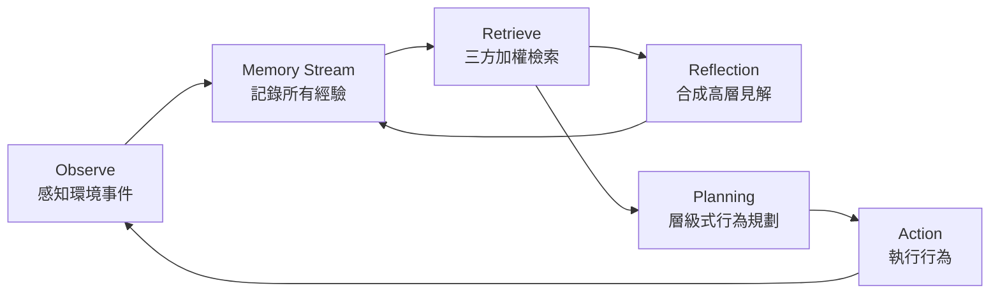

## Research Background

過去的 agent 系統多半是**反應式**的：你問它、它回答；你給目標、它執行。但在開放世界中，人類行為的 believability 來自更根本的東西——我們會記住過去、會反思、會自發規劃明天要做什麼，而不是只回應眼前的刺激。

LLM 雖然具備生成自然語言的能力，但 LLM 本身**沒有持續狀態**：每次 API call 都是全新的，不會記住昨天發生的事，也不會主動決定「我今天下午應該去咖啡廳跟誰聊聊」。如果要在模擬環境中創造 believable human behavior，就必須在 LLM 之上建立一套認知架構，讓 agent 擁有記憶、反思、和自主規劃的能力。

> [!info] 這篇 paper 的核心主張
> 把 LLM 當 reasoning engine，在上面疊一個三層認知架構（memory → reflection → planning），就能讓 25 個 agent 在沙盒小鎮裡產生**可信的個體行為與湧現的社會行為**——不需要任何腳本。

## Research Problem

這篇 paper 想回答的核心問題是：

> **如何設計一個 agent 架構，讓 LLM-based agents 在長時間、多 agent 的開放環境中，產生 believable 且 emergent 的人類行為？**

具體拆解：

1. **記憶問題**：agent 如何累積經驗、在需要時取出相關記憶，而不是被無關資訊淹沒？
2. **反思問題**：agent 如何從大量零散觀察中合成高層次見解（insights），而不只是記住表面事件？
3. **規劃問題**：agent 如何主動決定「接下來做什麼」，而不只是被動回應環境刺激？
4. **湧現行為**：個體的認知架構能否讓群體產生非預設的社會行為（例如自動籌辦派對、自發約會）？

## Method

### 三層認知架構（Three-Tier Architecture）

這篇 paper 最核心的貢獻是其 agent 架構設計。三個模組構成一個持續運作的循環：



#### 1. Memory Stream（記憶流）

- **結構**：一個按時間排序的記錄序列，每筆記錄是一段自然語言描述 + timestamp
- **內容**：agent 觀察到、聽到、說過、做過的一切，都以 atomic event 形式存入
- **例子**：
  - "Klaus Mueller is reading a research paper on gentrification at the library" (Feb 13, 10:15am)
  - "Maria Lopez said: 'Are you coming to the Valentine's Day party?'" (Feb 12, 3:30pm)
- **重要性評分**：每筆記憶寫入時，LLM 給一個 1–10 的 importance score（吃早餐 vs 分手）
- **關鍵特性**：reflection 產出的 insights 也會寫回 memory stream，形成遞迴抽象（reflections on reflections）

#### 2. Reflection（反思機制）

- **觸發條件**：當最近記憶的 importance score 累積超過閾值（預設 150），自動觸發 reflection
- **過程**：
  1. 取出最近的記憶（最近 100 筆）
  2. 讓 LLM 回答：「Given these recent observations, what 3 high-level insights can you infer?」
  3. 產生的 insights 以 `[Reflection]` 前綴寫回 memory stream
- **效果**：把零散事件合成高層理解，例如：
  - "I am passionate about urban studies and gentrification research"
  - "Maria seems to be organizing a Valentine's Day party and is excited about it"
- **遞迴性**：因為 reflection 本身也是 memory stream 的 entry，之後可以 reflection-on-reflection

> [!tip] Reflection vs. 單純 summarization
> Reflection 不是把記憶壓縮，而是**從記憶中推導出抽象見解**。  
> 這些見解會影響後續的 planning 與 retrieval，使 agent 的行為隨時間**演化**。

#### 3. Planning（規劃系統）

- **層級式分解**：
  - **Daily plan**：每天早上根據 reflection + goals 產生一天的高層 agenda
  - **Hourly blocks**：把 agenda 分解成具體活動 + 時間分配
  - **Moment-to-moment actions**：即時回應當前情境的細粒度行為
- **Re-planning**：當新觀察與現有計畫衝突或創造機會時，agent 會重新調整計畫
- **關鍵差異**：planning 使 agent 從「被動回應」變成「主動決策」

### Memory Retrieval（記憶檢索）

當 agent 需要行動時，用三方加權函數從 memory stream 取出最相關的記憶：

$$\text{score}(m) = \alpha \cdot \text{recency}(m) + \beta \cdot \text{importance}(m) + \gamma \cdot \text{relevance}(m, q)$$

| 因子          | 定義                                          | 直覺                 |
| ----------- | ------------------------------------------- | ------------------ |
| **Recency** | $e^{-\lambda \cdot \Delta t}$，指數衰減          | 最近的事比較重要           |
| **Importance** | LLM 給的 1–10 分，反映事件固有重要性                    | 分手比吃早餐重要           |
| **Relevance** | 記憶 embedding 與當前 query 的 cosine similarity | 跟現在情境相關的記憶優先取出    |

取 top-k 高分記憶放入 LLM prompt，作為行為生成的上下文。

### Agent Lifecycle（完整運作循環）

把三個模組串起來，一個 agent 的完整 lifecycle 是：

```
observe → write to memory stream → retrieve relevant memories →
  ──→ if importance threshold met: reflect → write insights back →
  ──→ plan / re-plan → decide action → execute → new observation → ...
```

> [!important] Architecture 對應到 Ting 的研究方向
> - **Memory**：memory stream + retrieval = 記住什麼、何時取出 → 對應 Memory 方向
> - **Self-evolve**：reflection 把經驗合成見解，見解回寫後改變後續行為 → 對應 reflection-based adaptation（注意：不是持續訓練，是記憶層面的自我演化）
> - **Proactivity**：planning 讓 agent 主動決定行動，而非被動回應 → 對應 initiative / proactivity 方向

### Smallville 沙盒環境

- 靈感來自 The Sims
- 25 個 agent，每人有一段人寫的 identity 描述（背景、性格、目標）
- 階層式空間結構：房屋、咖啡廳、商店、公園，組織成 location tree
- Agent 之間用自然語言溝通
- 使用者可以透過扮演 persona 注入事件

## Contribution

### 1. 提出 Generative Agent 架構

第一個把 LLM + memory stream + reflection + planning 組合成可運作 agent 系統的完整設計，展示了 believable long-running agent 的可行性。

### 2. 展示湧現社會行為（Emergent Social Behavior）

最驚人的結果：只給一個 agent「想辦 Valentine's Day party」的念頭，兩天內：
- 派對消息透過 agent 間對話**自動傳播**
- Agent 自發結識新朋友
- Agent 互相約對方一起去派對
- 多個 agent **自動在正確時間抵達派對現場**

這些都不是預設的——純粹從個體認知架構的互動中湧現。

### 3. 系統性消融實驗（Ablation）

| 移除模組      | 效果                        |
| --------- | ------------------------- |
| 移除 Reflection | Agent 失去深度見解，行為變得表淺        |
| 移除 Planning  | Agent 變得漫無目的，無法維持長程目標     |
| 限制 Memory Retrieval | Agent 行為重複，無法根據情境調整       |

三個模組都**不可或缺**。

### 4. 開源完整實作

Repo: https://github.com/joonspk-research/generative_agents
- 完整 simulation module + 環境前端
- 可直接跑 3-agent 或 25-agent 模擬
- Python 3.9.12, 需要 OpenAI API key

## Conclusion

### 核心結論

1. **Memory + Reflection + Planning 是 believable agent 的三要素**，缺一不可
2. **個體認知架構可以驅動群體湧現行為**，不需要中央控制或預設腳本
3. **Reflection 是 agent 從「被動記錄」走向「主動理解」的關鍵機制**——它讓經驗變成見解、見解改變行為
4. **Planning 是 proactivity 的實現方式**——有計畫的 agent 才會主動做事，而不只是等指令

### 對 agent 研究的啟示

- LLM 本身不是 agent，需要記憶、反思、規劃的認知架構才能真正運作
- 記憶檢索的設計（recency × importance × relevance）比記憶容量更重要
- Believability 的評估需要人類判斷，不能只靠自動化指標

## Possible Gaps / Follow-up Ideas

### 可攻擊的弱點

1. **Reflection 是硬觸發的**：importance threshold 到了才 reflect，沒有更細緻的觸發策略（例如情境驅動 reflection、情緒驅動 reflection）
2. **Memory 只有增長沒有遺忘**：memory stream 只加不刪，長時間運行會膨脹，缺乏 forgetting 機制
3. **Reflection 品質未獨立評估**：只看行為 believability，沒有直接衡量 reflection 產出的 insights 品質
4. **Planning 是每天早上重新產生**：沒有更動態的跨天計畫演進機制
5. **成本問題**：大量 LLM call，25 個 agent 兩天模擬的成本相當高
6. **Evaluation 主要是人類評分**：缺乏可重複的自動化 believability benchmark
7. **No long-term adaptation / self-evolve beyond reflection**：reflection 只改變 memory，不改變 policy 或能力本身

### 對 Ting 的 AAAI 方向可借用的想法

| 方向             | 可借用                                                  | 延伸方向                                                          |
| -------------- | ---------------------------------------------------- | ------------------------------------------------------------- |
| **Memory**     | Memory stream + tripartite retrieval (recency × importance × relevance) | 加 forgetting / consolidation；加 memory compression；讓 retrieval policy 可學習 |
| **Proactivity** | Planning 作為 initiative 的具體實現                         | 研究 planning 的觸發時機、多目標權衡、proactive vs reactive 的切換策略           |
| **Self-evolve** | Reflection 作為 memory-level adaptation                | 延伸到 policy-level adaptation（reflection → strategy update），但要限定在 memory/experience-based，不是 retraining |
| **Evaluation** | 消融實驗設計 + 人類 believability 評分                          | 開發自動化 believability / proactivity 指標，讓評估可重現                    |

### Follow-up 研究題目

1. **Adaptive Reflection Trigger**：不依賴固定 importance threshold，而是讓 reflection 觸發策略可學習（例如 RL-based trigger policy）
2. **Memory Lifecycle with Forgetting**：引入 forgetting curve（借鏡 Ebbinghaus），讓 memory 有自然衰減與強化機制
3. **From Reflection to Strategy Evolution**：目前 reflection 只改變「理解」，不改變「策略」——能否讓 reflection 產出的 insights 進一步改寫 agent 的行為 policy？
4. **Proactivity Measurement**：量化 agent 的主動性（proactivity score）：多少行為是自發的 vs 被動回應的？在什麼條件下 agent 會主動行動？
5. **Multi-Agent Memory Sharing**：agent 之間如何共享記憶？如何避免冗餘與衝突？
6. **Cost-Efficient Architecture**：減少 LLM call 次數，用更小模型做 routine decisions、用大模型只做 reflection 和 planning

### 可重現性

- **官方 repo**：https://github.com/joonspk-research/generative_agents — 完整可跑
- **最小 demo 想法**：3-agent 版本（repo 已提供 `base_the_ville_isabella_maria_klaus`），跑 100–200 步即可觀察基本行為
- **需求**：Python 3.9+、OpenAI API key、Django frontend server
- **替代低成本實作**：https://github.com/cyfeike/genera — 本地運行、低成本的簡化版本