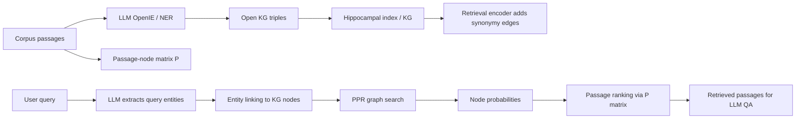

# HippoRAG: Neurobiologically Inspired Long-Term Memory for Large Language Models

- **Authors**: Bernal Jiménez Gutiérrez, Yiheng Shu, Yu Gu, Michihiro Yasunaga, Yu Su
- **Venue / year**: NeurIPS 2024
- **Core idea**: 把 RAG 的「外部資料庫」改造成一個近似 hippocampal index 的 **schemaless knowledge graph**，再用 **Personalized PageRank (PPR)** 做 single-step multi-hop retrieval，讓 LLM 能跨文件整合新知識。
- **Code / data**: https://github.com/OSU-NLP-Group/HippoRAG（目前 main README 以 HippoRAG 2 為主；原始 HippoRAG 1 可看 `legacy` branch）

## Direction tags

| Tag | 判斷 | 理由 |
|---|---|---|
| **Memory** | 強相關 | 這篇明確把 RAG 視為 LLM 的 non-parametric long-term memory，重點是如何寫入、組織與檢索新經驗。 |
| **Self-evolve** | 弱相關 / substrate | 系統可以持續把新 corpus 加進 KG，但沒有學習 policy、reflection 或自我改寫機制；比較像 self-evolving agent 的 memory substrate。 |
| **Proactivity** | 不直接相關 | HippoRAG 回答 query 時才 retrieve，沒有自主觸發、排程、initiative decision。 |

## 研究背景

LLM 的參數知識很強，但預訓練後要持續吸收大量新經驗仍然困難。常見替代方案是 **Retrieval-Augmented Generation (RAG)**：把新知識放在外部 corpus，query 時取回相關 passages，再交給 LLM 回答。

問題是，傳統 RAG 多半把每個 passage 單獨 encoding，適合找「語意相近」的文件，但不擅長處理需要**跨 passage 整合**的知識。例如：

> 找出「Stanford professor」且「研究 Alzheimer’s neuroscience」的人。

如果 corpus 裡沒有任何一段同時提到 Stanford 與 Alzheimer’s，dense retriever 很容易只抓到其中一邊。人類之所以能快速想到答案，是因為長期記憶中存在很多概念間的 association，而不是只靠 isolated text similarity。

這篇 paper 借用 **hippocampal memory indexing theory**：
- **neocortex**：處理與儲存感知 / 知識表徵
- **hippocampus**：維護指向記憶單元的 index，並保存 association
- **pattern separation**：把不同經驗分開表示
- **pattern completion**：從局部 cue 喚回完整相關記憶

HippoRAG 的核心直覺是：LLM 負責把文本轉成結構化概念與關係；KG 作為 hippocampal index；PPR 在圖上做 associative retrieval。

## 研究問題

這篇 paper 主要處理三個問題：

1. **RAG 如何更像 long-term memory？**  
   不只是把 documents 放進 vector DB，而是能把跨文件的概念關係累積成可重用的 memory structure。

2. **如何在 single-step retrieval 中做 multi-hop knowledge integration？**  
   目前多跳 QA 常需要 IRCoT 這類 iterative retrieve → reason → retrieve pipeline，成本與延遲都高。HippoRAG 想用一次 graph retrieval 取代多輪 LLM 推理。

3. **如何讓新增知識可持續整合，而不是每次重新 summarization 或 fine-tuning？**  
   相比 RAPTOR / GraphRAG 類 summarization-based indexing，HippoRAG 希望只要新增 KG nodes / edges，就能把新知識接入既有圖。

## 方法

### 1. 整體架構

HippoRAG 可以分成兩個 phase：

#### Modules

| Module | Paper 對應的 neurobiological role | 功能 |
|---|---|---|
| **Instruction-tuned LLM** | synthetic neocortex | 從 passages / query 抽 named entities 與 OpenIE triples。 |
| **Retrieval encoder** | synthetic parahippocampal regions (PHR) | 把相似但不完全相同的 noun phrases 連起來，形成 synonymy edges。 |
| **Knowledge graph** | artificial hippocampal index | 儲存 noun phrase nodes、relation edges、synonymy edges，作為外部長期記憶。 |
| **Personalized PageRank** | pattern completion mechanism | 以 query nodes 為 seeds，在 KG 上擴散 activation，找出共同相關的 subgraph。 |
| **Passage ranking layer** | hippocampus → neocortex recall | 將 node probability 聚合回 passages，決定要 retrieve 哪些文本。 |

### 2. Data structures / memory store

HippoRAG 的 memory 不是單純 vector store，而是三種結構的組合：

1. **Open KG**
   - Nodes `N`：由 passages 抽出的 named entities / noun phrases / concepts
   - Edges `E`：OpenIE triples 中的 relation edges
   - Synonymy edges `E'`：retrieval encoder 判斷 cosine similarity 超過 threshold `τ` 的 node pairs

2. **Passage-node matrix `P`**
   - 大小為 `|N| × |P|`
   - 記錄每個 noun phrase node 在每個 passage 出現幾次
   - PPR 得到 node scores 後，用這個矩陣轉成 passage scores

3. **Node specificity**
   - 類似 IDF 的局部重要性訊號
   - 定義為 `s_i = |P_i|^-1`，其中 `P_i` 是包含 node `i` 的 passage set
   - query node 越少見，seed probability 越被放大

### 3. Offline indexing：observe → write / consolidate

HippoRAG 的「寫入」發生在 offline indexing：

1. 將 corpus 切成 passages。
2. 對每個 passage 用 LLM 做 named entity extraction。
3. 把 named entities 放進 1-shot OpenIE prompt，抽出 triples。作者說這種 two-step prompt 能在 general concepts 與 named entities 之間取得較好平衡。
4. 把 triples 寫入 schemaless KG。
5. 用 Contriever 或 ColBERTv2 這類 retrieval encoder 對 noun phrases 做 embedding similarity，超過 threshold `τ=0.8` 就加 synonymy edge。
6. 建立 passage-node matrix `P`，保留 node 與原始 passage 的可追溯關係。

這裡的 consolidation 不是 reflection summary，而是**把多篇 passage 的概念關係合併到同一張 KG**。

### 4. Online retrieval：retrieve → use

query 進來後：

1. LLM 從 query 抽出 named entities，例如 `Stanford`、`Alzheimer’s`。
2. retrieval encoder 將 query entities link 到 KG 中最相似的 nodes，形成 query nodes `R_q`。
3. 以 query nodes 為 personalized seed distribution，在 KG 上跑 PPR。
4. PPR 會讓 probability mass 沿著 relation / synonymy edges 擴散，找到同時與多個 query cues 相關的 nodes。
5. 將 PPR node probability 乘上 passage-node matrix `P`，得到每個 passage 的 ranking score。
6. 取 top-k passages 給 QA reader / LLM 生成答案。

關鍵是：**multi-hop integration 發生在 graph search，而不是多輪 LLM prompting**。

### 5. Agent loop / planner / trigger policy / reflection mechanism

這篇不是 agent architecture paper，所以以下部分多數不適用：

- **Agent loop**：沒有完整 observe → plan → act → reflect loop；只有 indexing pipeline 與 query-time retrieval pipeline。
- **Planner**：沒有任務 planner；PPR 是固定 retrieval algorithm，不是 planning policy。
- **Trigger policy**：沒有自主判斷何時寫入 / 何時主動 retrieve；寫入由 corpus indexing 觸發，retrieve 由 user query 觸發。
- **Reflection / evolution mechanism**：沒有 Reflexion-style lesson generation，也沒有根據成功失敗改寫 memory policy。唯一接近 evolution 的地方是：新 passages 可以透過新增 KG triples / edges 持續接入既有 memory。
- **Forgetting**：沒有 explicit forgetting / pruning；paper 也指出 scalability 還需要進一步驗證。

## Lifecycle / mechanism 對照

| Lifecycle stage | HippoRAG 有沒有？ | 實作方式 |
|---|---:|---|
| **observe** | 有 | 讀入新 corpus passages。 |
| **write** | 有 | LLM OpenIE 抽 triples，寫入 open KG。 |
| **retrieve** | 有 | query entity linking + PPR graph search + passage ranking。 |
| **use** | 有 | retrieved passages 提供給 QA reader / LLM。 |
| **reflect / consolidate** | 部分 | 沒有語義反思；但 KG 會把跨 passage 的 concepts / relations 合併成 shared index。 |
| **update / forget / evolve** | 部分 / 缺 | 可新增 nodes / edges；沒有明確更新衝突處理、forgetting 或 learned memory policy。 |
| **decide whether to act** | 無 | 沒有 proactive decision 或 autonomous initiative。 |

## 貢獻

1. **提出一個神經生物啟發的 RAG-as-long-term-memory 架構**  
   HippoRAG 把 LLM、KG、PPR 組合成一個對應 hippocampal indexing theory 的 memory system。

2. **用 open KG 解決 isolated passage encoding 的限制**  
   傳統 RAG 通常只看 query-passage similarity；HippoRAG 透過 KG relation / synonymy edges，讓跨文件 association 可以在 retrieval 前就被保存。

3. **single-step multi-hop retrieval**  
   相比 IRCoT 這類 iterative retrieval，HippoRAG 在 query time 只需一次 graph search，就能完成部分 multi-hop retrieval。

4. **強調可持續整合的新知識**  
   新資料可透過新增 KG nodes / edges 進入 memory，不必直接改模型參數，也不一定要重新做大型 summarization hierarchy。

5. **提供可重現 code / data 與多組 ablation**  
   paper 與 GitHub repo 提供重現主要實驗、ablation、case study 的 scripts / data；這對 Ting 後續做 memory 系統 demo 很有參考價值。

## Evaluation / benchmark

### Tasks

作者主要評估 retrieval 與 QA：

- **MuSiQue answerable**：較難的 multi-hop QA
- **2WikiMultiHopQA**：entity-centric multi-hop QA
- **HotpotQA**：也納入比較，但作者指出它較容易受 spurious signals 影響，multi-hop reasoning 要求較弱
- 每個 validation set 抽 1,000 questions，並依 IRCoT 設定收集 supporting / distractor passages 形成 retrieval corpus。

### Metrics

- Retrieval：**Recall@2 / Recall@5**
- QA：**Exact Match (EM) / F1**
- 另有 **All-Recall (AR@k)**：衡量是否一次 retrieve 到所有 supporting passages，更能測 multi-hop retrieval 是否真的成功。

### Baselines

- Sparse / dense retrievers：BM25, Contriever, GTR, ColBERTv2
- LLM-augmented retrieval / indexing：Propositionizer, RAPTOR
- Iterative retrieval：IRCoT
- 組合設定：IRCoT + HippoRAG

### Key results

- **Single-step retrieval**：HippoRAG 在 MuSiQue 與 2WikiMultiHopQA 明顯優於 baselines；2WikiMultiHopQA 的 R@5 從 ColBERTv2 約 68.2 提升到 HippoRAG 約 89.1。
- **Multi-step retrieval**：HippoRAG 與 IRCoT 互補；IRCoT + HippoRAG 在三個資料集平均 R@5 最高。
- **QA performance**：retrieval improvement 會反映到 QA EM / F1；HippoRAG + IRCoT 在 2WikiMultiHopQA F1 提升尤其大。
- **Efficiency**：single-step HippoRAG 表現接近或優於 IRCoT，但 online retrieval 約 **10–30× cheaper**、**6–13× faster**。
- **All-Recall**：HippoRAG 在 MuSiQue / 2Wiki 的 all-supporting-passage retrieval 明顯更好，代表提升不是只靠撈到部分相關 passage。

### Ablations

| Ablation / variant | 結論 |
|---|---|
| REBEL as OpenIE | 表現大幅下降，表示 flexible LLM-based OpenIE 很重要。 |
| Llama-3.1-8B / 70B as OpenIE | 8B 多數情況接近 GPT-3.5；70B 在部分資料集更強，代表可降低 closed API dependency。 |
| Replace PPR with query nodes only | 表現下降，證明 graph diffusion / association 不只是裝飾。 |
| Remove node specificity | MuSiQue / HotpotQA 下降較明顯，類 IDF 訊號有用。 |
| Remove synonymy edges | 2Wiki 下降明顯，entity normalization / linking 對 entity-centric QA 很重要。 |

### 是否證明 long-term improvement / autonomous initiative？

- **Long-term improvement**：paper 證明的是「將新 corpus 建成 KG 後，retrieval 對跨文件知識整合更好」，不是 agent 長期互動中越來越強的 learning curve。
- **Autonomous initiative**：沒有證明。系統不會自主決定何時主動行動，也沒有 proactivity benchmark。
- **不只是 more context**：這點有被支持。HippoRAG 的增益來自 graph structure + PPR + node specificity / synonymy edges，而不只是把更多 passages 塞進 context。
- **不是 fixed scheduling**：沒有 scheduling component；retrieval 是 query-triggered。

## Reproducibility

### Repo availability

- Paper 宣稱 code and data available at OSU-NLP-Group/HippoRAG。
- 目前 GitHub main branch 已轉向 HippoRAG 2；README 明確連到 HippoRAG 1 的 `legacy` branch。
- Legacy README 提供：environment setup、custom data format、indexing scripts、retrieval scripts、IRCoT integration、ablation scripts、QA scripts、path-finding case study scripts。

### Toy reproduction requirements

最小 toy demo 可以不重跑完整 benchmark，只重現「single-step graph retrieval 找到跨文件答案」：

1. 準備 8–20 段短 passages，其中答案需要跨兩段或三段連接。
2. 用 OpenAI GPT 或本地 Llama 做 OpenIE / NER。
3. 用 Contriever 或 ColBERTv2 建 synonymy edges。
4. 跑 query entity linking + PPR。
5. 比較 BM25 / dense retrieval vs HippoRAG 是否能把 supporting passages 排進 top-k。

### Minimal demo idea

建立一個小型 researcher memory：

- Passage A：某研究者任職於某校
- Passage B：某研究者研究某疾病 / 技術
- Passage C：某校或研究方向的 distractors
- Query：「哪位某校教授研究某主題？」

如果 dense retriever 只抓到學校或主題其中一邊，而 HippoRAG 能因 KG path 把正確研究者排上來，就能展示核心貢獻。

## Borrowable ideas for Ting's AAAI direction

1. **把 memory store 從 chunk list 升級為 association graph**  
   Agent memory 不一定只存 episode summaries；可以把 user facts、tasks、research ideas、papers、failures 都抽成 nodes / edges，讓 retrieval 支援 multi-hop association。

2. **用 graph search 取代多輪 reflection / retrieval 的部分成本**  
   如果 AAAI direction 需要長期記憶檢索，PPR 類方法可作為 cheap first-pass retrieval，再交給 LLM rerank / reason。

3. **Memory 可分成 content store + index store**  
   原文 passage / episode 是 content；KG 是 hippocampal index。這個分離很適合 agent memory engineering：保留可追溯原文，同時建立可搜尋 association。

4. **All-Recall 是很好的 evaluation signal**  
   對 multi-hop memory retrieval，比單純 Recall@k 更能測「是否取回完整必要證據」。Ting 若做 agent memory，可設計「完成任務所需 memories 是否全部被 retrieve」的 metric。

5. **Node specificity 可改造成 personal memory salience**  
   HippoRAG 用 `|P_i|^-1` 代表少見概念更 specific；agent memory 可以加入 recency、importance、user-confirmed preference、task success/failure 等 salience weights。

6. **Path-finding questions 很適合做 agent memory benchmark**  
   不只是「根據 A 找 B」，而是「在很多可能關係中找出同時滿足多條 constraints 的記憶」。這很接近 personal assistant / research assistant 的真實需求。

7. **可作為 Self-evolve 的底層 substrate**  
   HippoRAG 本身不會 self-evolve，但可以接上一層 learned write policy / forgetting policy / proactive trigger，形成：episodic observation → graph memory update → retrieval → action → feedback → memory policy update。

## 結論

HippoRAG 的價值不在於「又一個 RAG pipeline」，而在於它把 long-term memory 的問題重新表述成：

> 如何把新知識組織成可持續更新、可跨文件聯想、可追溯回原文的 memory index？

它用 LLM OpenIE 建 KG，用 retrieval encoder 補 synonymy edges，再用 PPR 做 pattern completion，成功在 multi-hop QA 上取得比傳統 RAG 更好的 retrieval / QA performance，且 query-time 成本遠低於 iterative retrieval。

對 agent memory 研究來說，這篇很適合作為 **graph/KG-based long-term memory substrate** 的代表作；但它還不是完整 agent system，因為缺少自主寫入策略、反思、遺忘、長期互動 learning curve，以及 proactive action evaluation。

## Possible Gaps / Follow-up Ideas

### Attackable gaps

1. **OpenIE / NER 是主要瓶頸**  
   作者 error analysis 指出多數錯誤來自 NER / OpenIE。這代表 memory quality 高度依賴抽取器，若抽錯或漏抽，後面 PPR 再強也救不回來。

2. **Graph search 太 relation-agnostic**  
   PPR 主要看圖連通與 probability diffusion，沒有真正理解 edge relation type。未來可讓 relation semantics 影響 traversal，例如不同任務給不同 edge type 權重。

3. **Scalability 尚未充分證明**  
   實驗 corpus 雖比 toy 大，但距離真實長期 personal memory / web-scale corpus 還有差距。KG 持續膨脹後，PPR 成本、noise accumulation、entity duplication 都可能變嚴重。

4. **沒有 forgetting / conflict resolution**  
   長期記憶一定會遇到過期資訊、矛盾資訊、錯誤抽取；HippoRAG 沒有處理 memory decay、source trust、versioning。

5. **不處理 write policy**  
   paper 假設 corpus 已經要被 indexing；但 agent 系統需要決定哪些 observation 值得寫入、寫多細、何時 consolidate。

6. **缺少 autonomous initiative evaluation**  
   它能回答 query，但不能證明 agent 會主動發現該行動的時機。若 Ting 要做 proactivity，必須額外設計 trigger / decision layer。

### Follow-up ideas

1. **Learned salience-weighted HippoRAG**  
   把 node specificity 從固定 `1 / document frequency` 改成 learned salience：importance、recency、task relevance、user feedback、success contribution。

2. **Relation-aware PPR for agent memory**  
   讓 query intent 決定 edge type 權重。例如找研究 idea 時偏重 `extends / contradicts / evaluates`；找行程時偏重 `deadline / depends_on / assigned_to`。

3. **Memory lifecycle benchmark**  
   建立一組長期互動任務，測 observe → write → retrieve → act → feedback → update 是否讓 agent 在多天 / 多任務中變好，而不是只測一次 QA。

4. **Graph memory + reflection layer**  
   HippoRAG 負責 associative retrieval；LLM reflection 負責把 retrieval 結果轉成 lesson / policy update。這能補上 self-evolve 缺口。

5. **Forgetting-aware KG memory**  
   為 nodes / edges 加上 timestamp、source reliability、confidence、usage count，並設計 decay / pruning / conflict merge rules。

6. **Proactive trigger over graph memory**  
   在 KG 上偵測「未完成目標 + 新資訊 + 可行 action」的 pattern，讓 agent 不只是被 query 觸發，而是主動提醒或行動。
