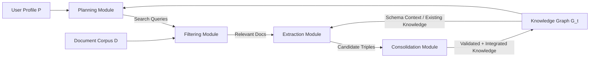

# KnoBuilder: An LLM-Agent for Autonomous and Personalized Knowledge Graph Construction from Unstructured Text

- **Authors**: Anonymous Author(s)
- **Venue**: NeurIPS 2025 workshop / OpenReview
- **Paper URL**: https://openreview.net/forum?id=teewCPCv2m
- **PDF**: https://openreview.net/pdf?id=teewCPCv2m
- **Code**: 未在 paper / OpenReview page 中看到公開 repo。

## Direction tags

| Direction | 判斷 | 原因 |
|---|---|---|
| **Memory** | **強相關** | KnoBuilder 把 Knowledge Graph 視為 agent 的 structured external memory，並讓 KG 狀態反過來指導下一輪 acquisition / extraction / consolidation。 |
| **Self-evolve** | **中到強相關** | graph 會隨新文件動態更新、entity merge、relation fusion、conflict resolution、representation update；但主要演化的是 knowledge store，不是 agent policy 本身。 |
| **Proactivity** | **中度相關** | planner 會主動根據 user profile 與 graph gaps 產生 search queries；但 paper 沒有完整處理「何時主動打擾使用者 / 採取外部行動」的 trigger policy。 |

> [!note] 一句話摘要
> KnoBuilder 是一個以 LLM agent 為核心的 personalized KG construction framework：agent 會根據 user profile 與目前 KG 的缺口規劃查詢、篩選文件、抽取 triples、驗證與修正，再把新知識透過 entity resolution / relation fusion / graph enrichment 整合回 KG，形成 agent 與 knowledge graph 共演化的 loop。

## Research Background

Knowledge Graphs 能把文字知識轉成 entities / relations，支援 semantic search、multi-hop reasoning、Graph RAG 與個人化知識管理。但傳統 KG construction 依賴人工標註、crowdsourcing 或 domain-specific NER / relation extraction pipeline，成本高且很難跟上新文獻速度。

LLM 看起來可以直接從 text 中抽取 entities 與 relations，但 paper 指出 one-shot LLM extraction 有三個核心問題：

1. **Inconsistency**：同一實體在不同文件被寫成不同節點，relation type 也可能漂移。
2. **Hallucination**：LLM 可能產生 source text 不支持的 triples。
3. **Lack of strategic focus**：被動處理文件，不知道目前 graph 缺什麼、下一步該讀什麼。

因此作者主張要把 LLM 從「一次性 extractor」提升成 **agentic knowledge curator**：能 plan、execute、validate、consolidate，並在每一輪利用已建立的 KG 來改善下一輪決策。

## Research Problem

這篇 paper 想解的問題是：**如何讓 LLM agent 從大量 unstructured text 中，自主建立一個符合使用者 profile 的 personalized knowledge graph，並且在長期迭代中維持 coverage、coherence 與 personalization？**

具體挑戰包括：

1. 如何根據 user interests 與現有 KG gaps 主動規劃 knowledge acquisition？
2. 如何避免 LLM extraction 的 hallucination 與 schema violation？
3. 如何把新 triples 整合進既有 graph，而不是只把資料 append 上去？
4. 如何處理 entity resolution、relation fusion、conflict resolution，讓 graph 保持 coherent？
5. 如何讓 KG 變成 agent 的 external memory，支援後續 query answering 與個人化推薦？

## Method

### 1. Overall formulation：sequential optimization for personalized KG construction

作者把任務形式化為 sequential optimization problem。第 $t$ 步的 KG 為：

$$
G_t = (V_t, E_t, \phi_t)
$$

其中 $V_t$ 是 entities，$E_t \subseteq V_t \times R \times V_t$ 是 typed relations，$\phi_t$ 是 entity / edge feature mapping。User profile $P$ 被建模成 topic、entity、relation interests 的 multivariate distribution，可由使用者明確指定或從互動歷史學得。

目標是最大化：

$$
\max_\pi \mathbb{E}\left[\sum_{t=0}^{T} \gamma^t U(G_t, P) - \lambda C(\pi_t)\right]
$$

utility 拆成三部分：

$$
U(G, P) = \alpha \cdot Coverage(G, P) + \beta \cdot Coherence(G) + \eta \cdot Personalization(G, P)
$$

這個 formulation 的重點是：agent 不只是追求抽越多 triples 越好，而是要在 **coverage / coherence / personalization / cost** 之間取捨。

### 2. Architecture：四個循環模組

Paper 的 Figure 1 描述了 KnoBuilder 的 agentic workflow。整體 loop 是：

四個模組各自負責：

| Module | 角色 | 核心輸入 | 核心輸出 |
|---|---|---|---|
| **Planning Module** | 決定下一輪要查什麼 / 補什麼知識 | user profile、current KG、knowledge gaps | search queries |
| **Filtering Module** | 選出值得處理的文件 | retrieved documents、profile、KG novelty | relevant documents |
| **Extraction Module** | 從文件抽取 schema-guided triples，並自我驗證 | relevant docs、ontology、KG context | validated candidate triples |
| **Consolidation Module** | 將 triples 整合回 graph | validated triples、existing KG | updated KG |

這裡最重要的設計是：**KG 不是被動儲存結果，而是每輪 decision 的 state representation / external memory。** Planning 會看 graph gaps，Extraction 會用 existing KG 做 grounding，Consolidation 會更新 KG，下一輪又使用更新後的 KG。

### 3. Planning Module：strategic knowledge acquisition

Planning Module 會在每個 timestep 產生一組 queries：

$$
Q_t = \{q_1, q_2, ..., q_k\}
$$

query 的 reward function 同時考慮 novelty、relevance、coverage：

$$
R(q) = \theta_{novelty}N(q, G_t) + \theta_{relevance}Sim(q, P) + \theta_{coverage}C(q, G_t)
$$

- $N(q, G_t)$：query 預期會帶來多少目前 graph 沒有的新知識。
- $Sim(q, P)$：query 與 user profile 的 semantic similarity。
- $C(q, G_t)$：query 可能補上多少 current graph structural gaps。

作者把這視為 multi-armed bandit：不同 queries 是 arms，系統在 exploration / exploitation 之間調整。早期 graph 還稀疏時提高 novelty；後期 graph 成熟後提高 coverage / consolidation。

Planner 會使用 LLM 分析：

- weakly connected components；
- relation sparse entities；
- emerging topics；
- user profile 中尚未充分覆蓋的 topics。

### 4. Filtering Module：relevance / novelty / credibility filtering

Filtering Module 對 retrieved documents 做多面向評分，決定哪些文件進入 extraction。Paper 描述的 scoring dimensions 包括：

1. **Topical alignment**：文件是否符合 user profile。
2. **Novelty relative to existing KG**：文件是否提供 KG 中缺少的內容。
3. **Source credibility**：來源可信度。

這一層使 KnoBuilder 不只是「搜尋後全吃」，而是把 acquisition budget 用在最可能補 graph gaps 的文本上。

### 5. Extraction Module：schema-guided + self-refining extraction

給定 document $d$，Extraction Module 先用 predefined ontology 約束 LLM 產生 candidate triples：

$$
T_{candidate} = \{(s_i, r_i, o_i)\}
$$

接著用三階段 self-refinement 改善 extraction quality：

#### 5.1 Consistency validation

每個 triple $t$ 會被打分：

$$
V(t) = \lambda_1 BERTScore(t, d) + \lambda_2 EntityAlignment(t, d) + \lambda_3 RelationPlausibility(t, G_t)
$$

- **BERTScore**：triple 是否語意上被 source document 支持。
- **EntityAlignment**：triple 中 entities 是否真的出現在 / 對齊 source text。
- **RelationPlausibility**：relation 是否符合 existing KG 與 ontology。

低於 threshold $\tau_v$ 的 triples 會被丟棄，或交給 LLM 進一步 reasoning / refinement。

#### 5.2 Conflict resolution

新 triples 若與 $G_t$ 中既有 knowledge 矛盾，系統會做 evidence-based arbitration，考慮：

- source credibility；
- temporal recency；
- supporting context；
- validation score。

這對 agent memory 很關鍵：不是「新記憶覆蓋舊記憶」，而是要留下 provenance / evidence，判斷哪個 relation 可信。

#### 5.3 Completeness assessment

系統會檢查 document discourse structure，找可能漏掉的 relations，尤其是與 already-known entities 相關的 relations。這等於用 existing KG 反過來提醒 extractor：「這篇文件中提到的已知 entity 可能還有新的 relation 沒抽到」。

### 6. Consolidation Module：entity resolution、relation fusion、graph enrichment

Consolidation Module 負責把 validated triples 整合回 KG，而不是單純 append。

#### 6.1 Entity resolution

Paper 使用 multi-view similarity function：

$$
Sim(e_i, e_j) = w_{text}f_{text}(e_i, e_j) + w_{type}f_{type}(e_i, e_j) + w_{context}f_{context}(e_i, e_j, G_t)
$$

三種 view：

| View | 意義 |
|---|---|
| $f_{text}$ | name similarity，包含 character-based 與 embedding-based matching。 |
| $f_{type}$ | entity type 是否一致。 |
| $f_{context}$ | graph neighborhood 是否相似，也就是 structural equivalence。 |

若 similarity 超過 threshold $\tau_e$，entities 會被 merge，且保留 relationship histories。

#### 6.2 Relation fusion

對 redundant / complementary relations，系統使用 quality-weighted aggregation，偏好：

- higher validation score；
- more credible source；
- better supported context。

這能把多份文件中的相似 relation 合成較可信的 graph edge。

#### 6.3 Graph enrichment

最後，系統透過 semantic propagation / pattern completion 推論潛在新關係，並使用 graph neural networks 學習 entity representations，讓 embeddings 同時包含 structural 與 attribute information。

### 7. Implementation details

Paper 描述的 implementation：

- **Orchestration**：Python + LangChain。
- **Graph database**：Neo4j。
- **Core LLM**：GPT-4。
- **Temperature**：planning / extraction 使用 $t=0.1$；query generation 使用 $t=0.3$。
- **Utility weights**：$\alpha=0.4, \beta=0.3, \eta=0.3$。
- **Validation threshold**：$\tau_v=0.7$。
- **Entity merge threshold**：$\tau_e=0.85$。
- **Queries per iteration**：$k=5$。
- **Embedding dimension**：Transformer-based embeddings, $d=768$。
- **Representation update**：momentum-based update，$\mu=0.9$，平衡 stability / plasticity。

> [!warning] 實作不確定性
> Paper 給了架構與參數，但沒有提供 code repo、prompt templates、Neo4j schema、GNN architecture、document retrieval setup 或完整 annotation protocol。這讓 reproduction 會比方法描述看起來困難。

## Lifecycle / Mechanism

以 agent memory 角度重寫 KnoBuilder 的 lifecycle：

```mermaid
flowchart LR
    A[Observe: corpus docs / user profile / current KG] --> B[Write: extract schema-guided triples]
    B --> C[Retrieve: use KG gaps + existing entities as context]
    C --> D[Use: support query answering / recommendation / next planning]
    D --> E[Reflect: validate triples, detect conflicts, assess completeness]
    E --> F[Consolidate: entity resolution + relation fusion + graph enrichment]
    F --> G[Update / Evolve: update KG + entity embeddings + relation histories]
    G --> H[Forget: no explicit forgetting; mainly merge / discard invalid triples]
    H --> I[Decide whether to act: planner chooses next search queries, not user-facing actions]
    I --> A
```

KnoBuilder 覆蓋得最完整的是 **observe → write → reflect/consolidate → update/evolve → retrieve/use**。但「forget」主要是 validation 後 discard 或 merge，沒有提出 explicit forgetting / decay / privacy deletion；「decide whether to act」限於下一輪 query planning，還不是主動對使用者採取行動。

## Contribution

1. **Holistic agentic KG construction loop**：把 strategic planning、filtering、self-refining extraction、dynamic consolidation 統一在一個 autonomous loop 中，而不是分開做。
2. **KG as evolving external memory**：KG 同時是產物與 agent state，能反過來指導 query generation、extraction grounding 與 conflict resolution。
3. **Personalized objective**：明確把 user profile 納入 utility function，讓 KG construction 追求 personalized coverage，而不是 generic corpus coverage。
4. **Self-refining extraction mechanism**：用 source grounding、entity alignment、relation plausibility 等 validation 分數降低 hallucination。
5. **Dynamic consolidation mechanism**：提供 entity resolution、relation fusion、graph enrichment，讓 graph 維持 coherence 與 non-redundancy。
6. **Multi-dimensional evaluation**：同時評估 acquisition efficiency、extraction quality、entity resolution、graph consistency、multi-hop QA 等面向。

## Conclusion

KnoBuilder 的結論是：高品質 personalized KG 不能靠一次性 LLM extraction 建成，而需要一個能持續規劃、抽取、驗證、整合的 agentic loop。實驗顯示 KnoBuilder 在 extraction F1、entity resolution、graph consistency 與 complex QA 上都優於 Naive-LLM、Supervised-IE、REBEL-Adapted、Graph-RAG 等 baselines。

對 Ting 的方向來說，這篇 paper 的價值不是「KG construction 本身」，而是它把 agent memory 的幾個核心問題具體化：**schema / ontology、merge、validate、conflict resolution、graph evolution、query planning**。這些正好能轉譯成 long-term agent memory system 的設計語言。

## Reproducibility

### Paper 可復現資訊

- 有 OpenReview page 與 PDF。
- 有列出 datasets、baselines、metrics 與主要參數。
- 有列出 backend / LLM / thresholds：LangChain、Neo4j、GPT-4、$\tau_v=0.7$、$\tau_e=0.85$、$k=5$ 等。

### 缺少的關鍵細節

| 缺口 | 影響 |
|---|---|
| 無 code repo | 很難確認 module orchestration 與 prompt 實作。 |
| 無 prompt templates | self-refinement、conflict arbitration、query generation 無法精確重現。 |
| Neo4j schema 未完整列出 | entity / relation / provenance / confidence 的資料結構不清楚。 |
| GNN enrichment 描述不足 | 不知道使用哪種 GNN、訓練資料、loss、更新頻率。 |
| Human annotation protocol 不明 | extraction gold standard / consistency score 的評估可信度需保留。 |
| 成本分析不足 | GPT-4 多輪 planning + validation + consolidation 成本可能很高。 |

### Minimal reproduction idea

若要做一個 Ting 可用的小型 demo，可先不做完整 GNN enrichment：

1. 選 50-100 篇 AAAI / agent memory 相關 abstracts。
2. 定義簡單 ontology：`Paper`、`Method`、`MemoryType`、`EvaluationTask`、`Dataset`、`Limitation`。
3. 用 LLM 抽 triples，保留 source sentence / confidence / timestamp。
4. 實作三個版本：
   - **Naive extraction**：每篇 abstract 一次抽取後 append。
   - **+ validation**：用 source grounding 檢查 triples。
   - **+ consolidation**：entity resolution + relation fusion。
5. 評估：duplicate entity rate、manual triple precision、multi-hop query success、更新後 graph consistency。
6. 額外加 planner：讓系統根據 sparse entities 產生下一批 paper search query。

## Evaluation / Benchmark

### Datasets

| Dataset | 用途 | 規模 / 特性 |
|---|---|---|
| **ArXiv metadata corpus** | 主實驗，測 personalized KG construction | 2.3M scholarly papers；使用 cs.* subset 約 800k papers, 2018-2024。 |
| **SciERC** | 測 scientific relation extraction | 500 abstracts；2,687 entities；695 relations；含 Used-for、Feature-of、Compare、Part-of 等 relations。 |
| **T-REx subset** | 測 general domain extraction | 3M text-triple pairs，對齊 Wikipedia snippets 與 DBpedia triples。 |

### Baselines

| Baseline | 代表意義 |
|---|---|
| **Naive-LLM** | GPT-4 one-shot extraction；沒有 planning、self-correction、consolidation。 |
| **Supervised-IE** | SciSpacy NER + BioBERT relation extraction。 |
| **REBEL-Adapted** | end-to-end relation extraction model，fine-tuned 到 scientific schema。 |
| **Graph-RAG** | contemporary LLM + graph construction / retrieval framework；同樣使用 GPT-4 + Neo4j 以控制 backend 差異。 |

### Metrics and key results

| 面向 | KnoBuilder 結果 | 對照 / 解讀 |
|---|---:|---|
| **Knowledge acquisition efficiency** | Novelty 0.78、Coverage Gain 0.85、Redundancy 0.12、42 queries to saturation | 相比 Naive-LLM 78 queries，約 46% acquisition efficiency improvement。 |
| **Extraction quality** | Precision 0.89、Recall 0.82、F1 0.85、Hallucination 0.04、Schema Compliance 0.96 | hallucination rate 明顯低於 Naive-LLM 0.15。 |
| **Consolidation** | Entity Resolution F1 0.91、Graph Density 2.8、Connectedness 0.94、Consistency 0.96 | 顯示 entity merge + relation fusion 有助於 coherent graph。 |
| **Complex QA** | Simple QA F1 0.92、Multi-hop QA F1 0.85、Reasoning Depth 3.2、Response Time 2.1s | multi-hop QA 明顯優於 Naive-LLM 0.62 與 Graph-RAG 0.79。 |

### Useful figure / table references

- **Figure 1**：最值得保留的架構圖，呈現 User Profile、Planning、Filtering、Extraction、Consolidation、Knowledge Graph 之間的 cyclic workflow。筆記中已用 Mermaid 重畫概念版，避免直接複製圖片。
- **Table 1**：acquisition efficiency，適合引用來說明 planner 的效果。
- **Table 2**：extraction quality，最能支持 self-refining validation 的價值。
- **Table 3**：consolidation effectiveness，對 memory merge / entity resolution 方向最有用。
- **Table 4**：complex QA，顯示 graph coherence 對 downstream multi-hop reasoning 的影響。

> [!warning] Evaluation caveat
> 數字看起來完整，但 paper 缺少足夠 replication detail；尤其 human annotation、prompt、retrieval pipeline、Graph-RAG baseline configuration、GNN enrichment 設定都不透明。因此這些結果適合作為「機制靈感與初步 evidence」，不宜直接當作強定論。

## Borrowable Ideas for Ting's AAAI Direction

1. **Memory store 需要 lifecycle，而不是單次 write / retrieve**
   KnoBuilder 的價值在於把 acquisition、validation、consolidation、update 放進 loop。Ting 的 agent memory 題目也可以主打：memory 不是 vector DB，而是一個會被維護的 evolving system。

2. **Graph gap-driven proactivity**
   Planner 根據 weakly connected components、sparse entities、missing relations 產生 search queries。這可以轉成 agent memory 的 proactive trigger：當某些 user goal / entity / preference 的 evidence 太少或矛盾時，agent 主動詢問或蒐集資料。

3. **Validation score 作為 memory write gate**
   把 $V(t)$ 的概念借到 memory：每條 memory claim 都有 grounding score、entity alignment score、plausibility score。低分 claim 不直接寫入 long-term memory，而是進入 pending / needs-confirmation 狀態。

4. **Entity resolution = personal memory 的 identity merge 問題**
   Agent 長期記憶中常見同義詞與指稱問題，例如同一個 project、paper、person 有多種叫法。KnoBuilder 的 multi-view similarity 可改成：name similarity + type consistency + interaction context + temporal continuity。

5. **Relation fusion = contradictory preference management**
   Personal memory 中 user preference 會變。Relation fusion 可以加入 temporal recency 與 evidence quality，避免舊偏好永遠覆蓋新偏好，也避免單次偶然訊息過度改寫長期模型。

6. **Coherence metrics for agent memory**
   不只測 QA F1，也測 memory graph density、connectedness、consistency、duplicate rate、conflict rate。這些指標很適合寫成 AAAI paper 的 intrinsic memory quality evaluation。

7. **Stability-plasticity framing**
   Paper 的 momentum update $\mu=0.9$ 可以借來談 agent memory 的 stability / plasticity：新資訊要能更新記憶，但不能讓整個 memory representation 被單次 noisy input 拉走。

8. **Personalized ontology / schema**
   KnoBuilder 預設 ontology 會約束 triples。Ting 可以延伸成 user-specific memory ontology，例如 `Preference`、`Goal`、`Constraint`、`Routine`、`Project`、`Relationship`、`Correction`，並研究 schema 如何自動擴充。

## Attackable Gaps / Follow-up Ideas

1. **沒有真正的 forgetting mechanism**
   Paper 主要處理 discard invalid triples、merge duplicate entities，但沒有 memory decay、privacy-aware forgetting、user-requested deletion、obsolete belief invalidation。

2. **Personalization 定義偏抽象**
   User profile $P$ 被描述成 topics / entities / relations distribution，但 paper 沒有細說 profile 如何從 interaction history 學得、如何更新、如何避免 over-personalization。

3. **Proactivity 停在 search query planning**
   KnoBuilder 會主動搜尋文件，但沒有處理 agent 何時應該問使用者、提醒使用者、執行工具或延後行動。這正好可作為 Ting 的 proactivity gap。

4. **Conflict resolution 缺少可審計資料結構**
   Paper 說會考慮 source credibility、recency、supporting context，但沒有完整設計 provenance graph / evidence trail。個人 agent memory 很需要可追溯：「我為什麼記得這件事？」

5. **Self-evolution 主要是 KG-level，不是 policy-level**
   Graph 會更新，但 agent 的 planning policy、trigger policy、tool-use strategy 是否隨經驗改善並不清楚。可延伸成 memory evolution 如何回饋 decision evolution。

6. **Evaluation 可能過於理想化**
   結果非常漂亮，但缺少 code 與設定細節，應該質疑是否有 prompt leakage、manual tuning、baseline under-configuration 或 dataset-specific optimization。

7. **GNN enrichment 描述不足**
   Paper 突然引入 GNN 做 semantic propagation / pattern completion，但沒交代 architecture / training objective / ablation，這部分是最容易被 attack 的 method gap。

8. **Ontology rigidity vs open-world memory**
   Schema-guided extraction 能降低 hallucination，但 personal agent memory 很多資訊是 open-ended 的。後續可研究 ontology expansion：何時新增 entity type / relation type？如何避免 schema drift？

9. **Cost and latency 未充分討論**
   每輪都 planning、filtering、extracting、validating、consolidating，使用 GPT-4 + Neo4j + embeddings + possible GNN，長期成本可能很高。需要 adaptive trigger / budget-aware memory maintenance。

10. **缺少 human-in-the-loop correction path**
   Personalized KG 一旦合錯 entity 或寫入錯誤 relation，使用者應該能修正。Paper 沒有設計 correction 如何傳播到 graph、embeddings 與 future planner。
