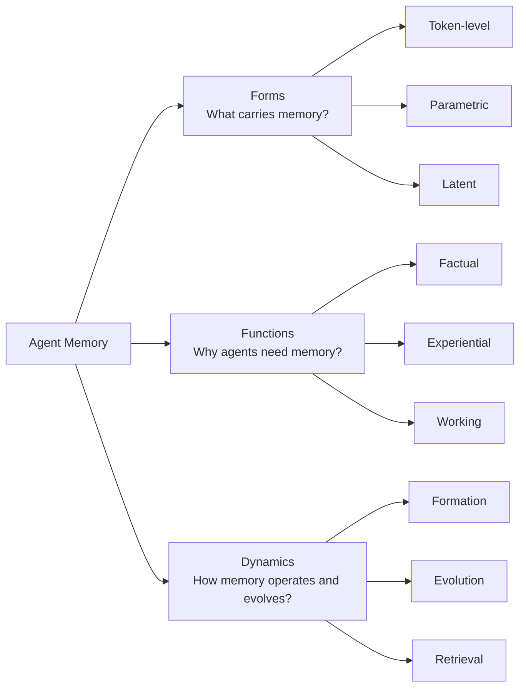
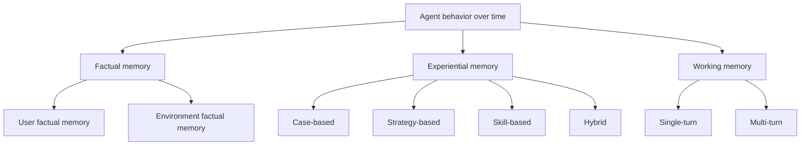
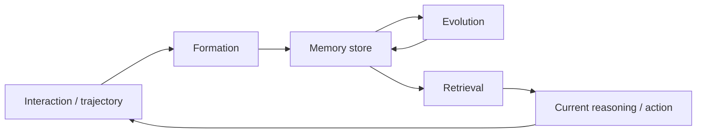

## Research Background

隨著 LLM-based agents 從單輪問答走向長時間、可持續互動的系統，**memory** 已經從加分模組變成核心能力。沒有 memory，agent 很難做到：
- 記住使用者偏好與長期目標
- 累積任務經驗、避免一直犯同樣錯
- 維持長程對話、角色、任務狀態的一致性
- 在未來任務中重用過去學到的策略、技能與世界模型

但目前 agent memory 研究很容易混亂，因為很多東西都被叫做 memory：
- context window 內的暫時資訊
- 外部 knowledge base / vector database
- RAG 檢索結果
- long-term user profile
- fine-tuning 後的參數知識
- latent state / recurrent state / KV cache
- tool library / code skill / API memory

這篇 survey 的價值在於：它不是只列 memory methods，而是試圖回答一個更根本的問題——**在 AI agents 時代，memory 到底是什麼、扮演什麼功能、又是怎麼運作與演化的？**

> [!info] 核心觀點
> 傳統的 short-term / long-term memory 二分法，已經不足以描述現代 agent memory。
> 作者主張應改用 **Forms / Functions / Dynamics** 三個視角重新理解整個領域：
> - **Forms**：memory 由什麼載體承載？存在 token、參數，還是 latent state？
> - **Functions**：memory 是為了幫 agent 做什麼？記 fact、存經驗，還是支撐當下推理？
> - **Dynamics**：memory 如何形成、更新、遺忘、檢索，並驅動 agent 自我演化？

## Research Problem

這篇 survey 主要處理五個層次的問題：

1. **Scope definition**：什麼才算是 agent memory？
2. **Conceptual boundary**：agent memory 跟 LLM memory、RAG、context engineering 差在哪？
3. **Structural taxonomy**：memory 到底以什麼形式存在？
4. **Functional taxonomy**：memory 為什麼存在？它是為了幫 agent 做什麼？
5. **Operational dynamics**：memory 是如何被建立、更新、遺忘、檢索與重組的？

> [!info] Agent memory 和幾個常混淆概念的差別
> **1) Agent Memory vs. LLM Memory**
> - **LLM memory** 通常指模型參數中隱含保留的知識，或 inference 過程中的上下文依賴。
> - **Agent memory** 更強調可持續、可操作、跨互動存在的記憶系統，常包含外部 storage、更新策略與 retrieval policy。
>
> **2) Agent Memory vs. RAG**
> - **RAG** 重點是從外部知識庫取回「相關資訊」。
> - **Agent memory** 不只是 retrieve facts，還要處理經驗、策略、技能、偏好、工作狀態，以及長期演化。
>
> **3) Agent Memory vs. Context Engineering**
> - **Context engineering** 重點是把當下最有用的資訊塞進 prompt。
> - **Agent memory** 更進一步關心：哪些資訊值得留下、何時更新、如何壓縮、怎麼遺忘、未來何時再調出來。

## Method

作者的整理方式可以看成一個三層地圖：

1. **Forms**：memory 的「物理 / 表徵載體」是什麼？
2. **Functions**：memory 的「認知功能」是什麼？
3. **Dynamics**：memory 的「生命週期操作」是什麼？

### 1. Forms：What Carries Memory?

作者先回答「記憶載體是什麼」。他們提出三種主要 forms：

| Form | 定義 | 直覺理解 | 優點 | 代價 / 風險 |
| --- | --- | --- | --- | --- |
| **Token-level memory** | 以外顯、離散、可讀寫單位儲存記憶 | 筆記、chunks、dialogue logs、KG、memory graph | 可編輯、可檢查、可檢索、可追溯 | 受 retrieval 品質限制；大型 memory 會有雜訊與冗餘 |
| **Parametric memory** | 記憶被內化到模型參數中 | 把知識 / 經驗學進 model weights 或 adapter | 推理時自然使用、低顯式管理成本、可泛化 | 難編輯、難追溯、更新成本高、可能 catastrophic forgetting |
| **Latent memory** | 記憶存在 hidden states、KV cache、latent embeddings | 模型內部暫態 / machine-native memory | token-efficient、適合 multimodal、延遲低、語意密度高 | 人類不可讀、難 debug、壓縮可能遺失資訊 |

> [!tip] 一句話記住這張表
> **Token-level 最像外部筆記，Parametric 最像內化習慣，Latent 最像工作中的腦內暫態。**

#### 1.1 Token-level memory：外顯、離散、可操作的記憶
![[Pasted image 20260506155806.png]]

Token-level memory 的重點是：memory 被存成外部可讀寫的離散單位。這裡的 token 不限文字 token，也可以是 visual tokens、audio frames、chunks、trajectory records、structured entries 等。

作者不是只說「有外部記憶」而已，而是按照 **inter-unit topology**（記憶單元之間有沒有結構）分成三類：

| Token-level type | 結構 | 代表用途 | 優點 | 主要限制 |
| --- | --- | --- | --- | --- |
| **Flat Memory (1D)** | 沒有明確拓撲；像 sequence、bag、pool | dialogue logs、user profile、experience trajectories、multimodal chunks | append / prune 成本低；容易用 similarity search | 單元之間關係不明；長期會累積冗餘與雜訊；不利 multi-hop reasoning |
| **Planar Memory (2D)** | 單層結構；graph、tree、table、key-value、timeline | KG memory、persona graph、reasoning tree、timeline memory | 能表達關聯、因果、語義群組；支援 relational traversal | 若沒有階層，所有東西仍擠在單一平面；構建與搜尋成本高 |
| **Hierarchical Memory (3D)** | 多層、多粒度、跨層連結 | pyramids、multi-layer graphs、semantic/episodic hierarchy | 可由粗到細 retrieval；支援跨抽象層推理 | 架構複雜；維護與檢索成本高；3D layout 難設計 |

##### Flat Memory (1D)

Flat memory 是最常見的 token-level memory：把記憶存在一個 pool / list / vector DB 裡，不明確建模記憶彼此的 semantic 或 relational dependencies。

作者在 flat memory 下面其實又整理了幾個常見目的：

| Flat memory 子類 | 存什麼 | 作用 | 例子 / 典型設計 |
| --- | --- | --- | --- |
| **Dialogue memory** | 對話歷史、summary、memos、QA pairs | 維持長對話一致性與上下文連續性 | MemGPT、MemoryBank、Mem0、RMM、COMEDY |
| **Preference memory** | user tastes、interests、decision patterns | recommendation / personalization | RecMind、InteRecAgent、Memocrs |
| **Profile memory** | 穩定 user profile、persona、角色設定 | 長期身份一致、role-playing consistency | MemoryBank、MPC、ChatHaruhi、RoleLLM |
| **Experience memory** | action trajectories、success / failure cases、feedback | 讓 agent 之後重用過去做法 | Reflexion、ExpeL、AWM、ReasoningBank、Voyager |
| **Multimodal memory** | image / video / audio / embodied sensor chunks | 長期 multimodal QA、navigation、video understanding | Ego-LLaVA、VideoAgent、KARMA、Mem2Ego |

Flat memory 的關鍵問題是：它能「存很多」，但不一定「理解彼此關係」。因此 retrieval 常變成 bottleneck：如果 top-k 找錯、找太多、或找出來的東西彼此矛盾，agent 的 reasoning 就會被干擾。

##### Planar Memory (2D)

Planar memory 在單一平面內建立明確拓撲，讓 memory 從「一堆資料」變成「有組織的資料」。作者整理三種常見形式：

| Planar 子類  | 核心做法                                                             | 適合處理                                                               | 代表方向                                    |
| ---------- | ---------------------------------------------------------------- | ------------------------------------------------------------------ | --------------------------------------- |
| **Tree**   | 用 parent-child / aggregation tree 組織 chunks 或 conversation       | coarse-to-fine retrieval、長文本 / 長對話摘要                               | HAT、MemTree                             |
| **Graph**  | 用 nodes / edges 表示 entity、relation、temporal、causal、persona links | multi-hop reasoning、personalization、KG QA、multimodal entity memory | Ret-LLM、KGT、PREMem、A-Mem、M3-Agent、COMET |
| **Hybrid** | 結合不同 cognitive modules，共用一個結構化 memory substrate                  | 同時需要 factual memory、experience pool、reasoning tree                 | Optimus-1、D-SMART                       |

Planar memory 的核心突破是 **linking**：memory units 之間可以互相支援，retrieval 不只靠 similarity search，而可以沿著 edge traversal、key-value lookup、graph search 取得更精準的上下文。

但作者也指出：2D memory 若沒有階層，仍容易變成單一巨大結構。任務越複雜，graph 越大，construction / search cost 越高。

##### Hierarchical Memory (3D)

Hierarchical memory 將記憶放在多層結構中，支援不同抽象層級之間的垂直移動。它不是只有「分類資料夾」，而是讓 memory 形成一個可以 lateral + vertical traversal 的 volumetric space。

| Hierarchical 子類 | 核心做法                                                                      | 優勢                                                        | 代表方向                                         |
| --------------- | ------------------------------------------------------------------------- | --------------------------------------------------------- | -------------------------------------------- |
| **Pyramid**     | 由 raw observations → event summaries → community / insight summaries 逐層抽象 | coarse-to-fine retrieval；先找高層摘要再下鑽細節                      | HiAgent、GraphRAG、Zep、ILM-TR、EMG-RAG、G-Memory |
| **Multi-Layer** | 不同層負責不同資訊型態或功能                                                            | 將 semantic、episodic、passage、sentence graph、topic graph 分層 | H-Mem、HippoRAG、AriGraph、SGMem、CAM            |

> [!important] 這裡是作者 taxonomy 裡很重要但原筆記容易漏掉的點
> Token-level memory 不是只有「外部文字記憶」。作者真正關心的是 **topology complexity**：
> - 1D：只是一堆記憶
> - 2D：記憶之間有一層關係
> - 3D：記憶同時有多層抽象與跨層關係

#### 1.2 Parametric memory：把記憶內化到參數

Parametric memory 指資訊被編碼在 model parameters 裡，而不是外部 tokens。作者依照 memory 是否寫進 base model 參數，分成兩大類：

| Parametric type | 存在哪裡 | 代表方法 | 優點 | 限制 |
| --- | --- | --- | --- | --- |
| **Internal Parametric Memory** | 原始模型 weights / biases | pre-train、mid-train、post-train、model editing | 沒有額外 retrieval overhead；推理自然使用 | 更新困難、成本高、容易干擾舊知識 |
| **External Parametric Memory** | 額外 adapter、LoRA、auxiliary model、side module | K-Adapter、WISE、ELDER、MLP-Memory、Retroformer | 模組化、可替換、比直接改 base model 安全 | 仍需和模型內部表徵對接；效果取決於 routing / integration |

##### Internal Parametric Memory

作者再依照 memory injection timing 分成：

| 階段 | 做什麼 | 適合記憶 |
| --- | --- | --- |
| **Pre-train phase** | 在預訓練中學入長尾知識、長上下文 priors、retrieval priors | 大規模 domain / world priors |
| **Mid-train phase** | continued pretraining，引入 agent experience 或長窗能力 | downstream agent experience、tool-use priors |
| **Post-train phase** | fine-tuning / model editing / KL distillation | persona、specific facts、任務風格、拒答規範 |

內部參數記憶適合「需要變成模型本能」的能力，例如 domain expertise、role-playing style、reasoning priors；不適合頻繁變動的 user memory，因為更新太重且難 rollback。

##### External Parametric Memory

作者整理兩種：

| 子類 | 核心想法 | 說明 |
| --- | --- | --- |
| **Adapter-based modules** | frozen base model + 外掛參數模組 | 用 adapter / LoRA / patcher 存新知識，避免直接破壞 base model |
| **Auxiliary LM-based modules** | 另一個模型或 amortization network 承載 memory | 用小模型 / side network 壓縮新文件或過去經驗，再影響主模型 |

External parametric memory 是 token-level 與 internal parametric 的折衷：比外部文字記憶更貼近模型內部表徵，又比直接改 base model 更容易管理。

#### 1.3 Latent memory：機器原生、不可讀但高密度的記憶

Latent memory 指 memory 存在 KV cache、activations、hidden states、latent embeddings 等內部表徵。作者依照 latent state 的來源分成三類：
![[Pasted image 20260507113047.png]]

| Latent type | 記憶怎麼來 | 代表用途 | 優勢 | 風險 |
| --- | --- | --- | --- | --- |
| **Generate** | 由 auxiliary model / encoder 產生新的 latent tokens / vectors | long-context compression、multimodal memory、persistent latent tokens | 主動生成高密度 representation | 生成過程可能 loss / bias；需額外訓練 |
| **Reuse** | 直接重用先前 forward pass 的 KV cache / activations | long-range retrieval、stateful inference | 保留原始內部訊號 fidelity | KV cache 會快速膨脹；需要 indexing |
| **Transform** | 對既有 latent states 做 selection、merging、projection、compression | KV compression、efficient long context | 壓縮 storage / latency | 壓縮後更難解釋，也可能丟失資訊 |

##### Generate

Generate 類方法會把長上下文、trajectory 或 multimodal input 壓成少量 latent memory units。例如：
- **Single-modal**：gist tokens、summary vectors、memory tokens、latent token pools、matrix slots。
- **Multimodal**：將 vision-language input、GUI trajectory、video patches、embodied perceptual states 壓成 embeddings。

它的設計邏輯是：與其每次重讀所有原始資料，不如生成一個可重用的 machine-native summary。

##### Reuse

Reuse 類方法不產生新的 representation，而是把模型之前算過的 KV pairs / activations 直接當記憶。這類方法最大好處是 fidelity 高，因為沒有額外 summarization 或 compression；但 KV cache 會隨 context 長度快速成長，所以需要決定：哪些 KV 要留？怎麼索引？怎麼檢索？

##### Transform

Transform 類方法把既有 latent states 重新塑形，例如 pruning、aggregation、layer-wise budget allocation、heavy-hitter token retention、reversible compression 等。它介於 generate 和 reuse 之間：不是重造記憶，也不是原樣 replay，而是把原本的 latent memory 壓成更有效率的形式。

#### 1.4 Forms 的 practical adaptation

作者最後不是只列分類，也討論各 form 適合什麼場景：

| Form | 適合場景 | 原因 |
| --- | --- | --- |
| **Token-level** | 多輪對話、個人化 agent、推薦系統、企業知識庫、法律 / 金融 / 醫療等 high-stakes domains | 可審計、可修改、可追溯，適合需要 governance 的場景 |
| **Parametric** | role-playing、數學 / coding / game reasoning、domain expert style、alignment priors | 把規則或風格內化，推理時不需每次 retrieval |
| **Latent** | multimodal agent、edge / on-device deployment、隱私敏感與低資源場景 | 高壓縮、高效率、machine-native，但犧牲可解釋性 |

---

### 2. Functions：Why Agents Need Memory?

作者認為 memory 不該只按「存多久」分類，而應該按「幫 agent 完成什麼任務」分類。最高層可以先分成：

- **Long-term memory**：跨 session 的持久知識與經驗。
- **Short-term / working memory**：任務當下的 active workspace。

再細分成三個 primary functions：

| Function | 回答的問題 | 主要用途 | 典型內容 |
| --- | --- | --- | --- |
| **Factual memory** | What does the agent know? | 保存 declarative facts，讓 agent 一致、連貫、可適應 | 使用者偏好、環境狀態、文件知識、工具狀態 |
| **Experiential memory** | How does the agent improve? | 保存做過的事與學到的經驗，支援 continual learning / self-evolution | cases、trajectories、strategies、skills |
| **Working memory** | What is the agent thinking about now? | 支撐當下推理、狀態維護、長任務協調 | 當前計畫、中間狀態、compressed context、active goals |

#### 2.1 Factual memory：agent 的 declarative knowledge base

Factual memory 對應人類 declarative memory，負責儲存 agent 可以明確取用的 facts。作者強調它的功能是確保：

- **Consistency**：agent 不要今天一套、明天一套。
- **Coherence**：agent 可以把對話與任務上下文串起來。
- **Adaptability**：agent 能根據 user profile / environment changes 調整行為。

作者依照 facts 指向的 entity 分成兩類：

| Factual type | 指向誰 / 什麼 | 主要功能 | 子類 |
| --- | --- | --- | --- |
| **User factual memory** | 特定使用者 | 維持人機互動一致性、個人化、長期目標追蹤 | dialogue coherence、goal consistency |
| **Environment factual memory** | 外部世界 / 文件 / 工具 / 其他 agents | 維持環境事實、跨 agent 協作與可稽核知識層 | knowledge persistence、shared access |

##### User factual memory

User factual memory 保存和特定使用者有關的可驗證 facts，例如 identity、preferences、routines、historical commitments、salient events。作者拆成兩個功能：

| 子類 | 問題 | 方法重點 |
| --- | --- | --- |
| **Dialogue Coherence** | 如何讓長對話不失憶、不重複問、不人格漂移？ | 選擇與排序互動紀錄；用 summarization / reflection 抽象成 semantic memory |
| **Goal Consistency** | 如何讓 agent 長期維持同一任務目標，不偏題？ | 動態追蹤 task state、confirmed constraints、unresolved intents，讓 retrieval 圍繞 active goal |

Dialogue coherence 常用 relevance、recency、importance、distinctiveness 等分數選擇要保留的 interaction history，再把 raw dialogue 壓縮成 profile、thought、reflection 或 compact QA pairs。

Goal consistency 則更像「任務狀態管理」：記住使用者已確認的約束、尚未解決的需求、先前承諾與當前目標，避免 agent 在長任務中 drift。

##### Environment factual memory

Environment factual memory 保存外部世界的 facts，例如 long documents、codebases、tools、environment states、interaction traces、其他 agents 的中間成果。

| 子類 | 問題 | 方法重點 |
| --- | --- | --- |
| **Knowledge Persistence** | 如何讓 agent 有可更新、可檢索、可驗證的外部 fact layer？ | KG、tree、database、model editing、persistent memory modules |
| **Shared Access** | 多 agent 如何共享事實、避免重複工作與矛盾？ | shared memory、message pool、hierarchical collaboration graph、public interaction log |

這部分對 multi-agent 特別重要：shared memory 不是單純把聊天記錄丟一起，而是要讓 agents 能共享 project state、intermediate artifacts、past queries / responses、collaboration insights，降低溝通成本與互相打架的機率。

#### 2.2 Experiential memory：agent 的 procedural / strategic memory

Experiential memory 保存 agent 從過去互動中學到的東西。它不像 factual memory 只問「什麼是真的」，而是問「過去怎麼做、什麼有效、什麼應避免」。

作者依 stored knowledge 的抽象程度分成四類：

| Experiential type | 存什麼 | 抽象程度 | 功能 |
| --- | --- | --- | --- |
| **Case-based memory** | raw trajectories、solutions、success / failure cases | 低 | 用具體案例 replay / imitate / compare |
| **Strategy-based memory** | insights、workflows、reasoning patterns | 中 | 抽象成可轉移策略，縮小 reasoning search space |
| **Skill-based memory** | code snippets、functions、scripts、APIs、MCPs | 高且可執行 | 把策略落地成可調用、可驗證的行動能力 |
| **Hybrid memory** | cases + strategies + skills 的組合 | 混合 | 在 fidelity、generalization、execution 之間取平衡 |

##### Case-based memory

Case-based memory 盡量保留歷史 episode 的原貌，避免過度抽象。作者再分成：

| 子類 | 存什麼 | 用法 |
| --- | --- | --- |
| **Trajectories** | action-observation sequences、GUI / embodied / game traces | 從過去軌跡 replay 或選 high-utility trajectories |
| **Solutions** | 已驗證的解法、程式碼範例、financial actions、belief updates | 當作 in-context examples 或 playbook 來改寫套用 |

優點是資訊保真、可驗證；缺點是 context 消耗大，且 raw case 未必能泛化。

##### Strategy-based memory

Strategy-based memory 把過去經驗提升成 transferable knowledge。作者分成三層：

| 子類 | 存什麼 | 例子 |
| --- | --- | --- |
| **Insights** | 單點規則、反思、錯誤修正、planning / execution lessons | 「先驗證登入狀態再操作」、「這類網頁任務要先定位 filter」 |
| **Workflows** | 多步驟流程模板 | web task workflow、agent problem-solving pipeline |
| **Patterns** | 更抽象的 reasoning skeletons / cognitive templates | thought templates、problem-solving schemas、dialogue strategy principles |

這類 memory 的重點是：不用每次重播整個 trajectory，而是把經驗抽成「可組合、可審計、可遷移」的高層 scaffold。

##### Skill-based memory

Skill memory 是最接近 execution substrate 的 experiential memory：它不只是告訴 agent 怎麼想，而是讓 agent 有可調用的能力。

| 子類 | 核心 | 說明 |
| --- | --- | --- |
| **Code Snippets** | 可重用程式碼片段 | 例如 Voyager 的 Minecraft skill library、self-modifying codebase |
| **Functions and Scripts** | 模組化函式 / 腳本 | 把複雜行為包成可測、可重用程序 |
| **APIs** | 工具介面與調用方式 | tool calling 的核心問題從「能不能叫工具」轉向「怎麼從大型工具庫檢索正確工具」 |
| **MCPs** | 標準化工具 / data protocol | 用 common interface 降低工具生態的碎片化 |

> [!important] Case → Strategy → Skill 的層級差異
> - **Case**：以前發生過什麼。
> - **Strategy**：從以前經驗抽出來的做法。
> - **Skill**：可以直接執行的能力。
>
> 這條線其實就是 agent self-evolution 的重要路徑：從記錄經驗，到抽象策略，再到可執行技能。

##### Hybrid experiential memory

作者也指出，強 agent 通常不會只保留一種 experiential memory。更合理的是：
- raw cases 提供 evidence
- strategies 提供 planning scaffold
- skills 提供 executable procedures

例如有些系統會從 repeated successful cases 逐步 compile 成 skills，讓 memory 從 heavy retrieval 走向 rapid execution。

#### 2.3 Working memory：當下任務中的 active workspace

Working memory 不是長期保存，而是支撐當前 episode 的 active management。作者把 LLM context window 視為被動 buffer，認為真正的 working memory 應該是可寫、可更新、可壓縮、可抗干擾的 workspace。

| Working memory type | 問題 | 子類 |
| --- | --- | --- |
| **Single-turn Working Memory** | 單次 forward pass 中，如何處理超長文件或高維 multimodal input？ | input condensation、observation abstraction |
| **Multi-turn Working Memory** | 多輪長任務中，如何維持 task state、不被歷史淹沒？ | state consolidation、hierarchical folding、cognitive planning |

##### Single-turn working memory

Single-turn working memory 主要是讓 agent 在單次輸入中最大化資訊密度。

| 子類 | 核心做法 | 補充 |
| --- | --- | --- |
| **Input Condensation** | 壓縮 context，保留重要資訊 | hard / soft / hybrid condensation |
| **Observation Abstraction** | 把高維 observation 改寫成結構化 state | 例如把 DOM、video frames、scene observations 轉成語義狀態 |

Input condensation 又可拆成：
- **Hard condensation**：明確選 token / segment，例如根據 perplexity、information gain 刪掉可預測或不重要內容。
- **Soft condensation**：把長 context 編碼成 latent vectors / memory slots。
- **Hybrid condensation**：同時保留部分 token-level evidence 與 global semantic adapters。

Observation abstraction 的重點不是只刪字，而是把 raw observation 轉成更適合 reasoning 的 representation，例如 GUI state summary、video event descriptions、visual feature banks。

##### Multi-turn working memory

Multi-turn working memory 的問題是：長任務的歷史會一直累積，即使 context window 變大，也會造成 latency、noise、goal drift。

| 子類 | 核心做法 | 說明 |
| --- | --- | --- |
| **State Consolidation** | 把不斷增長的 trajectory 壓成固定大小狀態 | streaming summarization、evolving report、latent memory token |
| **Hierarchical Folding** | 依 subgoal 把完成的子軌跡折疊成 summary | active subgoal 保留細節；完成後 fold 成高層狀態 |
| **Cognitive Planning** | 把 plan / world model 作為 working memory 核心 | plan 不只是過去摘要，而是 forward-looking control structure |

> [!tip] Working memory 的重點
> Working memory 不是「短期記憶」這麼簡單，而是 **context control mechanism**：選什麼進來、怎麼壓縮、當前狀態怎麼更新、計畫怎麼維持。

---

### 3. Dynamics：How Memory Operates and Evolves?

這是這篇最有研究感的一部分：作者不把 memory 看成靜態倉庫，而是看成**動態管理流程**。

| Dynamics stage | 回答問題 | 典型操作 |
| --- | --- | --- |
| **Formation** | How to extract the memory? 什麼資訊值得進 memory？ | summarization、distillation、structured construction、latent encoding、parametric internalization |
| **Evolution** | How to refine the memory? 已有 memory 要怎麼整合、修正、遺忘？ | consolidation、updating、forgetting |
| **Retrieval** | How to utilize the memory? 什麼時候、怎麼把 memory 拿回來？ | timing / intent、query construction、retrieval strategy、post-retrieval processing |

> [!important] big picture insight
> 這篇 paper 把 memory 從「被動資料庫」提升成「主動認知機制」。
> 重點不再只是存了多少，而是：**怎麼形成、怎麼維護、怎麼被行為系統有效調用。**

#### 3.1 Memory Formation：如何從 raw context 形成 memory

Memory formation 是把 raw contexts（dialogue、documents、images、trajectories、tool-use traces）轉成 compact knowledge 的過程。作者分成五類：

| Formation type | 輸出形式 | 核心目的 | 子類 |
| --- | --- | --- | --- |
| **Semantic Summarization** | textual / multimodal summaries | 壓縮冗餘，保存 global semantics | incremental、partitioned |
| **Knowledge Distillation** | factual / experiential knowledge units | 抽出可重用 facts、goals、strategies、insights | factual、experiential |
| **Structured Construction** | KG、tree、hierarchical graph、networked notes | 把 amorphous data 組成可推理拓撲 | entity-level、chunk-level |
| **Latent Representation** | embeddings、KV states、latent tokens | 直接編成 machine-native representation | textual、multimodal |
| **Parametric Internalization** | model weights / adapters | 把外部記憶內化成模型能力 | knowledge、capability |

##### Semantic Summarization

Semantic summarization 是 lossy compression：保留 global semantics，但犧牲細節解析度。作者分成：

| 子類 | 做法 | 優點 | 風險 |
| --- | --- | --- | --- |
| **Incremental Summarization** | 新 chunk 持續和既有 summary merge | 適合 streaming / long dialogue；逐步累積 global semantics | serial update 成本高；可能 semantic drift / forgetting |
| **Partitioned Summarization** | 先按 session、topic、chapter、clip 分區，再各自 summary | 效率高；保留 finer-grained semantics | 容易丟失跨 partition 依賴 |

##### Knowledge Distillation

Knowledge distillation 比 summarization 更細，目標不是寫摘要，而是抽出可重用知識。

| 子類 | 抽出什麼 | 用途 |
| --- | --- | --- |
| **Factual distillation** | user facts、intent、goal state、object location、environment facts | 維持 persona、task constraints、world state |
| **Experiential distillation** | planning principles、failure insights、workflow patterns、step-level execution rules | 提升 agent 之後解題與規劃能力 |

作者特別指出 experiential distillation 從 success-only、failure-reflection，逐漸走向對成功 / 失敗做 contrastive reflection，甚至訓練模型學會「該抽什麼 insight」。

##### Structured Construction

Structured construction 把記憶從 isolated units 變成有 topology 的 memory system。

| 子類 | 基本單位 | 建構方式 | 適合 |
| --- | --- | --- | --- |
| **Entity-Level Construction** | entities / relations / triples | 從文字抽 entity-relation graph、semantic graph、episodic graph、temporal KG | multi-hop QA、KG reasoning、temporal reasoning |
| **Chunk-Level Construction** | text chunks / memory items | 把 chunks 插入 tree、networked notes、hierarchical JSON、multi-layer graph | 長文檔、長對話、streaming memory |

Structured construction 的優勢是可解釋、可沿結構檢索、適合多步依賴；缺點是 schema rigidity 和維護成本高。

##### Latent Representation

Latent representation 直接把 raw experiences 編成 embeddings / KV cache / latent tokens。它不先轉成自然語言摘要，而是以機器原生形式保留語意。

| 子類 | 說明 |
| --- | --- |
| **Textual latent representation** | 把文字記憶編成 self-updatable latent embeddings、cross-layer memory tokens、KV-cache states |
| **Multimodal latent representation** | 把 image / video / embodied sensor data 編成可和語言對齊的 continuous embeddings |

優點是 dense、token-efficient、適合跨模態；缺點是 opaque，難以人工檢查、編輯、驗證。

##### Parametric Internalization

Parametric internalization 是最徹底的 formation：把外部記憶融合到模型參數，使模型不再需要顯式 retrieval。

| 子類 | 內化什麼 | 方法 |
| --- | --- | --- |
| **Knowledge Internalization** | factual knowledge、domain knowledge | model editing、LoRA adapters、rank-one updates、batch edits |
| **Capability Internalization** | procedural expertise、reasoning schema、tool-use ability | SFT、DPO、GRPO、learning from reasoning traces |

這使 memory 從「可取回資訊」變成「模型擁有的能力」，但代價是難以精準刪改，也容易 catastrophic forgetting。

#### 3.2 Memory Evolution：memory 如何持續修正與演化

Formation 只回答「怎麼形成新記憶」。Evolution 則回答：新記憶進來後，如何和舊記憶整合？如何處理矛盾？如何避免無限膨脹？

| Evolution mechanism | 目標 | 子類 |
| --- | --- | --- |
| **Consolidation** | 合併新舊記憶，形成更高層 insight | local consolidation、cluster-level fusion、global integration |
| **Updating** | 修正衝突與過時資訊 | external memory update、model editing |
| **Forgetting** | 刪除 / 弱化過期、低頻、低價值資訊 | time-based、frequency-based、importance-driven |

##### Consolidation

Consolidation 的任務是把零碎短期 traces 重組成穩定、可泛化的長期 knowledge schema。

| 子類 | 粒度 | 說明 |
| --- | --- | --- |
| **Local Consolidation** | 相似 memory fragments | 找 top-k 相似記憶，判斷是否 merge，避免重複與局部冗餘 |
| **Cluster-level Fusion** | memory clusters | 對相近 cluster 做 generalization / refinement，形成高階 reasoning units |
| **Global Integration** | 整體 memory base | 將新資訊整合到 global summary / role profile / task-agnostic principles |

Consolidation 的好處是形成 cumulative learning；風險是 abstraction 會 smoothing 掉 outlier 或 rare exceptions。

##### Updating

Updating 著重 conflict resolution，不同於 consolidation 的 generalization。作者分成：

| 子類 | 做法 | 重點 |
| --- | --- | --- |
| **External Memory Update** | 修改 vector DB、KG、memory graph 裡的 entries | 從 replace/delete 走向 temporal validity、soft update、eventual consistency、learned update policy |
| **Model Editing** | 修改 model parameter / latent memory pool | 精準注入或修正知識，避免完整 retraining |

這裡的核心難題是 **stability–plasticity dilemma**：新資訊何時該覆蓋舊資訊？何時只是 noise？錯誤更新會直接污染長期 memory。

##### Forgetting

Forgetting 不是失敗，而是 memory management 的必要能力。無限制累積會造成 retrieval delay、noise、outdated knowledge interference。

| 子類 | 根據什麼忘 | 直覺 |
| --- | --- | --- |
| **Time-based Forgetting** | creation time / age | 舊記憶自然衰退或被淘汰 |
| **Frequency-based Forgetting** | access frequency / recency of use | 很久沒用或低頻的記憶被移除 / archived |
| **Importance-driven Forgetting** | semantic value、task relevance、emotion salience、redundancy | 用綜合價值判斷保留哪些 high-value memories |

作者也提醒：太 aggressive 的 forgetting 會刪掉 rare-but-critical knowledge。因此 forgetting 不是簡單 LRU，而應考慮 long-tail value。

#### 3.3 Memory Retrieval：如何在正確時機取回正確記憶

Retrieval 不是單純 top-k similarity search。作者把 retrieval pipeline 拆成四步：

| Retrieval step | 問題 | 子類 |
| --- | --- | --- |
| **Retrieval Timing and Intent** | 何時 retrieve？去哪個 memory store retrieve？ | automated timing、automated intent |
| **Query Construction** | 用什麼 query retrieve？ | decomposition、rewriting |
| **Retrieval Strategies** | 怎麼 search？ | lexical、semantic、graph、generative、hybrid |
| **Post-Retrieval Processing** | 取回後怎麼清理、排序、壓縮？ | re-ranking / filtering、aggregation / compression |

##### Retrieval Timing and Intent

| 子類 | 核心問題 | 說明 |
| --- | --- | --- |
| **Automated Retrieval Timing** | 什麼時候該查記憶？ | 從 always-on retrieval 走向由 LLM / controller / latent trigger 自主決定 |
| **Automated Retrieval Intent** | 該查哪個 memory module？ | 在 factual、experiential、working、parametric、activation、plaintext memory 之間 routing |

這裡有一個重要 trade-off：
- retrieve 太多 → noise、latency、context pollution
- retrieve 太少 → agent 以為自己知道但其實不知道，形成 silent failure / hallucination

##### Query Construction

Query construction 是把 user surface utterance 轉成更符合 memory index 的 retrieval signal。

| 子類 | 做法 | 適合 |
| --- | --- | --- |
| **Query Decomposition** | 把複雜問題拆成 sub-queries | multi-hop QA、tool-use、complex planning |
| **Query Rewriting** | 重寫 query 或生成 hypothetical document | user query 和 memory index 語意不對齊時 |

作者強調：近期研究從「設計更複雜 memory architecture」逐漸轉向「如何構造更好的 retrieval query」。因為 retrieval query 的品質會直接決定 memory 是否真的有用。

##### Retrieval Strategies

| Strategy | 核心 | 優點 | 限制 |
| --- | --- | --- | --- |
| **Lexical Retrieval** | TF-IDF、BM25、keyword matching | 快、可解釋、precision 高 | 不懂語意變形與上下文 |
| **Semantic Retrieval** | embedding similarity | 支援 fuzzy matching、語意泛化 | top-k noise、semantic drift |
| **Graph Retrieval** | node / edge / K-hop / PageRank / graph traversal | 強 multi-hop、可利用結構約束 | graph construction 與 search 成本高 |
| **Generative Retrieval** | 直接生成 document IDs | query-doc interaction 深 | corpus 變動時擴展困難 |
| **Hybrid Retrieval** | 多種訊號結合 | 兼具 precision、recall、結構與時間訊號 | pipeline 複雜，需要 score calibration |

##### Post-Retrieval Processing

取回 raw fragments 後，還要避免把一堆矛盾、重複、無關內容塞進 prompt。作者分成：

| 子類 | 做法 | 目的 |
| --- | --- | --- |
| **Re-ranking and Filtering** | 根據 relevance、recency、role relevance、timestamp、LLM evaluator、learned scorer 重新排序 / 過濾 | 移除無關、過期、低價值 memory |
| **Aggregation and Compression** | 合併多個 retrieved memories，壓成 coherent context | 減少冗餘，讓 final context 更短、更一致、更貼近任務 |

> [!important] Retrieval pipeline 的完整觀念
> 一個成熟的 agent memory retrieval 不只是「向量庫 top-k」。完整流程應該是：
> 1. 判斷要不要 retrieve，以及去哪裡 retrieve。
> 2. 把任務轉成好的 retrieval query。
> 3. 使用合適 retrieval strategy。
> 4. 對 retrieved results 做 filtering、reranking、compression。

---

### 4. Benchmarks 與 Frameworks

作者還整理了 memory 相關 benchmark、dataset 與 open-source framework，目的不是單純列工具，而是說明這個領域正在從「觀念討論」走向「可工程化、可比較、可重現」的階段。

#### 4.1 Benchmark 類型

作者將 benchmarks 分成兩大類：

| 類型 | 測什麼 | 例子 |
| --- | --- | --- |
| **Memory / lifelong / self-evolving oriented benchmarks** | 明確測 agent 能否建立、維持、檢索、更新記憶 | MemBench、LoCoMo、LongMemEval、MemoryBench、LifelongAgentBench、Evo-Memory |
| **Other related agent benchmarks** | 原本測 web、tool-use、embodied、planning，但因任務長、連續、多步，也會壓力測 memory | WebChoreArena、MT-Mind2Web、long-context QA、interactive fiction、embodied tasks |

這些 benchmark 會檢查不同能力：
- factual recall
- experiential reuse
- multimodal memory
- user preference tracking
- chronological consistency
- continual learning
- catastrophic forgetting
- forward / backward transfer
- test-time adaptation

#### 4.2 對研究設計的提醒

對研究者來說，這代表兩件事：
- 做 agent memory paper，不能只展示 qualitative case；需要更完整 benchmark positioning。
- memory 設計會越來越像 systems problem，而不只是 prompt trick。

---

### 5. Frontiers：這個領域接下來往哪裡走？

作者整理的 frontier 很值得直接記起來：

| Frontier | 核心方向 | 研究問題 |
| --- | --- | --- |
| **Memory retrieval → memory generation** | 不只撈舊記憶，而是主動生成更適合的新記憶表示 | agent 能否在互動中生成可泛化、可重用的新 memory units？ |
| **Automated memory management** | 從手刻規則走向讓 agent 自己學會存、改、刪、取 | memory controller / policy 如何學？如何評估？ |
| **RL meets memory** | 把 memory 管理變成可學習 policy，而非硬編 heuristics | memory write / update / retrieval 是否能透過 reward optimize？ |
| **Multimodal memory** | 記住的不只文字，也包含圖像、語音、GUI 軌跡、sensor data | 如何跨模態對齊、壓縮、查詢與更新？ |
| **Shared memory in multi-agent systems** | 多 agent 如何共享記憶、避免冗餘與衝突 | shared memory governance、access control、conflict resolution |
| **Memory for world model** | 記憶不只是歷史紀錄，也能成為建構 world model 的材料 | memory 如何支援 causal / spatial / temporal world modeling？ |
| **Trustworthy memory** | 處理 hallucination、staleness、privacy、poisoning、misretrieval | 長期記憶如何可驗證、可刪除、可防攻擊？ |
| **Human-cognitive connections** | 借鏡人類記憶理論來設計 agent memory | 哪些 cognitive memory principles 真能轉成工程機制？ |

## Contribution

1. **重新定義 agent memory 的研究框架**
   不再用簡單 short-term / long-term 二分法，而改用 **Forms / Functions / Dynamics** 三軸架構。

2. **清楚畫出 agent memory 的邊界**
   幫你把 agent memory 與 LLM memory、RAG、context engineering 拆開，避免概念混用。

3. **把 Forms taxonomy 做得很細**
   不只說 external / internal memory，而是進一步區分 token-level 的 1D / 2D / 3D topology、parametric 的 internal / external、latent 的 generate / reuse / transform。

4. **把 Functions taxonomy 對應到 agent cognitive needs**
   Factual memory 對應「知道什麼是真的」，experiential memory 對應「如何從經驗改善」，working memory 對應「當下正在操作什麼」。

5. **把 memory 從 storage 問題提升為 systems problem**
   真正重要的是 formation、evolution、retrieval 的整體流程設計，而不只是 memory store 本身。

6. **提出未來研究前沿**
   特別強調 automated memory management、RL integration、multimodal memory、multi-agent shared memory、trustworthiness、world model。

> [!important] 對做 agent research 最關鍵的幫助
> 這篇 paper 提供了一個很強的 framing：
> 你之後看到任何 memory paper，都可以問：
> - 它處理的是哪一種 **form**？token-level / parametric / latent？若是 token-level，是 1D / 2D / 3D？
> - 它主要服務哪一種 **function**？factual / experiential / working？
> - 它優化的是 **dynamics** 的哪一段？formation / evolution / retrieval？
> - 它的失敗風險在哪？retrieval noise、memory conflict、forgetting、privacy、poisoning、不可解釋性？

## Conclusion

這篇 survey 最重要的訊息是：**memory 不是 agent 的附屬模組，而是 agent intelligence 的 first-class primitive。**

幾個值得直接帶走的結論：

- **大 context window 不等於 memory**。能看到很多 token，不代表 agent 真的會形成、保留、更新、重用經驗。
- **RAG 也不等於 memory**。RAG 偏向 retrieval；agent memory 更強調持續性、經驗性、行為整合與自我演化。
- **memory 的價值不只在「記住事實」**，更在於讓 agent 保存策略、技能與當前工作狀態。
- **未來的關鍵不是做更大的 memory store，而是做更聰明的 memory management**。
- **trustworthiness 會變成主戰場**：因為一個會長期記住、更新、共用記憶的 agent，也更可能累積錯誤、偏差、隱私風險與被污染的記憶。

### 我會怎麼用這篇 paper 來定位研究

如果要做 agent memory 研究，這篇很適合作為總框架：

| 研究方向 | 對應 taxonomy |
| --- | --- |
| user preference memory | factual memory → user factual → dialogue coherence / goal consistency |
| shared team memory / multi-agent memory | factual memory → environment factual → shared access；frontier: shared memory |
| reflection / lesson bank | experiential memory → strategy-based → insights / patterns |
| trajectory replay / example bank | experiential memory → case-based |
| code skill library / tool memory | experiential memory → skill-based |
| planning scratchpad / long-horizon coordination | working memory → multi-turn → state consolidation / cognitive planning |
| memory write policy | dynamics → formation / evolution |
| memory update / conflict resolution | dynamics → evolution → updating |
| retrieval policy / memory routing | dynamics → retrieval → timing and intent |
| graph-based agent memory | forms → token-level → planar / hierarchical；dynamics → structured construction / graph retrieval |
| RL-based memory controller | frontiers → RL meets memory + automated memory management |

簡單說，這篇 paper 幫你把 agent memory 從「很多零碎技巧」整理成一個可以真正拿來設計 research problem 的地圖。

## Possible Gaps / Follow-up Ideas

1. **Taxonomy 很完整，但評估仍然分散**
   Forms / Functions / Dynamics 是好框架，但 benchmark 仍常只測某一小塊，例如 factual recall 或 long-context QA。後續可以做一個能同時測 formation、evolution、retrieval 的 integrated benchmark。

2. **Memory management policy 仍缺乏可靠學習訊號**
   什麼該寫入、何時更新、何時遺忘，很適合 RL，但 reward design 很難。可研究 weak supervision / human feedback / counterfactual evaluation。

3. **Trustworthy memory 會比一般 RAG 更難**
   因為 memory 是長期、可演化、可能被多 agent 共用。錯誤一旦被 consolidation 或 internalization，就不只是 retrieved noise，而可能變成系統長期偏差。

4. **Graph memory 很適合 knowledge engineering 角度切入**
   作者多次提到 KG、memory graph、temporal graph、hierarchical graph。可以把 agent memory sharing 視為 knowledge engineering problem：schema、provenance、conflict resolution、temporal validity、access governance 都是研究點。

5. **From cases to skills 是 self-evolving agents 的核心路徑**
   很多 work 隱含一條線：trajectory → insight / workflow → executable skill。這可以被明確建模成 agent self-evolution pipeline，並研究每一步的 failure modes。

6. **Latent memory 效率高但治理困難**
   Latent memory 適合 multimodal 與 edge deployment，但不可讀、不可稽核。未來可能需要 latent memory interpretability、latent memory editing、latent privacy auditing。
