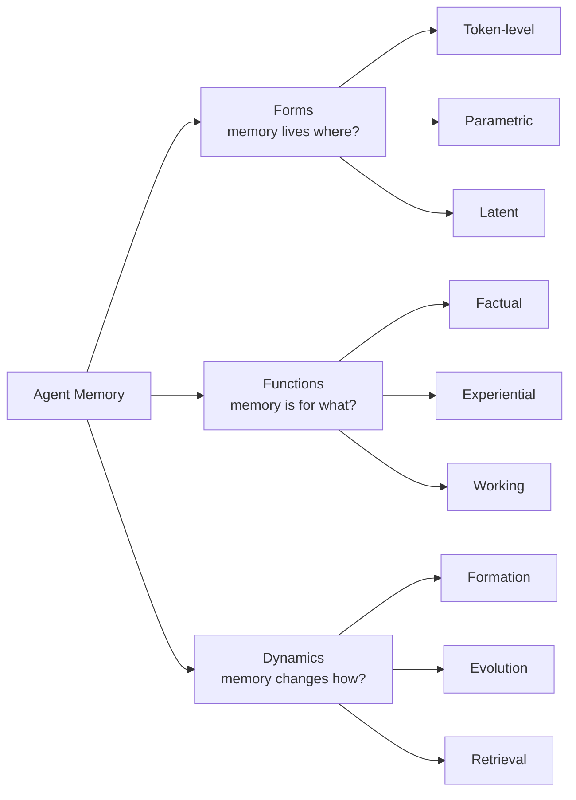
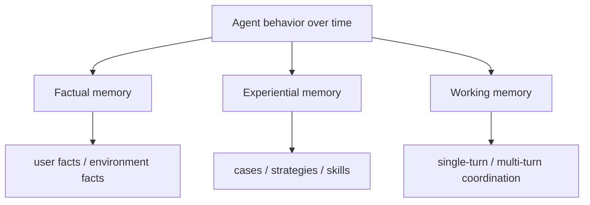
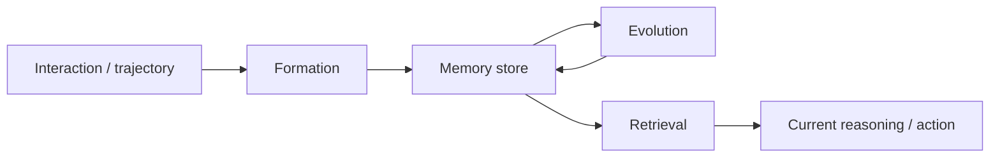

## Research Background

隨著 LLM-based agents 從單輪問答走向長時間、可持續互動的系統，「memory」已經從加分模組變成核心能力。沒有 memory，agent 很難做到：
- 記住使用者偏好
- 累積任務經驗
- 維持長程一致性
- 在未來任務中重用過去學到的策略

但目前 agent memory 研究很容易混亂，因為很多東西都被叫做 memory：
- context window 內的暫時資訊
- 外部 knowledge base
- RAG 檢索結果
- long-term user profile
- fine-tuning 後的參數知識
- latent state / recurrent state

這篇 survey 的價值在於：它不是只列 memory methods，而是試圖回答一個更根本的問題——**在 AI agents 時代，memory 到底是什麼、扮演什麼功能、又是怎麼運作與演化的？**

> [!info] 核心觀點
> 傳統的 short-term / long-term memory 二分法，已經不足以描述現代 agent memory。  
> 作者主張應改用 **Forms / Functions / Dynamics** 三個視角重新理解整個領域。

## Research Problem

這篇 survey 主要處理五個層次的問題：

1. **Scope definition**：什麼才算是 agent memory？
2. **Conceptual boundary**：agent memory 跟 LLM memory、RAG、context engineering 差在哪？
3. **Structural taxonomy**：memory 到底以什麼形式存在？
4. **Functional taxonomy**：memory 為什麼存在？它是為了幫 agent 做什麼？
5. **Operational dynamics**：memory 是如何被建立、更新、遺忘、檢索與重組的？

> [!info] Agent memory 和幾個常混淆概念的差別
> **1) Agent Memory vs. LLM Memory**
> - **LLM memory** 通常指模型參數中隱含保留的知識，或 inference 過程中的上下文依賴。
> - **Agent memory** 更強調可持續、可操作、跨互動存在的記憶系統，常包含外部 storage、更新策略與 retrieval policy。
>
> **2) Agent Memory vs. RAG**
> - **RAG** 重點是從外部知識庫取回「相關資訊」。
> - **Agent memory** 不只是 retrieve facts，還要處理經驗、策略、技能、偏好，以及長期演化。
>
> **3) Agent Memory vs. Context Engineering**
> - **Context engineering** 重點是把當下最有用的資訊塞進 prompt。
> - **Agent memory** 更進一步關心：哪些資訊值得留下、何時更新、如何壓縮、怎麼遺忘、未來何時再調出來。

## Method

### 1. Forms：What Carries Memory?

作者先回答「記憶載體是什麼」。他們提出三種主要 forms：

| Form                   | 定義                                          | 直覺理解                                         | 優點              | 代價 / 風險            |
| ---------------------- | ------------------------------------------- | -------------------------------------------- | --------------- | ------------------ |
| **Token-level memory** | 以外顯、離散單位儲存記憶                                | 像筆記、記錄、knowledge graph、memory chunks         | 可編輯、可檢查、可檢索、可追溯 | 容易受 retrieval 品質限制 |
| **Parametric memory**  | 記憶被內化到模型參數中                                 | 像把經驗學進 model weights (pre-trained knowledge) | 推理時使用自然、低顯式管理成本 | 難編輯、難追溯、可能遺忘       |
| **Latent memory**      | 記憶存在 hidden states / latent representations | 像 agent 內部暫存與中介狀態                            | 適合連續、上下文依賴的動態表徵 | 可解釋性低、較難控制         |

> [!tip] 一句話記住這張表
> **Token-level 最像外部筆記，Parametric 最像內化習慣，Latent 最像工作中的腦內暫態。**

作者也指出：真正強的 agent 往往不是只用一種 memory，而是多種 form **混合搭配**。

### 2. Functions：Why Agents Need Memory?

作者認為 memory 不該只按「存多久」分類，而應該按「幫 agent 完成什麼任務」分類。

| Function                | 主要用途          | 典型內容            |
| ----------------------- | ------------- | --------------- |
| **Factual memory**      | 保存穩定事實        | 使用者偏好、環境狀態、知識片段 |
| **Experiential memory** | 保存做過的事與學到的經驗  | 成功案例、失敗案例、策略、技能 |
| **Working memory**      | 支撐當下推理與多步任務協調 | 中間變數、當前計畫、最近觀察  |

這個 functional taxonomy 很有用，因為它直接對應到 agent 的三種核心需求：
- **知道什麼是真的**（factual）
- **知道以前怎麼做過**（experiential）
- **知道現在正在做什麼**（working）

### 3. Dynamics：How Memory Operates and Evolves?

這是這篇最有研究感的一部分：作者不把 memory 看成靜態倉庫，而是看成**動態管理流程**。

| Dynamics stage | 問題                   | 典型操作                                                                  |
| -------------- | -------------------- | --------------------------------------------------------------------- |
| **Formation**  | 什麼資訊值得進 memory？      | summarization, distillation, structured construction, latent encoding |
| **Evolution**  | 已有 memory 要怎麼變？      | consolidation, updating, forgetting                                   |
| **Retrieval**  | 什麼時候、怎麼把 memory 拿回來？ | query construction, retrieval strategy, reranking, post-processing    |

> [!important] big picture insight
> 這篇 paper 把 memory 從「被動資料庫」提升成「主動認知機制」。  
> 重點不再只是存了多少，而是：**怎麼形成、怎麼維護、怎麼被行為系統有效調用。**

### 4. Benchmarks 與 Frameworks

作者還整理了 memory 相關 benchmark 與 open-source framework，目的不是單純列工具，而是說明這個領域正在從「觀念討論」走向「可工程化、可比較、可重現」的階段。

對研究者來說，這代表兩件事：
- 之後做 agent memory paper，不能只展示 qualitative case；需要更完整 benchmark positioning
- memory 設計會越來越像一個 systems problem，而不只是 prompt trick

### 5. Frontiers：這個領域接下來往哪裡走？

作者整理的 frontier 很值得直接記起來：

| Frontier                                 | 核心方向                                                      |
| ---------------------------------------- | --------------------------------------------------------- |
| **Memory retrieval → memory generation** | 不只撈舊記憶，而是主動生成更適合的新記憶表示                                    |
| **Automated memory management**          | 從手刻規則走向讓 agent 自己學會存、改、刪、取                                |
| **RL meets memory**                      | 把 memory 管理變成可學習 policy，而非硬編 heuristics                   |
| **Multimodal memory**                    | 記住的不只文字，也包含圖像、語音、GUI 軌跡等                                  |
| **Shared memory in multi-agent systems** | 多 agent 如何共享記憶、避免冗餘與衝突                                    |
| **Memory for world model**               | 記憶不只是歷史紀錄，也能成為建構 world model 的材料                          |
| **Trustworthy memory**                   | 處理 hallucination、staleness、privacy、poisoning、misretrieval |
| **Human-cognitive connections**          | 借鏡人類記憶理論來設計 agent memory                                  |

## Contribution

1. **重新定義 agent memory 的研究框架**  
   不再用簡單 short-term / long-term 二分法，而改用 **Forms / Functions / Dynamics** 三軸架構。

2. **清楚畫出 agent memory 的邊界**  
   幫你把 agent memory 與 LLM memory、RAG、context engineering 拆開，避免概念混用。

3. **把 memory 從 storage 問題提升為 systems problem**  
   真正重要的是 formation、updating、forgetting、retrieval 的整體流程設計。

4. **提出未來研究前沿**  
   特別強調 automated memory management、RL integration、multimodal memory、multi-agent shared memory、trustworthiness。

> [!important] 對做 agent research 最關鍵的幫助
> 這篇 paper 提供了一個很強的 framing：  
> 你之後看到任何 memory paper，都可以問：
> - 它處理的是哪一種 form？
> - 它主要服務哪一種 function？
> - 它優化的是 dynamics 的哪一段？

## Conclusion

這篇 survey 最重要的訊息是：**memory 不是 agent 的附屬模組，而是 agent intelligence 的第一級組件（first-class primitive）。**

幾個值得直接帶走的結論：

- **大 context window 不等於 memory**。能看到很多 token，不代表 agent 真的會形成、保留、更新、重用經驗。
- **RAG 也不等於 memory**。RAG 偏向 retrieval；agent memory 更強調持續性、經驗性與行為整合。
- **memory 的價值不只在「記住事實」**，更在於讓 agent 能保存策略、技能與工作中的中間狀態。
- **未來的關鍵不是做更大的 memory store，而是做更聰明的 memory management**。
- **trustworthiness 會變成主戰場**：因為一個會長期記住、更新、共用記憶的 agent，也更可能累積錯誤、偏差與隱私風險。

### 我會怎麼用這篇 paper 來定位研究

如果你想做 agent memory 研究，這篇很適合作為總框架：
- 做 user preference memory → 屬於 **factual memory**
- 做 reflection / lesson bank → 偏 **experiential memory**
- 做 planning scratchpad / long-horizon coordination → 偏 **working memory**
- 做 memory write policy → 屬於 **formation / evolution**
- 做 retrieval policy / memory routing → 屬於 **retrieval dynamics**
- 做 RL-based memory controller → 屬於 **automated memory management + RL frontier**

簡單說，這篇 paper 幫你把 agent memory 從「很多零碎技巧」整理成一個可以真正拿來設計 research problem 的地圖。