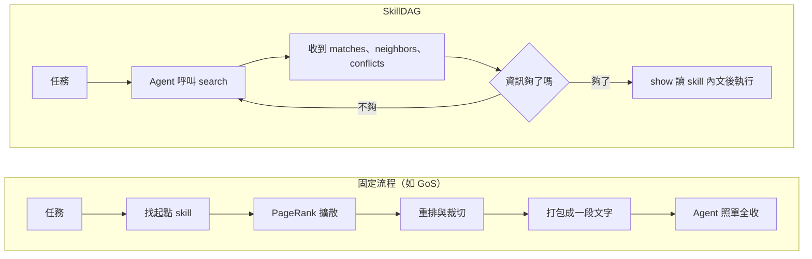
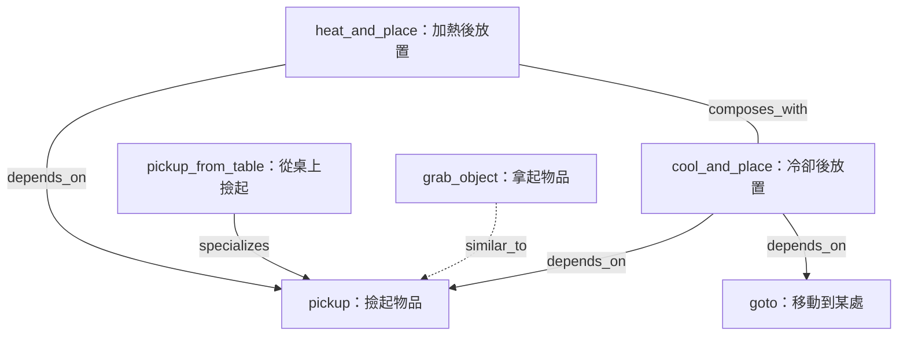
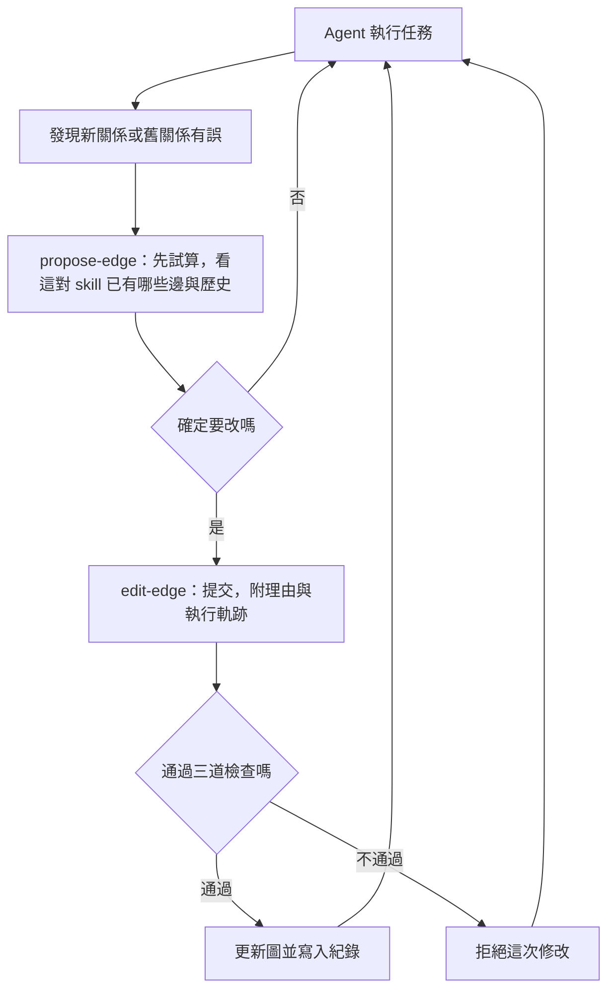

## 1. 研究問題

Skill 庫長到上千個之後，不可能全塞進 prompt，通常改用「向量相似度挑 top-K」。但這樣把每個 skill 當成獨立文件，會出兩種問題：

- **漏掉前置 skill**：最像任務的 skill 被選到了，它需要的前置 skill（例如先把東西撿起來）卻因為描述不像而沒被選到。
- **選到重複或互相干擾的 skill**：浪費 context，甚至讓 agent 做錯。

論文想讓 **agent 自己能查詢、修改 skill 之間的關係**，而不是被動接收一包檢索結果。

---

## 2. 文獻回顧：目前做法

| 類別 | 做法 | 問題 |
|---|---|---|
| 全部塞進 prompt | 整個庫貼進去 | 小庫可行；大庫 token 爆炸、描述被淹沒 |
| Flat top-K 檢索 | 向量相似度或 BM25 挑前 K 個 | 看不到依賴、衝突、重複 |
| 圖結構檢索 | 把 skill 之間的關係建成圖，再用圖輔助挑選 | 圖是被固定流程「消費」，agent 不能查、不能改（見下） |
| Skill／經驗演化 | XSkill 修改個別 skill；Agent Workflow Memory 累積工作流程 | 改的是 skill 本身，沒有去學 skill 之間的關係 |

### 圖結構檢索：三個代表

**① SkillNet：** 把 50 萬以上的 skill 整理成圖，但關係是離線建好的，不會依實際執行結果更新。

**② Graph of Skills（GoS，本篇最直接的對手）**

白話流程：

1. **離線**先把 skill 建成圖：節點是 skill，邊是「誰依賴誰」。
2. 任務來了，先用相似度挑幾個「起點 skill」。
3. 用 **Personalized PageRank**（想成「水波」）沿著邊往外擴散，把跟起點有關的 skill（例如它的前置）也撈出來。
4. 在 token 預算內重排、裁切。
5. 把結果**打包成一段文字**塞進 prompt。

> 例：任務是「把東西冷卻後放好」。起點找到 `cool_and_place`，擴散後發現它依賴 `pickup`，一起打包。

**問題**：整條流程固定。agent 拿到的是一包「黑盒」，不能問「為什麼選這個」，不能退回某個不對的結果，也不能補充流程沒發現的關係。

**③ GraSP／CUA-Skill**

- **GraSP**：把檢索到的 skill「編譯」成一張有型別的 DAG（像執行計畫，決定誰先誰後），執行中出錯時會修復這張計畫。
- **CUA-Skill**：針對操作電腦的 agent，skill 附帶參數化執行方式，並由離線寫好的組合圖串起來。

**共通問題**：圖與結構仍由固定流程決定，agent 本身無法查詢、修改這些關係。

> 註：②③的說明是根據本篇 related work 的描述整理，沒有另外讀 GoS、GraSP、CUA-Skill 的原論文。

### 對比

---

## 3. 方法

### 核心想法

不把圖藏在檢索流程裡，而是把它變成一個**工具**，跟 agent 平常用的其他工具並列。agent 可以反覆查詢，發現關係不對時也能修正。

### 3.1 圖長什麼樣：五種關係

節點是 skill，邊有五種型別：

| 關係 | 白話 | 執行時的作用 |
|---|---|---|
| `depends_on` | A 需要先有 B（前置） | 選 A 時把 B 一起帶上 |
| `specializes` | D 是 A 的特化版 | 適用時優先用 D |
| `composes_with` | A、B 搭配效果好 | 提示可以組合使用 |
| `similar_to` | A、B 功能重複 | 兩個選一個即可 |
| `conflicts_with` | A、B 同時用會出問題 | 避免一起選（只用來排除，不沿著它找 skill） |

`depends_on` 和 `specializes` 構成圖的骨幹，**不允許出現環**（這就是名稱 DAG 的由來）。

示意（我自編的例子）：

### 3.2 開局先建一張圖（冷啟動）

每個 skill 做兩種描述，各自轉成向量：

- **它做什麼**（名稱、說明、內文開頭）
- **它需要什麼**（讓 LLM 想像幾個使用情境，再總結共同的前置條件）

為什麼要兩種？因為「冷卻 skill」和「撿起 skill」描述完全不像，但前者需要後者的結果（手上要有東西）。只比「做什麼」會漏掉這種關係，加上「需要什麼」才找得到。

流程：

`conflicts_with` **不在這一步建立**：衝突要實際執行、看到結果才知道，光看文字推不出來。

### 3.3 Agent 怎麼用這張圖

兩個查詢工具：

- **`search`**：回傳三個**分開**的欄位。
  - `matches`：和任務主題最相近的 K 個 skill
  - `neighbors`：從 matches 沿圖走幾步找到的關聯 skill（前置、特化、搭配、重複）
  - `conflicts`：和 matches 衝突、不該一起載入的 skill
- **`show`**：真正需要某個 skill 時才讀它的完整內文。

三個欄位分開給，是為了讓 agent 可以自己取捨（例如 context 很緊時直接不看 neighbors），也可以邊做邊重新查詢，且決策過程有紀錄可追。

### 3.4 邊做邊修圖（線上演化）

- 一次修改可以**新增、刪除、或改型別**，所以 agent 有明確的收回錯誤關係的管道。
- 只要一次執行的證據就能提交，不需要投票或人工審核。
- 唯一的把關是三條結構規則（不判斷語意對不對，只防圖壞掉）：
  1. **無環**：不能讓前置鏈繞回自己。
  2. **無矛盾**：同一對 skill 不能同時有衝突邊和正向邊。
  3. **可回滾**：所有修改寫進 append-only 紀錄，錯了可以退回。

### 3.5 實驗設定（簡述）

- **環境**：ALFWorld（文字版家務模擬，37 個 skill）、SkillsBench（87 個程式任務，skill 池從 200 到 2000）。
- **對照**：全部塞進 prompt、向量檢索、GoS。
- **消融**：只用向量 → 加型別圖（不改）→ 再加線上修改，分別看貢獻。

---

## 4. 結論（通用）

1. **Skill 之間有結構，只看相似度不夠。** 依賴、特化、重複、衝突是不同性質的關係：前置 skill 該補進來，重複的該擇一，衝突的該避開。把它們都壓成一個「相似度分數」，會漏掉必要的、塞進多餘的。

2. **結構交給 agent 讀寫，比交給固定流程消費更有價值。** 同樣一張圖，讓 agent 自己查詢、決定怎麼用、發現錯誤能修正，效果比檢索系統先算好再丟給 agent 更好。論文在兩個 benchmark 上都優於對照方法；在已接近滿分的情況下則打平。

3. **兩個機制各自有貢獻：**
   - **agent 自己排序、不做圖擴散**：skill 池擴大 10 倍時，檢索品質仍然穩定。
   - **邊做邊學的關係**：能累積成可重複使用的結構，也能套用到沒見過的任務上；而且新增的邊只會擴大找得到的範圍，不會把原本找得到的 skill 擠掉。

4. **設計啟示：** skill 庫應該被當成「放在介面後面、可寫入的結構」，而不是「建好索引就不動的文件集合」。檢索器與 agent 之間的分界線是**設計選擇**，把更多判斷權放進 agent，庫就能「越用越準」。

### 限制與保留

- **成本**：agent 要多輪查詢，input token 用量明顯較高（對 GoS 約 2.4 倍）。
- **可靠性未驗證**：只憑單次執行證據就能寫入關係，長期下來會不會累積錯誤，作者自己說還是開放問題。
- **線上修改量很小**：實驗中只新增 27 條邊（冷啟動約 2,359 條），「自我演化」的貢獻在量上有限。
- **評測範圍有限**：只在 ALFWorld 和 SkillsBench 驗證，skill 庫規模與任務類型都偏小或偏單一，結論能否推廣到真實大型 skill 庫仍待驗證。
- **維護問題只碰到一部分**：論文處理的是「關係」的演化，skill 本身的去重、淘汰、版本管理等不在範圍內。
