- **Authors**: Preston Rasmussen, Pavlo Paliychuk, Travis Beauvais, Jack Ryan, Daniel Chalef
- **Venue**: arXiv 2025
- **Paper URL**: https://arxiv.org/abs/2501.13956
- **Code / system**: Graphiti open-source engine: https://github.com/getzep/graphiti；Zep production memory layer: https://www.getzep.com/

## Direction tags

| Direction | 判斷 | 原因 |
|---|---|---|
| **Memory** | **強相關** | Zep 的核心就是 agent memory layer，用 temporal knowledge graph 保存 cross-session conversation 與 business data，並提供低延遲 retrieval context。 |
| **Self-evolve** | **中度相關** | Graphiti 會隨新 episode 增量更新 entity、fact、community、validity interval，並讓舊 edge 被新資訊 invalidate；但它主要是 memory state evolution，不是 policy / planner 自我改寫。 |
| **Proactivity** | **弱相關** | 系統處理「被查詢時如何取回記憶」，沒有設計何時主動打斷使用者、何時自主發起任務的 trigger policy。 |

> [!note] 一句話摘要
> Zep / Graphiti 把 agent memory 從靜態 RAG chunk retrieval 推進到**可追溯、可更新、帶時間有效期的 knowledge graph**：原始 episode 保留 provenance，抽出的 entities / facts / communities 支援低延遲檢索與 temporal reasoning。

## Research Background

LLM agent 在企業與長期使用情境中，不能只依賴單次 prompt context。真實 agent 需要跨 session 記得使用者偏好、工作流程、歷史事件、商業資料與這些資訊的變化。傳統 RAG 多半假設 corpus 是相對靜態的文件集合；但 conversation memory 會不斷新增、修正、過期，而且同一個事實在不同時間可能有不同有效狀態。

這篇 paper 的出發點是：如果 agent 要長期可用，memory layer 需要同時滿足：

- **non-lossy storage**：保留原始對話或 JSON data，避免抽取時丟失細節。
- **semantic structure**：把 entities、facts、communities 組織成可檢索與可推理的 graph。
- **temporal validity**：知道某個關係何時成立、何時失效，而不是只留下最新 summary。
- **production constraints**：除了 accuracy，還要看 latency、token cost、scalability。

## Research Problem

Zep 想解決的問題可以整理成三層：

1. **動態知識整合**：如何把 ongoing conversations 與 structured business data 持續寫入 agent memory？
2. **時間感知記憶**：如何保存 facts / relationships 的歷史變化，讓 agent 能回答 temporal reasoning 與 knowledge update 類問題？
3. **可部署 retrieval**：如何在長對話與企業資料規模下，提供比 full-context 更低延遲、更低 token 成本、且 accuracy 更好的 memory retrieval？

## Method / Architecture

### 1. Memory store：Graphiti temporal knowledge graph

Graphiti 將 memory 表示為 temporal dynamic knowledge graph $G = (N, E, \phi)$，其中節點與邊被分成三層 subgraph：

| Layer | 內容 | 作用 |
|---|---|---|
| **Episode subgraph** | raw messages、text、JSON episodes | non-lossy source store；保留 provenance，可回溯 semantic facts 來自哪段原始資料。 |
| **Semantic entity subgraph** | entity nodes 與 entity-to-entity facts | agent 可直接檢索與使用的 semantic memory；支援 entity resolution、fact deduplication、temporal edge invalidation。 |
| **Community subgraph** | entity clusters 與 community summaries | 類似 GraphRAG 的高層摘要，提供 global / topic-level memory view。 |

這個設計把 human memory 的 **episodic memory** 與 **semantic memory** 做成一個可互相追溯的 graph：episode 保存原始事件，semantic graph 保存抽象關係，community graph 保存更高層概念。

### 2. Write pipeline：episode → entities → facts → temporal updates

Graphiti 的 ingestion pipeline 大致如下：

1. **Episode ingestion**：輸入 message / text / JSON，並記錄 reference timestamp $t_{ref}$。
2. **Entity extraction**：LLM 從 current message 與前 $n=4$ 則訊息抽取 entities；speaker 也會被抽成 entity。
3. **Reflection for extraction quality**：使用類似 Reflexion 的步驟降低 hallucination、提高 extraction coverage。
4. **Entity resolution**：用 embedding similarity + full-text search 找候選 duplicate，再由 LLM 判斷是否 merge，並更新 name / summary。
5. **Fact extraction and deduplication**：從 episode 中抽出 entity pair 關係，並對同一 entity pair 的相關 edges 做 dedup。
6. **Temporal extraction**：抽出 facts 的 valid time range，支援 absolute time 與 relative time。
7. **Edge invalidation**：若新 edge 與既有 edge 在時間上重疊且語意矛盾，系統會把舊 edge 的 invalid time 更新為新 edge 的 valid time。
8. **Community update**：用 label propagation 維護 entity communities，並產生 community summaries / names 供 retrieval。

> [!tip] 關鍵設計
> Zep 不只是「把對話切 chunk 後做 vector search」，而是把每個 fact 放進 temporal graph，並保留它的來源 episode 與有效時間。這讓 memory 可以回答「以前是什麼、現在是什麼、何時改變」這類問題。

### 3. Retrieval pipeline：search → rerank → construct context

Zep 的 graph search API 可視為：

$$
f(\alpha) = \chi(\rho(\phi(\alpha))) = \beta
$$

其中 query $\alpha$ 會被轉成候選 nodes / edges，再經 reranker 排序，最後 constructor 產生可放進 LLM prompt 的 text context $\beta$。

| Module | 功能 |
|---|---|
| **Search** | 結合 cosine semantic search、BM25 full-text search、BFS graph traversal。 |
| **Reranker** | 支援 RRF、MMR、episode mentions reranker、node distance reranker、cross-encoder reranker。 |
| **Constructor** | 將 facts、valid date ranges、entity summaries、community summaries 格式化成 prompt context。 |

### 4. Planner / trigger policy / reflection mechanism

- **Planner**：paper 沒有提出新的 task planner；Zep 是 memory layer，提供 context 給外部 agent / LLM 使用。
- **Trigger policy**：沒有討論何時自主 retrieve、何時主動通知使用者；retrieval 通常由 user query 或 agent workflow 觸發。
- **Reflection / evolution**：主要體現在 graph construction 中的 extraction reflection、entity resolution、fact deduplication、temporal invalidation、community refresh。

## Lifecycle / Mechanism

```mermaid
flowchart LR
    A[Observe: message / text / JSON episode] --> B[Write: extract entities and facts]
    B --> C[Store: episode + semantic entity + community graph]
    C --> D[Retrieve: hybrid search + BFS + rerank]
    D --> E[Use: construct context for LLM agent]
    E --> F[Reflect / consolidate: resolution, dedup, community summary]
    F --> G[Update / forget / evolve: invalidate contradicted temporal edges]
    G --> H[Decide whether to act: outside Zep scope]
```

Zep 覆蓋 observe → write → retrieve → use → reflect/consolidate → update/evolve 的 memory lifecycle，但最後「是否主動 act」不是它的研究重點。

## Contribution

1. **Temporal KG memory architecture**：提出 Graphiti 作為 dynamic, temporally-aware KG engine，支援 conversation memory 與 structured data。
2. **Non-lossy + semantic dual memory**：同時保存 raw episodes 與 semantic entities / facts，兼顧 provenance 與 retrieval utility。
3. **Bi-temporal modeling**：區分 factual timeline $T$ 與 transactional ingestion timeline $T'$，讓 facts 有 created / expired 與 valid / invalid 兩組時間。
4. **Production-oriented retrieval**：把 latency、context token size、scalability 放進 memory system 評估，而不只報 accuracy。
5. **Benchmark critique**：指出 DMR 太容易、太短、偏 single-turn fact retrieval，無法充分測 agent memory。

## Evaluation / Benchmark

### Tasks and datasets

| Benchmark | 任務 | 特性 |
|---|---|---|
| **Deep Memory Retrieval (DMR)** | 500 multi-session conversations，每個 conversation 5 sessions，問單一 memory QA | 對現代 LLM 太短；full conversation 可直接塞進 context。 |
| **LongMemEval-s** | 平均約 115k tokens 的長對話 QA | 包含 single-session、multi-session、knowledge-update、temporal-reasoning 等問題類型，更接近 enterprise memory。 |

### Metrics and baselines

- **Metrics**：QA accuracy、latency、average context tokens。
- **Baselines**：recursive summarization、conversation summaries、MemGPT、full-conversation baseline。
- **Models**：gpt-4-turbo、gpt-4o-mini、gpt-4o；graph construction 使用 gpt-4o-mini；embedding / reranking 使用 BGE-m3。

### Key results

- **DMR**：Zep with gpt-4-turbo 達到 94.8%，略高於 MemGPT 93.4% 與 full-conversation 94.4%；但作者也承認 DMR 不夠有區辨力。
- **LongMemEval-s**：Zep with gpt-4o 達到 71.2%，full-context baseline 為 60.2%；context tokens 約 1.6k vs 115k，latency 約 2.58s vs 28.9s。
- **Question type breakdown**：在 temporal-reasoning、multi-session、single-session-preference 改善明顯；但 single-session-assistant 類型反而下降。

### 是否證明 long-term improvement / autonomous initiative？

- **Long-term memory retrieval**：有相當證據，尤其 LongMemEval 顯示 temporal KG retrieval 能在長 context 下提高 accuracy 並降低 latency。
- **Self-improvement**：只證明 memory state 會動態更新，沒有證明 agent policy 或行為策略會跨任務持續變好。
- **Autonomous initiative**：沒有證明；系統沒有主動行動或自動觸發任務的 evaluation。
- **Ablation**：paper 沒有完整拆解 graph layer、BFS、reranker、temporal invalidation 各自貢獻，這是明顯缺口。

## Conclusion

Zep 的主要結論是：temporal knowledge graph 是比靜態 RAG / summary 更適合長期 agent memory 的基礎結構。它能在保留 raw provenance 的同時，抽出可檢索的 entities、facts、communities，並用 temporal invalidation 處理知識更新。實驗顯示，這種 memory layer 在長對話 QA 上可以同時降低 context token 與 latency，並提升 accuracy。

不過，這篇 paper 更像 production memory architecture paper，而不是完整 self-evolving agent paper。它證明了「記憶可以動態更新並更好地被取回」，但還沒有證明「agent 會因此自主改善策略或主動行動」。

## Reproducibility

- **Repo availability**：Graphiti 有 open-source repo；paper 中提到 experimental notebooks 將公開，但實驗 notebook availability 需要再確認。
- **Toy reproduction requirements**：
  - Neo4j 或其他 graph DB
  - LLM API for extraction / resolution / temporal contradiction checking
  - embedding model（如 BGE-m3）與 BM25/full-text index
  - 一組 multi-session conversations + memory QA dataset
- **Minimal demo idea**：
  1. 建立 20-50 則跨日對話，包含「偏好改變」與「關係失效」事件。
  2. 把每則訊息寫入 temporal KG。
  3. 比較 full-context、vector RAG、temporal KG 三種 retrieval 在 temporal QA 上的 accuracy / token / latency。
  4. 額外測試「contradiction invalidation」是否能讓 agent 回答最新狀態與歷史狀態。

## Borrowable ideas for Ting's AAAI direction

- **Temporal validity as first-class memory field**：如果研究 agentic memory，應把 fact 的 valid time / invalid time 放進 schema，而不只是 timestamp。
- **Provenance-preserving memory**：每個抽象 fact 都能回溯到 raw episode，適合做可信引用、錯誤修正、memory debugging。
- **Memory benchmark 不只看 accuracy**：可以同時報 context token、latency、update cost、retrieval cost，讓 paper 更像可部署系統。
- **Graph + hybrid retrieval**：BM25 / embedding / BFS 各抓不同 similarity，這個 multi-channel candidate generation 很適合拿來當 baseline 或 module。
- **Knowledge update evaluation**：設計 AAAI experiment 時可特別放入 preference change、relationship update、deadline update 等 temporal contradiction cases。

## Attackable Gaps / Follow-up Ideas

1. **缺少 module-level ablation**：Graphiti 的三層 graph、temporal invalidation、BFS、community summary 各自貢獻不清楚。
2. **benchmark 仍偏 QA**：即使 LongMemEval 比 DMR 好，仍主要測回答問題，不測 agent 是否能用 memory 改善 planning / action。
3. **LLM extraction error propagation**：entity/fact extraction、temporal parsing、contradiction detection 都依賴 LLM；paper 沒有深入分析錯誤如何累積。
4. **structured business data claim 未充分驗證**：abstract 強調 unstructured conversation + structured business data，但 evaluation 主要還是 conversation QA。
5. **沒有主動性模型**：memory 很強，但沒有「何時應該主動提醒、主動查詢、主動更新計畫」的 trigger policy。
6. **forgetting / privacy policy 不明確**：edge invalidation 處理事實過期，但不等於 user-requested deletion、privacy-aware retention 或 selective forgetting。
